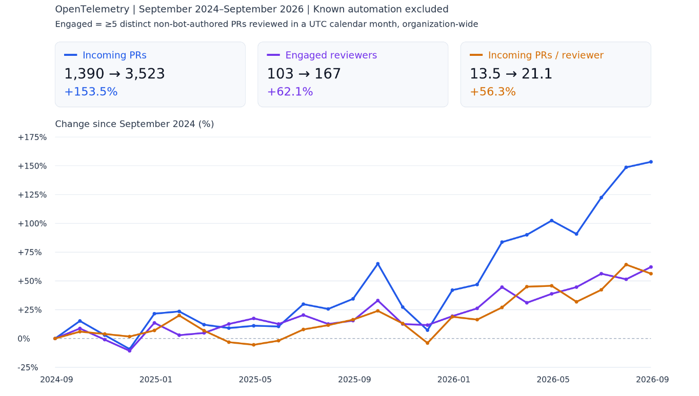

I believe OpenTelemetry's primary constraint isn't ideas, code contributions, or
adoption, but maintainers.

> [!NOTE] About me
>
> I've been working on OpenTelemetry since early 2021. I'm a maintainer of
> opentelemetry-java, opentelemetry-configuration, and opentelemetry-injector,
> and a member of the Technical Committee. In that time I've worked at two
> observability companies, New Relic and now Grafana Labs, in roles with a
> charter to work on OpenTelemetry while also engaging in internal engineering
> efforts that depend on it. This post is my opinion, informed by involvement in
> a lot of different OpenTelemetry projects and by watching various contributors
> come and go.

Maintainers do the unglamorous, continuous work that keeps the project running:
releases, triage, issue and pull request review, security advisories, mentoring,
maintaining user trust, and more. Every contribution matters, but maintainers
are the connective tissue that makes the rest possible. Without maintainers,
other contributions will never be shipped.

OpenTelemetry has grown in nearly every dimension: contributors, contributions,
repositories, adoption. The maintainer pool hasn't kept pace. If you've ever
waited weeks for a review, you've felt this.

Measuring this cleanly is hard because of confounding factors: a lack of data
for maintainership over time, large numbers of automated PRs (e.g., Renovate,
Dependabot) and reviews which distort the data, and maintainer burden not being
shared equally. I pulled all PR and review data for OpenTelemetry repositories
since 2024 and analyzed it. I found that, probably to nobody's surprise,
starting in early 2026, growth in incoming PRs began outpacing growth in engaged
reviewers (my proxy for maintainer capacity). From September 2024 to September
2026, the incoming PR / reviewer ratio has grown by 56%.

| Measure                           | September 2024 | September 2026 |  Change |
| :-------------------------------- | -------------: | -------------: | ------: |
| Incoming PRs                      |          1,390 |          3,523 | +153.5% |
| Engaged reviewers                 |            103 |            167 |  +62.1% |
| Incoming PRs per engaged reviewer |          13.50 |          21.10 |  +56.3% |

Similar points were made in a recent blog post
[OTel Isn't Going Well (And I Made A Spreadsheet About It)](https://matduggan.com/otel-isnt-going-well-and-i-made-a-spreadsheet-about-it/),
but in more detail and for specific areas of OpenTelemetry.

Here, I'll make the case for why you should consider becoming a maintainer, and
why the companies that depend on OpenTelemetry should support you doing so.

## Virtuous and vicious cycles

People often complain about the pace of OpenTelemetry. It's been described as a
high-throughput, high-latency project: a lot gets done, but individual
workstreams can take a long time. But OSS and OpenTelemetry are not inherently
slow. I've seen parts of the project move extremely fast, and I've watched
individual repositories swing from fast to slow and back again.

My read is that the biggest factor in whether a repository moves fast or slow is
whether it has enough engaged maintainers to keep up with its contribution rate.
That's the difference between a virtuous cycle and a vicious one.

When a repository has enough engaged maintainers:

- Each maintainer has a manageable number of PRs and issues needing their
  attention, so they can respond promptly without constantly context switching.
- Prompt feedback encourages contributors and makes small, self-contained pull
  requests practical, since even a stacked sequence lands in a reasonable time.
  Small pull requests are easy to review, which keeps feedback fast.
- The project ships more and responds to users faster, which grows adoption and
  attracts more contributors, some of whom become maintainers.

When it doesn't, whether from too few maintainers or too little engagement:

- Each maintainer has more PRs and issues needing attention than they can keep
  up with. Constantly context switching between them drains energy and leads to
  burnout.
- Feedback cycle time on any individual pull request grows as maintainers
  round-robin through the queue.
- Slow feedback discourages contributors and pushes them toward larger pull
  requests, since waiting out a long review cycle for each in a sequence of
  small pull requests is unpalatable.
- Large pull requests are harder to review and increase the cognitive load of
  context switching. This slows feedback further and discourages would-be
  maintainers from stepping up. Review load stays high.

Both cycles reinforce themselves. It may only take one or two engaged
maintainers to tip a repository from one cycle to the other. And engagement can
be fragile, changing quickly with new jobs, shifting priorities, or life events.

## Aligning incentives: individuals and companies

If engaged maintainers are a serious lever for project health, it follows that
we need more of them. I've proposed that the project
[incentivize maintainership](https://github.com/open-telemetry/community/issues/3437)
because I think we can do more to encourage it. But there are already good
reasons to be a maintainer today, and I haven't seen them clearly articulated.

This is OSS, so anyone with the interest and skills can contribute and
eventually become a maintainer. However, in practice most OpenTelemetry
maintainers do the work as part of their day job (as of writing this, more than
75% of maintainers are affiliated with observability vendors by my analysis).
Whether that's good or bad is a separate question, but it is the reality.

If we want more maintainers, the incentives need to work for both individuals
and the companies that employ them. Expecting individuals to carry this alone is
asking too much.

Aside: Maintainership isn't all upside for either individuals or companies, but
those details are out of scope for this post. Perhaps a future post or another
author can elaborate.

### Why you should be a maintainer

**Career signal.** Being a maintainer is good for your career. When a stranger
decides whether to hire you, they're looking for signals that you'll succeed:
where you went to school, where you've worked, who recommends you, how you did
on a coding challenge. Maintaining a serious OSS project is a strong signal, and
it holds up in the age of AI when others have weakened. Doing it well takes deep
technical competence and prioritization skills. It also includes people
management skills like conflict resolution, all in public and alongside
collaborators who often work for competitors. It's been good for my
career[^career], and for many others too.

**Visibility.** Maintainers get opportunities that are hard to come by
otherwise: CNCF events (e.g. KubeCon, Observability Summit) grant privileges
like a dedicated maintainer track, maintainer summit access, and more.
Maintainers are invited to speak on podcasts, webinars, and to share their
thoughts in other forums as well. The industry network, reputation, and public
body of work you develop travels with you, outlasting any single job.

**Being part of something bigger.** This was my biggest motivation for getting
involved in OSS.

A while back, I had a job I poured myself into. My team built some impressive
stuff, earned a few patents, and we were proud of what we accomplished. We were
building platform capabilities, essential to the business but not what the
business was built around. The company never found product-market fit and
contracted dramatically: layoffs, pivots, the whole thing. That software is now
sitting abandoned on a hard drive somewhere.

I refuse to be apathetic about work that takes up so much of my life, and it
kills me that years of it came to nothing because of forces outside my control.

With OSS, if the idea and the execution are good, your software can succeed and
be used at massive scale. That's what motivates me to wake up and try to do good
work every day. No software lasts forever, and OpenTelemetry will likely be
replaced eventually (hopefully not for decades). But whatever comes next will
have been influenced by it (as OpenTelemetry was influenced by its
predecessors). Standards projects like OpenTelemetry become a permanent part of
software's lineage. I can't say the abandoned software I helped build behind
closed doors influenced anyone beyond the few dozen engineers who interacted
with it.

### Why your company should sponsor maintainers

If you're a manager or a stakeholder weighing whether to fund maintainer time,
this is for you.

**More effective contributions.** Maintainers don't get special treatment, but
they know the codebase and the project's norms and priorities, they typically
have rapport with other maintainers, and know whom to involve to get the context
needed for a good decision. This helps them shape proposals that fit the project
and avoid dead ends.

**Security.** Security advisories have surged since LLMs made finding
vulnerabilities cheap. Maintainers help triage and fix advisories before they're
public. If you ship OpenTelemetry components in your product or maintain a
vendored fork, that head start means mitigation is already in motion when the
advisory lands.

**Influence.** Projects evolve, and not always in the direction you'd choose. If
you depend on OpenTelemetry and have no maintainers, you have a much smaller say
in where it goes.

**Credibility.** Customers adopting OpenTelemetry make buying decisions partly
based on who they believe understands it best. Maintainers are the clearest
proof of that expertise. If a competitor has maintainers and you don't, they
have an advantage.

**Shared foundation.** As OpenTelemetry grows, it's increasingly hard to justify
investing in proprietary instrumentation. OpenTelemetry is becoming the shared
foundation of every observability vendor's story, and a weak foundation weakens
every story built on it. If every company waits for others to sustain that
foundation, repositories slide into the vicious cycle, and the features and
fixes your product depends on arrive slowly for everyone.

## Becoming a maintainer

If I've convinced you, the natural next questions are what it takes and where to
start.

> [!NOTE] Contributor ladder
>
> At a repository level, the
> [contributor ladder](https://github.com/open-telemetry/community/blob/2c7afdc7fef121bcded259c1234489b834a770e8/guides/contributor/membership.md)
> runs from member → triager → approver → maintainer. Different SIGs have their
> own norms for progression.

### What maintainers look for

In my experience, getting invited to be a maintainer is conceptually
straightforward (which is not to say it's easy): exercise good judgment, and
show up consistently with an ownership mentality.

**Exercise good judgment.** The project puts a lot of trust in maintainers. They
can merge code and publish releases that end up in many production systems.
Existing maintainers want to extend that trust to people with good judgment. In
practice, that means all the classic software engineering stuff, including
understanding what you're proposing and its tradeoffs. But in OSS, soft skills
carry particular weight. Consider other perspectives and follow through on
feedback. Help discussions move forward by summarizing points of agreement and
disagreement, identifying missing information or pending decisions that block
progress, and breaking proposals into smaller steps that can proceed
independently.

**Show up consistently.** How much time maintainership takes varies with the
project's size, maturity, and so on. Whatever the total, showing up consistently
in small chunks is much more useful than showing up in large, infrequent ones.
If you have 5 hours a week, 1 hour a day for 5 days beats 5 hours in one day.
Showing up week after week gives maintainers confidence that you'll stick around
and share responsibility for the project.

**Have an ownership mentality.** A maintainer is responsible for every aspect of
their project's lifecycle: build, testing, roadmap, style, documentation,
releases, and more. You can and should adopt that mentality before you're
invited. You won't be able to run releases or merge pull requests, but you can
contribute to everything else, especially code review. **You don't need to be an
approver or maintainer to review code. Reviews are meaningful from any
contributor.** This is the behavior existing maintainers look for when deciding
whether to invite someone new.

### Where to start

Work with what you use and what you need.

OpenTelemetry is a big project, and even a single repository can be daunting. I
find the best approach is to start with a piece of the project you already use
and know could be better. Watch for issues and pull requests related to it, and
review them. Start attending the relevant special interest group (SIG) meetings.
Check out proposed changes locally and use them as a forcing function to explore
how the subcomponent connects to the rest of the project. As you explore, you'll
come across things that make you raise an eyebrow. Fix them in small, focused
pull requests along the way. This builds rapport with maintainers. As you learn
more subcomponents, expand the issues and pull requests you watch to include
them.

You may be tempted to avoid repositories whose maintainer group already looks
crowded. Ignore that instinct. If an area aligns with your interests and
maintainership is clearly lacking, that's a strong signal to get involved. But
even groups that look sufficient at first glance may not be. The issue and pull
request load may be high enough that a decent-sized group struggles to stay
afloat. Some maintainers may be sticking around without the time to commit,
because leaving would drop the project below the threshold it needs to function.

When you do make contributions via PRs or issues, be patient, since you may be
stepping into a project in one of these vicious cycles. For better or worse,
when attention is scarce, stating the case for why a thing matters synchronously
in the SIG meeting can be an effective way to gain consensus and make progress.

Aside: The
[open-telemetry/community](https://github.com/open-telemetry/community/)
repository is a great resource for finding your way around OpenTelemetry. It has
SIG meeting schedules and links, plus documentation on roles, responsibilities,
and processes.

## Takeaways

OpenTelemetry's primary constraint is maintainers. Repositories with enough
engaged maintainers tend to move fast, repositories without them tend to stall,
and the difference compounds.

If you're an engineer working with OpenTelemetry, maintainership is a career
goal worth pursuing seriously. If you're a manager at a company that depends on
OpenTelemetry, maintainership is a strategic investment that makes the rest of
your OpenTelemetry work more effective. Companies can't sponsor maintainers
without individuals willing to do the work. And individuals usually can't do the
work without a company to sponsor them.

OpenTelemetry is great today, but there's still a lot of important work ahead.
More maintainers means more virtuous cycles, and that's how the project reaches
its potential.

[^career]:
    Since getting involved in OpenTelemetry, I have been promoted several times
    directly as a result of that work. I believe I also have more career
    mobility than average: I'm frequently targeted by recruiters specifically
    interested in my OSS background, and have an easy time demonstrating
    competency through my public OSS contributions. I was a decent engineer
    before OSS, but I've definitely improved my verbal and written communication
    and my technical skills by working with and observing highly competent
    engineers.
