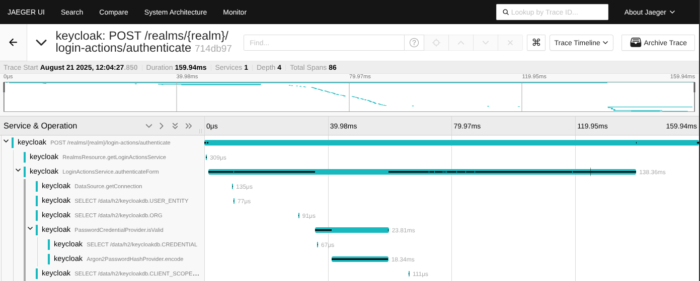

As part of an ongoing series, the Developer Experience SIG interviews
organizations about their real-world OpenTelemetry deployments to share
practical lessons with the broader community. This post features
[Keycloak](https://www.keycloak.org/), a CNCF project, and looks at the journey
from the perspective of project maintainers who add native OpenTelemetry support
to the software they ship.

If you have ever needed an Identity and Access Management (IAM) solution, there
is a good chance Keycloak was on your radar: a widely used, community-driven
open source IAM system that secures applications by authenticating both human
and non-human users through industry-standard protocols such as OpenID Connect
(OIDC), OAuth 2.0, and SAML.

When [Martin Bartoš](https://github.com/mabartos) and
[Alexander Schwartz](https://github.com/ahus1) from the Keycloak team set out to
improve the production readiness of their system, they envisioned a
"batteries-included" observability experience. Building on the
[Quarkus](https://quarkus.io/) Java framework, their goal was native telemetry
that users could trust for high-stakes authentication flows. But the path to a
smooth OpenTelemetry integration revealed that the journey for maintainers is
often as much about architectural trade-offs as it is about implementing new
signals.

## When native beats agents: lessons from the Java world

The obvious first move was the
[OpenTelemetry Java agent](/docs/zero-code/java/agent/), a zero-code way to get
tracing into any JVM app by attaching at startup and rewriting bytecode on the
fly. It let the team explore OpenTelemetry's features quickly, but the cost
showed up immediately: for Keycloak, the agent added dozens of seconds to an
otherwise near-instant startup. This is not specific to Keycloak. The agent has
to scan, and potentially transform, every class the application loads, and the
agent maintainers have
[confirmed that this startup overhead is inherent to the approach](https://github.com/open-telemetry/opentelemetry-java-instrumentation/issues/8629),
with users reporting startup times growing by roughly a third.

> "While the OpenTelemetry Java agent allowed us to explore features, it
> delivered a very slow start for Keycloak," Alexander Schwartz noted during the
> interview. "For a security-sensitive application where instant performance and
> rapid scaling are critical, adding dozens of seconds to our startup time was
> simply not something we wanted to support."

The team shifted to native Quarkus integration, which preserved fast startup
while keeping the telemetry they needed. For maintainers of similarly
performance-sensitive applications, native framework support is worth
prioritizing over generic agents.

## Integrating the signals: metrics and traces

Keycloak's observability journey began with metrics, which delivered immediate
value, but the team soon realized that tracing was the missing link for deep
root cause analysis. In complex flows involving database or LDAP bottlenecks,
tracing provided the context needed to pinpoint exactly where a request was
stalling. The power of linking these signals became clearest with exemplars,
which let developers jump from a metric spike directly to a representative
trace, dramatically reducing the time to troubleshoot 99th-percentile latencies.

Reflecting on the challenges of fragmented architectures, Martin Bartoš shared:

> "We frequently hear from community maintainers at meetups and conferences that
> setting up a fragmented observability stack is highly confusing. Our goal with
> Keycloak is to fully unify this experience under one native paradigm rather
> than forcing users to juggle disconnected Prometheus endpoints, separate
> tracing extensions, and independent log aggregators."

## Enabling tracing in Keycloak

Tracing is enabled through Keycloak's own configuration. OpenTelemetry support
is turned on by default, but you need to enable at least one component, such as
tracing, to actively use it. With the following configuration, Keycloak starts
exporting traces:

```sh
bin/kc.sh start --tracing-enabled=true ...
```

Or when deploying Keycloak in Kubernetes with its Operator:

```yaml
apiVersion: k8s.keycloak.org/v2alpha1
kind: Keycloak
metadata:
  name: example-kc
spec:
  telemetry:
    endpoint: http://localhost:4317 # default option
    serviceName: keycloak # default option
    protocol: grpc # default option
  tracing:
    enabled: true
```

For a complete guide on setting up these features, refer to the official
Keycloak documentation for
[telemetry](https://www.keycloak.org/observability/telemetry) and
[tracing](https://www.keycloak.org/observability/tracing).



_Image source:
[Keycloak tracing guide](https://www.keycloak.org/observability/tracing)._

## The "trust" trade-off: push vs. pull models

The transition to OpenTelemetry also surfaced a fundamental debate about data
trust. Traditional pull-based models like Prometheus offer a high degree of
confidence because the scraper connects to a known, trusted endpoint. Alexander
Schwartz explained the concern:

> "Coming from a traditional Prometheus background, I value the built-in
> backpressure and trusted anchoring of pull-based systems. When an architecture
> relies entirely on push-based telemetry over an open TCP socket, it introduces
> complex perimeter questions for platform operators: can you truly verify the
> origin pod of that metric claim, or could a compromised pod overwhelm your
> infrastructure with fraudulent signals?"

The lack of built-in backpressure in push-based signals remains a core concern
for maintainers, who must protect the application environment from overloads
where the observability stack itself might become a liability.

## Pain points and community needs

Looking ahead, there is a clear call for more standardization and better
tooling. For Keycloak, the absence of standardized
[semantic conventions](/docs/specs/semconv/) for identity providers means
relying on custom prefixes, which creates friction for users who expect
ecosystem-wide consistency.

Martin Bartoš emphasized that the entry barrier remains high for
non-specialists:

> "Most developers aren't OpenTelemetry specialists; they are newcomers
> implementing business compliance requirements. The path starts with steep
> learning, which is why the ecosystem urgently requires explicit, best-practice
> tour guides and automated validation tools to prevent breaking changes before
> deployment."

The team also noted that maintainers looking to adopt OpenTelemetry would
benefit from better validation tools like
[Weaver](https://github.com/open-telemetry/weaver), along with comprehensive
guides to help newcomers navigate the integration process.

## Strategic takeaways for fellow maintainers

For fellow maintainers embarking on this path, the Keycloak team's experience
points to a few concrete lessons. Measure the cost of an agent before committing
to it; for startup-sensitive applications, native framework integration is the
better fit. Start with the signal that pays off first, then unify all signals
under one native configuration so users don't have to assemble a fragmented
stack. Treat push-based telemetry as a change to your threat model, not just an
operational detail. And where semantic conventions don't yet cover your domain,
choose your attribute names deliberately and be ready to converge once upstream
conventions arrive.
