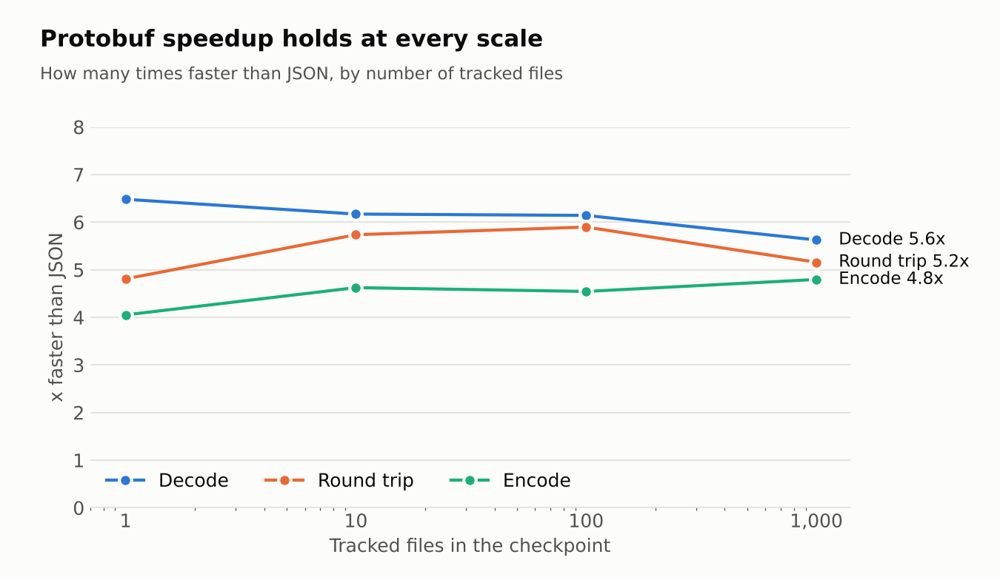

If you run the [filelog receiver][filelog] with a `storage` extension, the
Collector writes a checkpoint every time it polls your log files. That
checkpoint is how the receiver remembers where it stopped reading, so a restart
does not lose or duplicate logs. For years that checkpoint format was JSON.

Starting with OpenTelemetry Collector Contrib v0.164.0, checkpoints are always
written as protobuf. On our benchmarks, saving a checkpoint is almost 5 times
faster, loading one is more than 5 times faster, and the checkpoint itself is
about 35% smaller.

## Why checkpoints were worth optimizing

The filelog receiver keeps a small record for every file it tracks: a
fingerprint built from the first bytes of the file, the read offset, the record
number, the file attributes, and some state used to flush partial lines. When
storage is configured, that whole list is serialized and written to the storage
extension at the end of every poll cycle, and once more when the receiver stops.
It is read back only once, when the receiver starts.

With the default `poll_interval` of 200 ms, that means five writes per second,
for as long as the Collector runs. On a Kubernetes node with hundreds of
container log files, every one of those writes serializes hundreds of records.

In October 2025,
[a user reported](https://github.com/open-telemetry/opentelemetry-collector-contrib/issues/43266)
that a Collector collecting Kubernetes logs with `file_storage` was using
noticeably more resources than Fluent Bit doing similar work. Profiling showed a
surprising amount of CPU going into JSON encoding of the checkpoint.

## JSON vs protobuf

JSON is great when people need to read the data. Nobody reads a checkpoint
except the receiver, so JSON was paying a price for nothing.

The biggest cost is the file fingerprint, the first 1,000 bytes of each file.
JSON cannot hold raw bytes, so they were converted to text, which made them
about a third bigger and had to be redone on every save and every load. On top
of that, every record repeated the same field names, and numbers and timestamps
were written out as text.

Protobuf is a compact binary format. It stores the fingerprint as it is, uses
small numeric tags instead of field names, and keeps numbers as numbers. For a
single tracked file, the checkpoint goes from 1,818 bytes to 1,186 bytes, and it
takes much less work to write and read.

The work landed in
[#45097](https://github.com/open-telemetry/opentelemetry-collector-contrib/pull/45097)
and became the only way checkpoints are written in
[#52037](https://github.com/open-telemetry/opentelemetry-collector-contrib/pull/52037).
Before making it permanent we asked users running it in production for feedback
and did not hear about any problems.

## The numbers

We used the benchmarks that live next to the checkpoint code in
`pkg/stanza/fileconsumer`. Each benchmark builds realistic metadata for 1, 10,
100 and 1,000 files, each with a 1,000 byte fingerprint and five file
attributes, and saves it to an in memory storage. We ran the same binary with
JSON and with protobuf encoding, interleaved, 10 runs each, and compared the
results with `benchstat`.

The machine was a shared cloud VM (4 vCPU Intel Xeon at 2.80 GHz, linux/amd64,
Go 1.26.0). Absolute numbers will differ on your hardware, but the ratios are
what matter here.

### Time

| Operation, 1,000 files | JSON     | Protobuf | Change  |
| ---------------------- | -------- | -------- | ------- |
| Encode (Save)          | 15.38 ms | 3.21 ms  | -79.15% |
| Decode (Load)          | 28.18 ms | 5.01 ms  | -82.22% |
| Round trip             | 44.04 ms | 8.54 ms  | -80.61% |

The improvement does not depend on how many files you track. Protobuf is between
4 and 6.5 times faster than JSON from a single file all the way to 1,000 files:

Encoding is the number that matters most, because it runs on every poll. To put
it in perspective, at five saves per second with 1,000 tracked files, JSON spent
roughly 77 ms of CPU every second just on checkpoints. With protobuf that goes
down to about 16 ms. That is CPU your Collector gets back for parsing and
exporting logs.

### Size and memory

| 1,000 files        | JSON      | Protobuf  | Change  |
| ------------------ | --------- | --------- | ------- |
| Stored checkpoint  | 1.740 MiB | 1.139 MiB | -34.58% |
| Allocated per Save | 5.807 MiB | 2.919 MiB | -49.74% |

The checkpoint is about 35% smaller at every file count we tested, which means
less data written to disk by `file_storage` five times per second. Each save
also allocates half as much memory, so there is less work for the garbage
collector.

There is one small trade off. Protobuf makes about 10% to 13% more allocations
per save, because each record is converted into a protobuf message before it is
marshaled. Those allocations are smaller, and the total bytes allocated still go
down by half, so in practice it is a net win.

## What you need to do

Nothing. Existing JSON checkpoints are still read when the Collector starts and
are rewritten as protobuf on the next save, so upgrading is transparent and you
keep your read offsets.

The archive used by the `polls_to_archive` setting uses the same encoding, so it
benefits from the same improvements.

If you see anything unexpected with checkpoints after upgrading, please leave a
comment on
[#43266](https://github.com/open-telemetry/opentelemetry-collector-contrib/issues/43266).

[filelog]:
  https://github.com/open-telemetry/opentelemetry-collector-contrib/tree/701867a218d0590a3e95c920388b7fb65aa3dd1d/receiver/filelogreceiver
