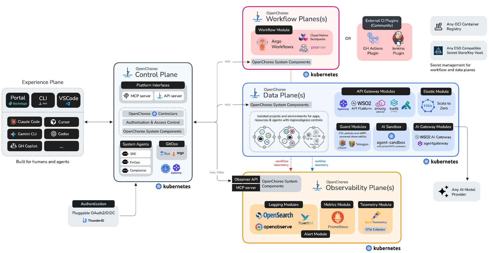
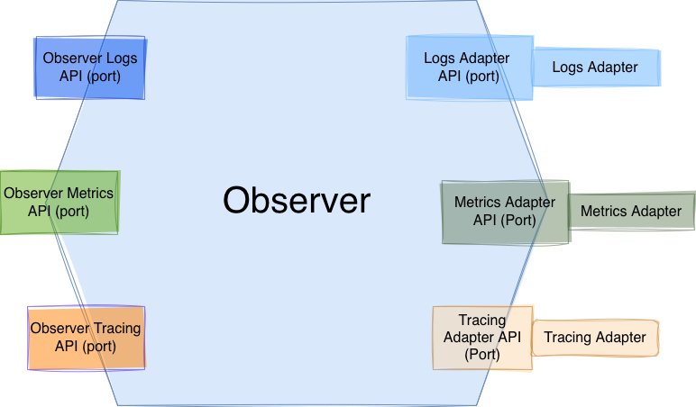
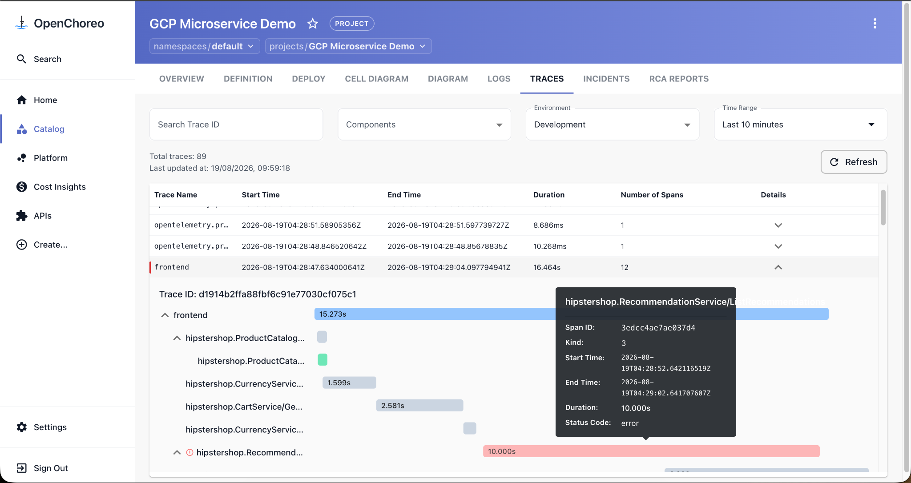
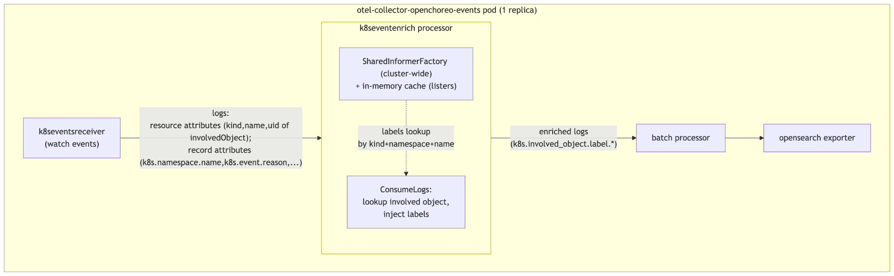
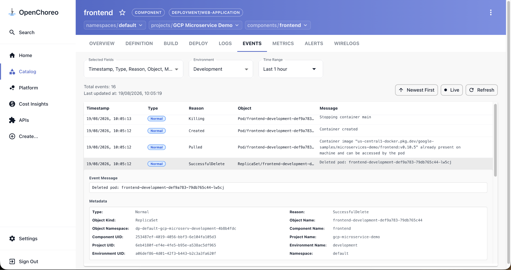

---
title:
  OpenTelemetry-powered distributed tracing and Kubernetes events in OpenChoreo
linkTitle: OpenChoreo tracing and K8s events
date: 2026-11-11
author: >-
  [Nilushan Costa](https://github.com/nilushancosta) (WSO2), [Akila
  Induranga](https://github.com/akila-i) (WSO2)
canonical_url: https://www.cncf.io/blog/2026/10/27/opentelemetry-powered-distributed-tracing-and-kubernetes-events-in-openchoreo/
issue: https://github.com/open-telemetry/opentelemetry.io/issues/12137
sig: End-User SIG
# prettier-ignore
cSpell:ignore: Akila awsxray azuremonitor googlecloud Induranga k8sattributes k8seventenrich Nilushan openchoreo sattributes seventenrich
---

Getting code from a developer's editor into production means building it,
testing it, deploying it, and then understanding how it behaves once it's
running. Internal Developer Platforms (IDPs) promise a "golden path" through all
of that, so developers can focus on business logic instead of wiring up tooling.
Observability is one important step in that path as it helps to understand what
your workloads are doing. But there are too many observability tools to choose
from, too many components to wire together and too many dashboards to manage. So
observability has become a platform problem.

This article looks at how OpenChoreo tackles that problem with OpenTelemetry. It
uses the OpenTelemetry Collector to deliver two platform features: distributed
tracing, and persistent, enriched Kubernetes events.

## What is OpenChoreo?

[OpenChoreo](https://openchoreo.dev/) is a CNCF Sandbox project: a modular, open
source Internal Developer Platform for Kubernetes. Building, deploying,
observing, and securing applications work out of the box, and a growing
ecosystem of modules lets platform teams swap in the tools they prefer to use.

OpenChoreo splits the platform into planes, each running on Kubernetes. A
control plane manages platform state. One or more data planes run the workloads.
Optional workflow planes run build and test workflows, and an observability
plane collects and serves observability data. On top of these, an experience
plane gives both people and AI agents a way in, through a Backstage-based
portal, a CLI, IDE integrations, and MCP servers.



_Figure 1: OpenChoreo's planes. Workloads in each data plane send runtime
telemetry to the observability plane, where the OpenTelemetry Collector sits
alongside the logging and metrics modules._

## Observability as a core pillar

An IDP isn't complete until you can see what's happening to the platform and
especially to the workloads. That's why OpenChoreo builds observability in from
the start rather than bolting it on later. The observability plane collects
logs, metrics, traces and events from across the platform.

At the centre of that plane is the Observer, which follows a hexagonal, or
"ports and adapters", architecture. On one side, it exposes logs, metrics, and
tracing APIs (the inbound ports) that the portal, CLI, and agents query. On the
other side, it connects to storage backends through adapter APIs with published
specs. Each backend ships as an
[ecosystem module](https://github.com/openchoreo/community-modules) that
implements the relevant adapter, so moving traces from OpenSearch to AWS X-Ray
means installing a different Helm chart, not changing the platform.



## Where OpenTelemetry fits

OpenChoreo relies on the OpenTelemetry Collector for two features: the telemetry
pipeline behind distributed tracing, and a purpose-built Collector distribution
that captures Kubernetes events.

### Distributed tracing

Without distributed tracing, debugging a request that fans out across dozens of
microservices is very difficult. In OpenChoreo, developers instrument their
applications with the standard OpenTelemetry SDK for whatever language they use,
and export spans over OTLP. From there, the Collector pipeline takes over:

- **Receive.** The `otlp` receiver ingests spans from workloads. A Collector
  runs local to each data plane, so spans are processed before they leave the
  cluster they came from.
- **Enrich.** The
  [`k8sattributes`](https://github.com/open-telemetry/opentelemetry-collector-contrib/tree/c64840337cf400792cb684037ed998428b268197/processor/k8sattributesprocessor)
  processor matches each span to the pod that produced it and attaches that
  pod's Kubernetes metadata. Because OpenChoreo labels every workload it
  deploys, those labels map each span back to OpenChoreo concepts: the project,
  component, and environment it belongs to.
- **Sample.** The
  [`tail_sampling`](https://github.com/open-telemetry/opentelemetry-collector-contrib/tree/c64840337cf400792cb684037ed998428b268197/processor/tailsamplingprocessor)
  processor decides which traces to keep after it has seen their spans, so the
  decision can take the whole trace into account instead of guessing from the
  first span.
- **Export.** Enriched traces are forwarded to a central Collector in the
  observability plane, or sent straight to a cloud backend with the
  `googlecloud`, `awsxray`, or `azuremonitor` exporters. The `otlphttp` exporter
  covers OTLP-native backends, and auth extensions supply each exporter's
  credentials.

Tracing modules are available today for OpenSearch, OpenObserve, AWS X-Ray,
Azure Application Insights, and Google Cloud Trace.

Traces appear in the Traces tab of the OpenChoreo portal, filterable by
component, environment, and time range, so developers can debug without leaving
the portal. The observability MCP server exposes the same tracing data through
tools, so AI agents can use distributed traces to debug applications too.



_Figure 3: A trace in the OpenChoreo portal. The failing 10-second
RecommendationService span stands out from the rest of the request._

### Persistent Kubernetes events

Not every incident shows up in application logs or traces. When a deployment
can't scale on Black Friday because it has hit its resource limits, the evidence
lives in Kubernetes events. Platform engineers reach for `kubectl get events`,
but by default the API server keeps events for only about an hour. By the time
someone investigates the incident, the events that explain it are often gone.

Events also resist the enrichment approach used for traces. They're emitted
about many kinds of objects, including Pods, Deployments, ReplicaSets, and Jobs,
so they can't be tied to a workload through pod association the way spans can.
OpenChoreo includes a
[purpose-built Collector distribution](https://github.com/openchoreo/community-modules/tree/35fac05461e3287ed0ddecc8911d292135a4dd35/observability-events-otel-collector)
to close that gap:

- **Collect.** The
  [`k8s_events`](https://github.com/open-telemetry/opentelemetry-collector-contrib/tree/c64840337cf400792cb684037ed998428b268197/receiver/k8seventsreceiver)
  receiver from the Collector contrib repository watches events across the
  cluster. The collector runs as a single replica so that each event is recorded
  once.
- **Enrich.** A custom processor, `k8seventenrich`, looks up the object each
  event refers to and copies its labels, annotations, and controlling owner
  reference onto the event as resource attributes: `k8s.object.label.<key>`,
  `k8s.object.annotation.<key>`, and `k8s.object.owner.{kind,name,uid}`. Lookups
  are served from cluster-wide, in-memory informer caches, so enrichment adds no
  API server calls on the event path.
- **Export.** After the `batch` processor, events go to a durable log backend.
  The distribution bundles OpenSearch, OTLP (gRPC and HTTP), AWS CloudWatch
  Logs, and debug exporters, which covers backends such as OpenSearch and
  OpenObserve.



_Figure 4: The events pipeline. The `k8seventenrich` processor enriches each
event from an in-memory informer cache before it is batched and exported._

Because the enriched labels carry OpenChoreo's own identifiers, the portal can
show each component's events in its Events tab, complete with project,
component, and environment, long after the API server has discarded them. That
makes events a lasting layer of observability instead of a short-lived one.



_Figure 5: Kubernetes events for a component in the OpenChoreo portal, with
OpenChoreo metadata attached to each event._

The distribution is published as an ecosystem module and installs into the
observability plane with Helm:

```sh
helm upgrade --install observability-events-otel-collector \
  oci://ghcr.io/openchoreo/helm-charts/observability-events-otel-collector \
  --namespace openchoreo-observability-plane --create-namespace \
  --version 0.2.0
```

Out of the box it prints enriched events through the debug exporter. The
module's README shows how to point it at OpenSearch, OpenObserve, or CloudWatch
Logs.

## Why OpenTelemetry?

Four strengths made OpenTelemetry the right choice for OpenChoreo's
observability plane:

- **Vendor-neutral by default.** A per-vendor agent would have tied the platform
  to one backend. OTLP is an open standard, the Collector is vendor-neutral, and
  both are supported by a wide range of vendors.
- **A component for most jobs.** The Collector's catalogue of receivers,
  processors, and exporters covered most of what OpenChoreo needed to assemble,
  so much of each pipeline is configuration rather than code.
- **SDKs for numerous languages.** Developers instrument in the language they
  already use, and the platform doesn't need to care which one it is.
- **An extensible core.** When no existing component fit, as with event
  enrichment, a custom processor on the core distribution was a small, testable
  piece of Go. The OpenChoreo team plans to contribute it back to the
  OpenTelemetry community.

## Try it yourself

The
[GCP microservices demo sample](https://github.com/openchoreo/openchoreo/tree/4bd2b139ff9cf23d3b7e33a3d37ad7718b7c437e/samples/gcp-microservices-demo)
deploys Google's microservices demo on OpenChoreo. Once it's running, you can
follow a single request across services to find where it slows down or fails,
then read the events behind a deployment action to see what the cluster actually
did.

## Wrapping up

OpenChoreo shows what the Collector's receivers, processors, and exporters make
possible for platform teams. Standard components handle ingestion, enrichment,
sampling, and export; a small custom processor fills the one gap they couldn't
cover. By bringing enriched traces and persisted Kubernetes events into the
developer portal, OpenChoreo takes more of the operational burden of Kubernetes
off developers, so they can get back to writing software.

To learn more or get involved, visit [openchoreo.dev](https://openchoreo.dev/),
join the community on [Slack](https://openchoreo.dev/slack), or explore the
project on [GitHub](https://github.com/openchoreo/openchoreo).

Watch the [OTel in Practice](https://www.youtube.com/live/yyJmBj8k7mk) session
to see OpenTelemetry with OpenChoreo in action.
