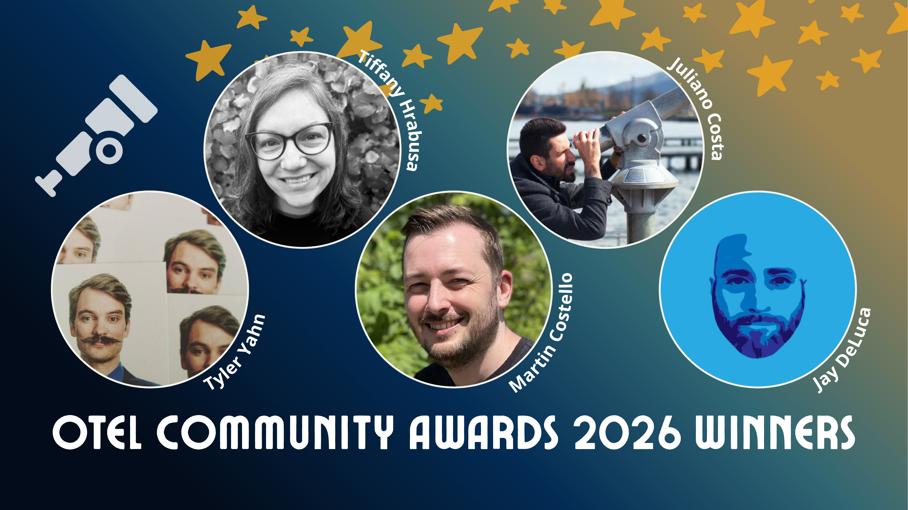

## Congratulations to our 2026 OpenTelemetry Community Award winners!

We are very pleased to announce the winners of the 2026 OpenTelemetry 
Community Awards! These awards recognize individuals who have made a notable 
impact to the OpenTelemetry project over the past year, through code, 
documentation, project management, outreach, adoption, and more. 

We’d like to extend a sincere thank you to everyone who took the time to 
nominate a contributor, and to project Maintainers for recognizing their peers. 
It truly takes a village, and this community _is_ that village.

We invite you to read more about each winner in the following section, which 
is sorted in alphabetical order and includes direct quotes from their 
nominations. 

[@jaydeluca](https://github.com/jaydeluca) 
 SIGs: `docs`, `ecosystem-explorer`, `java-contrib`, `semconv-conformance`
 **Jay DeLuca** is “an incredible maintainer/contributor” who kicked off and 
drove the Ecosystem Explorer. He welcomes and mentors new contributors, and 
contributes high-quality work to the Java repositories. 

[@julianocosta89](https://github.com/julianocosta89)
 SIGs: `demo`, `sig-developer-experience`
 **Juliano Costa’s** contributions to the OTel demo, docs, and blog are 
“invaluable” and “impactful.” In particular, his work with the DevEx SIG on 
the practitioner blog series “formed the foundation” of the community’s 
reference implementation project.

[@martincostello](https://github.com/martincostello)
 SIGs: `benchmarks`, `dotnet-contrib`, `dotnet`
 **Martin Costello** is “one of the most active” contributors of “high level 
quality” to the project. In addition to maintaining the OTel .NET and 
benchmarks repos, he provides “thoughtful feedback” on other repos that 
impact the project as a whole. 

[@MrAlias](https://github.com/MrAlias)
 SIGs: `configuration`, `ebpf-instrumentation`, `go-instrumentation`, `go`
 **Tyler Yahn** works hard to solve difficult issues across the entire 
project. His peers appreciate that he is “direct, free-spoken, and 
straightforward without beating around the bush.” 

[@tiffany76](https://github.com/tiffany76)
 SIGs: `docs`, `social-media`
 **Tiffany Hrabusa** is “an incredible member of OTel” who is “very 
welcoming” and provides high level reviews and feedback. She is a driving 
force behind the OTel blog and docs, and is “the best!”

> [!NOTE]
>
> Because the Community Awards are organized by the Community Managers
> and the Governance Committee, these members are not eligible to receive
> these awards. Nonetheless, every nomination is greatly appreciated!
