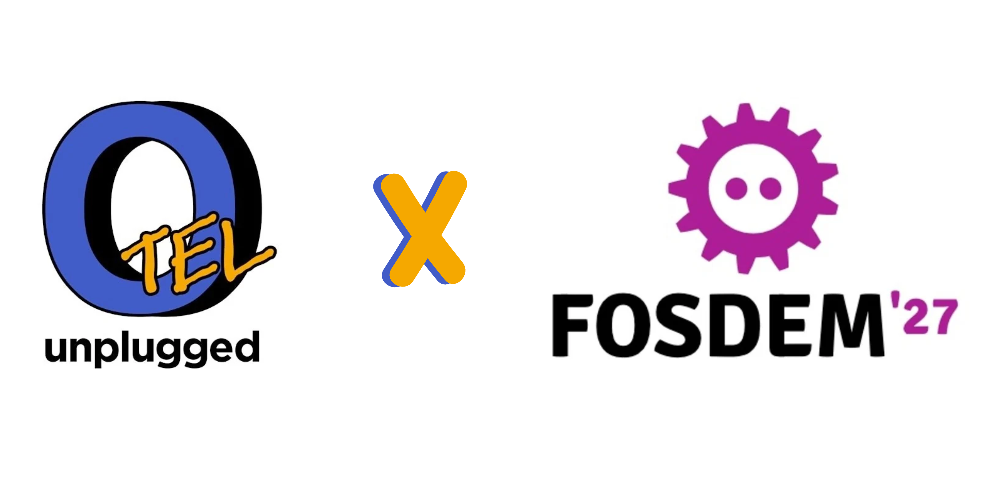

<!-- prettier-ignore -->

## OpenTelemetry is returning to FOSDEM!

After this year's resounding success of
[OTel Unplugged at FOSDEM 2026](/blog/2025/otel-unplugged-fosdem), we're excited
to announce that [OTel Unplugged][] will be returning to FOSDEM in 2027!!

## What is OTel Unplugged?

OTel Unplugged is an OpenTelemetry [unconference][] and project roadmapping
session. An unconference is like a conference, only instead of a speaker track,
we have a series of breakout sessions where attendees get to pick the topics. If
you are an end user, this is a great opportunity to connect with maintainers and
other users to get your questions answered and give feedback to the project. If
you are a maintainer or contributor, the is your chance to connect with your
users face to face!

With everything fresh in our minds from the breakout sessions, we will end with
a project roadmapping session. This is an opportunity to give suggestions and
vote in order to communicate what your priorities are for this next year.

## When and where is it happening?

OTel Unplugged will be happening on Monday, February 1st, 2027 -- the day after
[FOSDEM](https://fosdem.org/2027/). The event will be held in the lovely Sparks
meeting hall located in central Brussels.

## Where can I register?

Register from the
[event page](https://events.humanitix.com/otel-unplugged-2027).

## Interested in sponsoring?

The OpenTelemetry community needs sponsors in order to put on events! For
sponsorship details, please contact us at
[unplugged@opentelemetry.io](mailto:unplugged@opentelemetry.io)

This year's OTel Unplugged EU's agenda is organized and run by the OpenTelemetry
[Governance Committee][].

[Governance Committee]:
  https://github.com/open-telemetry/community/blob/2325c5bc19f91ae68a11878ad9c0bcf75daf4453/community-members.md
[OTel Unplugged]: https://events.humanitix.com/otel-unplugged-2027
[unconference]: https://en.wikipedia.org/wiki/Unconference
