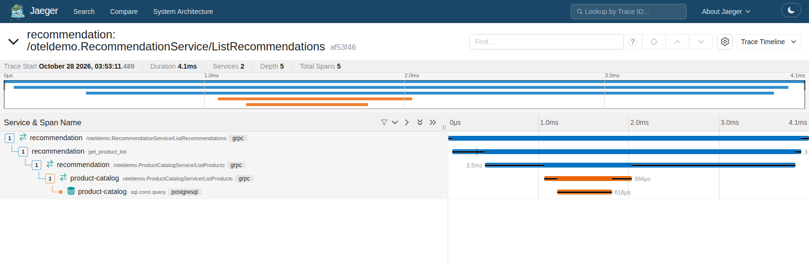
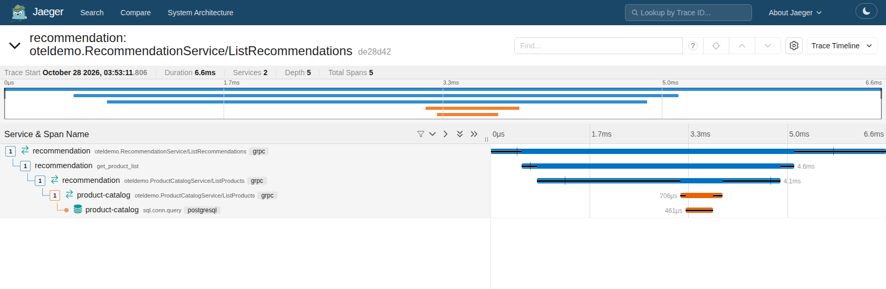

---
title:
  'Preserving telemetry when rewriting the recommendation service in Spring Boot
  4'
linkTitle: Preserving telemetry in a service rewrite
date: 2026-10-23
author: '[Aditya Reddy](https://github.com/adityareddy-dev)'
issue: 12100
sig: SIG Demo
cSpell:ignore: Aditya
---

A recommendation request in the OpenTelemetry Demo crosses a few boundaries. The
recommendation service receives a gRPC call, selects products inside a
`get_product_list` span, and calls the product catalog. That trace was already
useful before I replaced the Python service with Spring Boot 4. The new service
needed to preserve the relationships and application signals people use to
understand a request.

The Demo already had Python services, plus the Java Ad service and the Kotlin
fraud-detection service. Both of those JVM services use the OpenTelemetry Java
agent. Adding a Spring service gives developers an example using a widely used
Java framework. The recommendation service also demonstrates the OpenTelemetry
Spring Boot starter, so the Demo can show a second instrumentation path. The
[Java agent remains the default recommendation for Spring Boot applications](/docs/zero-code/java/spring-boot-starter/).

The
[merged rewrite](https://github.com/open-telemetry/opentelemetry-demo/pull/3966)
keeps the gRPC contract. To check the telemetry, I started with the old trace.

## Start with the Python trace

This is a local capture from the
[Python implementation before the rewrite](https://github.com/open-telemetry/opentelemetry-demo/blob/e5552ee25bcede2900d89188f076c464cd73c074/src/recommendation/recommendation_server.py).
The screenshots in this post show the recommendation part of the request and its
catalog call. I ran both implementations against the same product catalog and
feature-flag configuration, with the cache failure disabled.

Read the trace from the incoming recommendation RPC down. The `get_product_list`
span is its child. The catalog client span sits inside that work, and the
catalog's server span continues the same trace. The final database span belongs
to the catalog, which stays unchanged for this comparison.

Those relationships tell you whether the time was spent selecting products or
waiting for another service. Preserving a span name without preserving its
parent would lose part of that explanation.

The application attributes also give the trace meaning. For this request, the
catalog contains ten products, the viewed product is excluded, and five
recommendations are returned:

| Attribute                                | Python  | Spring  |
| ---------------------------------------- | ------- | ------- |
| `demo.product.count`                     | 10      | 10      |
| `demo.product.filtered.count`            | 9       | 9       |
| `demo.product.recommended.count`         | 5       | 5       |
| `demo.feature_flag.recommendation_cache` | `false` | `false` |

The filtered product list is random, so matching its exact contents is not the
migration goal. Its size and exclusion behavior must still make sense.

## Rebuild the RPC boundaries in Spring

The starter configures the OpenTelemetry instance and export pipeline. Its
version 2.31.1
[autoconfiguration list](https://github.com/open-telemetry/opentelemetry-java-instrumentation/blob/v2.31.1/instrumentation/spring/spring-boot-autoconfigure/src/main/resources/META-INF/spring/org.springframework.boot.autoconfigure.AutoConfiguration.imports)
does not include gRPC instrumentation. Having an SDK and exporter available does
not attach an interceptor to a Spring gRPC server or channel.

The
[OpenTelemetry gRPC library](https://github.com/open-telemetry/opentelemetry-java-instrumentation/blob/v2.31.1/instrumentation/grpc-1.6/library/src/main/java/io/opentelemetry/instrumentation/grpc/v1_6/GrpcTelemetry.java)
provides those interceptors. The service's
[configuration](https://github.com/open-telemetry/opentelemetry-demo/blob/c7b195f4f0a866bd89ceeff3d662df43e2fe69b9/src/recommendation/src/main/java/oteldemo/recommendation/GrpcTelemetryConfiguration.java)
creates `GrpcTelemetry` from the starter's `OpenTelemetry` instance and
registers its server and client interceptors as Spring beans, using
`@GlobalServerInterceptor` and `@GlobalClientInterceptor`.

The server interceptor creates the incoming RPC span and extracts the caller's
trace context. The client interceptor creates the catalog RPC span and injects
context for the catalog service to continue. This wiring preserves the RPC
boundaries visible in the old trace, rather than leaving only the manually
created application span. This is the setup for the starter and Spring gRPC
versions used by the rewrite, not a claim that every Spring instrumentation
option needs the same configuration.

Inside those boundaries, the
[Java implementation](https://github.com/open-telemetry/opentelemetry-demo/blob/c7b195f4f0a866bd89ceeff3d662df43e2fe69b9/src/recommendation/src/main/java/oteldemo/recommendation/RecommendationService.java)
starts `get_product_list` and makes it current while fetching and selecting
products. That scope makes the catalog call a child of the application span. The
service retains the `demo.*` attributes, records runtime exceptions, and ends
the span in a `finally` block.

## Read the Spring trace against the original

The Spring trace keeps the same chain: recommendation server, product-list work,
catalog client, then catalog server. The product counts in the table also match.
The Python instrumentation prefixes the RPC span names with `/`, while the Java
library does not. The request still crosses the same instrumented boundaries.

These captures compare structure and application attributes. Their individual
request durations do not establish a performance difference between the
implementations.

The
[service-level checks](https://github.com/open-telemetry/opentelemetry-demo/blob/c7b195f4f0a866bd89ceeff3d662df43e2fe69b9/src/recommendation/src/test/java/oteldemo/recommendation/RecommendationServiceTests.java)
use an in-memory exporter to assert the incoming span, the product-list parent,
and the catalog-client trace ID. They also exercise errors. The running captures
check that both services actually export connected spans through the Collector
to Jaeger. The Demo's end-to-end checks remain a separate layer.

## Keep the behavior behind the signals

Some details are easy to miss while translating the handler. The frontend sends
product IDs as one repeated element per character. The Python service joins
those characters and splits on commas. The Spring service keeps that behavior
and also accepts complete IDs. Otherwise, a valid gRPC response could recommend
the product already on the screen.

The metric still means the same thing. I kept `demo.recommendation.requests`,
the `recommendation.type=catalog` attribute, and the counting logic: five
returned recommendations add five to the counter. Incrementing once per request
would change what a dashboard measures despite keeping its metric name.

The `recommendationCacheFailure` flag is a deliberate failure scenario. On a
cache miss, the service appends catalog IDs and copies a quarter of the
accumulated cache back into itself. The response uses distinct IDs, so it can
look reasonable while the stored list grows. Keeping the cache-hit and product
count attributes lets a reader investigate that behavior. Removing the leak
would remove the scenario the Demo is meant to expose.

For another rewrite, start with a request you can follow in the old trace. Check
which boundaries, application attributes and metric meanings need to survive,
then compare the running implementation against that baseline. The
[recommendation service README](https://github.com/open-telemetry/opentelemetry-demo/blob/c7b195f4f0a866bd89ceeff3d662df43e2fe69b9/src/recommendation/README.md)
explains how this example's starter and gRPC library fit together.
