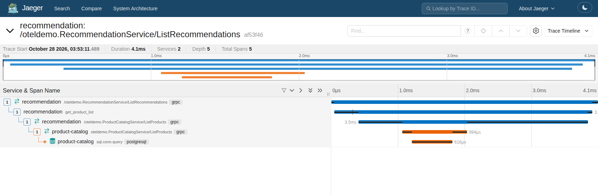
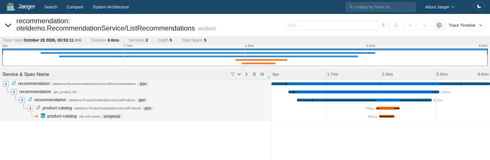

---
title:
  'Preserving telemetry when rewriting the recommendation service in Spring Boot
  4'
linkTitle: Preserving telemetry in a service rewrite
date: 2026-10-23
author: '[Aditya Reddy](https://github.com/adityareddy-dev)'
issue: 12100
sig: SIG Demo
cSpell:ignore: Aditya
---

The recommendation service in the OpenTelemetry Demo used to be Python. I
rewrote it in Spring Boot 4 and the
[rewrite](https://github.com/open-telemetry/opentelemetry-demo/pull/3966) merged
on October 13. The first version was up a week after I picked up the issue. Over
the next month its instrumentation changed three times, from Spring's own setup
to the OpenTelemetry Spring Boot starter, then to the Java agent, then back to
the starter. The trace from the old service stayed fixed through all of it, so
that's where this starts.

Why Spring at all? The Demo had four Python services and no Spring one, though
Spring is widely used. Its JVM services, Ad in Java and fraud detection in
Kotlin, both run the OpenTelemetry Java agent. The Demo maintainer preferred
rewriting an existing service over adding one, and recommendation got picked.
The [Java agent](/docs/zero-code/java/agent/) is still the default for Spring
Boot. This service shows the
[Spring Boot starter](/docs/zero-code/java/spring-boot-starter/) as a second
way.

## Start with the Python trace

Read it from the incoming recommendation RPC down. `get_product_list` is its
child, the catalog client span sits inside that work and the catalog's server
span continues the same trace. The database span belongs to the catalog, which
didn't change. Those parent-child links tell you whether the time went into
picking products or waiting on another service, so keeping a span name without
its parent isn't enough.

With ten catalog products, one viewed product excluded and the cache failure
off, both versions should record these attributes:

| Attribute                                | Python (expected) | Spring (expected) |
| ---------------------------------------- | ----------------- | ----------------- |
| `demo.product.count`                     | 10                | 10                |
| `demo.product.filtered.count`            | 9                 | 9                 |
| `demo.product.recommended.count`         | 5                 | 5                 |
| `demo.feature_flag.recommendation_cache` | `false`           | `false`           |

The recommended products are picked at random, so the exact list was never going
to match. The counts and the exclusion have to.

## Spring, the starter, the agent and the starter again

The
[issue I picked up](https://github.com/open-telemetry/opentelemetry-demo/issues/1368)
asked for Micrometer tracing on Spring Boot. I picked up Spring Boot cause I
felt it was a good entry point. I was comfortable in Java and Spring from my day
job and previous workplaces, and the issue was tagged good first issue. I
honestly thought it would probably be one place where responses would be quick
for a newbie. Turns out Juliano was amazing and guided me through, I just got
lucky I guess. The first version used Spring Boot's
`spring-boot-starter-opentelemetry`, with Micrometer Tracing for the
`get_product_list` span and a `MeterRegistry` for the counter.

Funny thing is, the first reply on the PR wasn't about the code at all. Someone
asked if the Demo even needed another Java service. I'd just deleted most of the
old service in that PR, so yeah, not the welcome I was hoping for. Juliano
jumped in the same day and explained why a Spring service made sense, and
honestly that's what kept me going that week.

Then it wouldn't start for one of the reviewers. Fine on my machine (Windows
with WSL2), stuck on his Linux box. I couldn't reproduce it, and I can't fix
what I can't see, so I asked for logs and waited. Then asked again a few days
later. That was the worst part of the whole PR, way worse than any code. He got
it running later and checked the spans in Jaeger before approving, so it worked
out.

On September 23 the Java instrumentation approvers were
[asked](https://github.com/open-telemetry/opentelemetry-demo/pull/3966#issuecomment-5797579640)
whether Micrometer made sense in the OpenTelemetry Demo. The answer was one
line, "I think the OpenTelemetry Demo should use OpenTelemetry's recommended
approach", with a link to the starter page. I switched that day, and that's
where the gRPC spans went missing. The starter's
[out-of-the-box instrumentation](/docs/zero-code/java/spring-boot-starter/out-of-the-box-instrumentation/)
doesn't include gRPC in 2.31.1, cause gRPC comes from the separate Spring gRPC
project, not core Spring Boot. So I added the
[OpenTelemetry gRPC library](https://github.com/open-telemetry/opentelemetry-java-instrumentation/blob/v2.31.1/instrumentation/grpc-1.6/library/README.md)
and registered its interceptors myself.

Two weeks later another reviewer
[pointed out](https://github.com/open-telemetry/opentelemetry-demo/pull/3966#issuecomment-6017929704)
that the same page says "The default choice for instrumenting Spring Boot
applications is the OpenTelemetry Java agent". Fair, so I moved to the agent,
loaded through `JAVA_TOOL_OPTIONS` like Ad. Two days after that the Demo
maintainer
[asked me to hold](https://github.com/open-telemetry/opentelemetry-demo/pull/3966#issuecomment-6058694428).
Ad already runs the agent, and the whole point of a Spring service was to show a
different way. So, back to the starter.

Every time, I just did what was asked. Switched quickly, didn't argue. And then
the plan changed again. Nobody was wrong here, they were reading the same docs
page differently and working it out in my PR. But from where I was sitting it
felt like going in circles. At one point the agent version's tests had to set up
the exact gRPC interceptors I'd just deleted from the app, and the approval I
had was for code that didn't exist anymore.

The comment that actually changed how I looked at it came from the Java
approver. He was
[fine with the starter](https://github.com/open-telemetry/opentelemetry-demo/pull/3966#issuecomment-6066087816)
as long as the example is "super clear about it not being the default
recommendation", cause people (and AI tools) copy this repo as is. Before that I
thought I was just porting a service. After that it was something people would
copy without ever reading the thread, which is a different kind of pressure. So
the README now says right at the top that the agent is the default and this
service shows the starter as a second option. The changelog says it too.

The agent is the default for a good reason, it instruments everything out of the
box. Pick the starter only when the agent doesn't fit, like a native image,
another agent already attached, or a tight container. Memory came up early in
the review, and the starter ran about 75 MiB lighter under load than the agent
(around 305 against 380 MiB of a 500 MiB limit), so it made sense for the Demo
too.

All in, it took 13 commits and five weeks, and a bunch of those commits were
just me merging `main` back in while waiting for the next review. Looks like
steady progress from outside. Inside, there's always this small voice going
"what if this just sits here forever".

## Wire the gRPC spans back in

The starter hands out the `OpenTelemetry` instance as a bean but doesn't attach
anything to a Spring gRPC server or channel. As the
[recommendation service docs](/docs/demo/services/recommendation/#grpc-spans)
show, the service creates `GrpcTelemetry` from that bean and registers its
interceptors with `@GlobalServerInterceptor` and `@GlobalClientInterceptor`. The
server one creates the incoming RPC span from the caller's context, the client
one creates the catalog span and passes the context on.

Inside those boundaries the service
[creates `get_product_list`](/docs/demo/services/recommendation/#create-new-spans)
and makes it current while it fetches products, which makes the catalog call its
child. The [Java API docs](/docs/languages/java/api/#span) cover spans and
context in general.

## Compare the Spring trace against the original

Same chain: recommendation server, product-list work, catalog client, catalog
server, with the attributes from the table. The Python instrumentation prefixes
RPC span names with `/` and the Java library doesn't. The Java library also
still writes the older `rpc.system` attribute while the catalog uses
`rpc.system.name`, so a query across services has to handle both. Two single
requests say nothing about performance.

## Keep the behavior behind the signals

The frontend sends product IDs as one repeated element per character. The Python
service joined them and split on commas. The Spring service does the same and
also accepts whole IDs, otherwise it could recommend the product already on the
screen.

I kept `demo.recommendation.requests`, its `recommendation.type=catalog`
attribute and the counting, so five returned recommendations add five. Counting
once per request would keep the name and change what every dashboard on it
measures.

The `recommendationCacheFailure` flag is a failure scenario on purpose. On a
cache miss the service appends the catalog IDs, then copies a quarter of the
cache back into itself. Responses use distinct IDs, so they look fine while the
list grows until the container restarts. Fixing it would remove the scenario, so
the cache-hit and product-count attributes stay for whoever goes looking.

The setup changed three times and the check didn't: open Jaeger and compare the
chain and the `demo.*` attributes with the Python trace. The final setup is in
the [recommendation service docs](/docs/demo/services/recommendation/).

## If it's your first contribution

When it merged I thanked everyone, including the person who asked on day one if
the service should even exist. Thinking about it now, that question is a big
reason the README explains what this service is for.

If this is your first contribution: the first reply might question whether your
change should exist, and reviewers might not agree with each other on what "the
recommended way" is. That doesn't mean you messed up. Pick the one thing that
has to stay the same (for me it was the trace) and keep checking against it
every time the plan changes. And when a decision gets made, put it somewhere
people will actually see it, not buried in the PR thread.
