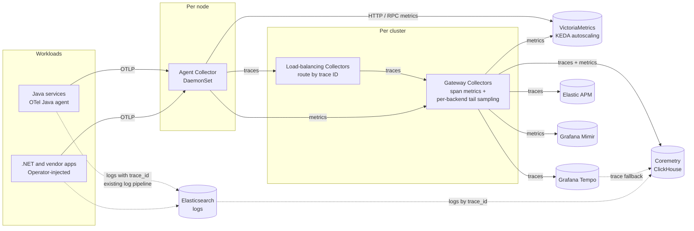

By [Cenk Çil](https://github.com/cilcenk) (Akbank) | October 20, 2026

Akbank is one of Turkey's largest private banks. Its digital channels (mobile
and internet banking, branch systems, lending and payments) run on thousands of
services across several on-premises OpenShift clusters in multiple regions. The
estate mixes Java applications on JBoss EAP / WildFly and Spring, .NET services,
and applications bought from third-party vendors whose code the bank cannot
change or rebuild.

Banking regulation shapes every observability decision: telemetry contains
customer and transaction context, so every component, from collection to storage
and analysis, runs inside the bank's own network.

## Organizational structure

Akbank has around 2,000 developers. Observability is owned centrally by the SRE
team: it runs the OpenTelemetry Operator, the Collector tiers and Coremetry, and
owns the instrumentation defaults. Application teams get traces, metrics and
correlated logs without changing their code; vendor and .NET workloads are
onboarded with a pod annotation.

## Environment and scale

| Dimension                | Details                                                                                                              |
| ------------------------ | -------------------------------------------------------------------------------------------------------------------- |
| Infrastructure           | On-premises Red Hat OpenShift, tens of clusters across multiple regions                                              |
| Languages instrumented   | Java (JBoss EAP / WildFly, Spring), .NET, third-party vendor applications                                            |
| Number of services       | Thousands                                                                                                            |
| Scale                    | Billions of spans per day, even after tail sampling                                                                  |
| Collector fleet          | Per cluster: a DaemonSet agent on every node, ~20 load-balancing and ~30 gateway pods                                |
| Observability backend(s) | Grafana Tempo, Grafana Mimir, VictoriaMetrics, Elastic APM, Elasticsearch (logs), Coremetry (Apache-2.0, ClickHouse) |

## Why OpenTelemetry

Before OpenTelemetry, telemetry at the bank was split across tools that did not
share identifiers: application logs in Elasticsearch, metrics in a separate
stack, and tracing in only a few teams. Incident calls often started with "which
system has the data?" rather than "what is broken?".

The bank wanted three things:

- One wire format for traces, metrics and logs, so that instrumentation in
  thousands of applications would not be tied to any one backend.
- Trace context everywhere, including in places a bank cannot change quickly:
  legacy application servers, vendor applications and Oracle application error
  tables.
- Components that can all run on-premises.

OpenTelemetry gave the first two through zero-code instrumentation and OTLP, and
the third because every component runs inside the bank's own clusters.

## OpenTelemetry components in use

### SDKs and instrumentation

Instrumentation is a combination of zero-code auto-instrumentation and manual
instrumentation:

- **Java:** the OpenTelemetry Java agent on JBoss EAP / WildFly and Spring
  applications, with no code changes in the first phase. HTTP servers and
  clients, JDBC, JMS and Kafka are covered by the agent's instrumentations.
- **.NET and vendor applications:** zero-code auto-instrumentation injected by
  the OpenTelemetry Operator through an `Instrumentation` resource and a pod
  annotation. This is what let the team cover applications it cannot rebuild
  without asking every vendor for a code change.
- **Manual instrumentation:** where the business flow is invisible to
  auto-instrumentation, such as batch jobs, message consumers and internal steps
  of a long transaction, teams add spans and attributes with the OpenTelemetry
  API on top of the agent.
- **Resource attributes:** `service.name`, `service.namespace`,
  `service.version`, `deployment.environment.name` and the `k8s.*` attributes
  are set consistently, so every signal can be attributed to a team, a cluster
  and a release.
- **Log correlation:** the Java agent injects `trace_id` and `span_id` into the
  logging context, so every log line can be joined with its trace, even when the
  trace itself was not sampled.

### OpenTelemetry Collector

Every cluster runs three Collector roles:

1. **Agent:** a DaemonSet on every node. Applications send OTLP to a node-local
   endpoint. The agent does the work that is cheapest close to the source:
   - drops noise spans (health, readiness and liveness checks, actuator, metrics
     scrapes, Swagger, favicon) before they cross the network;
   - adds Kubernetes metadata with `k8sattributes` (pod, node, namespace,
     deployment, container image and tag) and copies two **team ownership pod
     labels** (the development team and the SRE team) onto every span, which is
     how every trace is attributed to a team;
   - deletes `process.command_line` / `process.command_args`, which can carry
     secrets;
   - extracts business codes (function code, channel code) from the Kafka
     message key into span attributes.
2. **Load-balancing tier:** a Deployment running the `loadbalancing` exporter
   with `routing_key: traceID` and the `k8s` resolver on the gateway's headless
   Service, so every span of a trace, whichever node and service produced it,
   reaches the same gateway pod.
3. **Gateway:** a Deployment that sees each trace complete. It derives span
   metrics, applies tail sampling per backend, drops high-cardinality attributes
   and exports.

Only traces need trace-aware routing, so metrics go from the agents straight to
the gateway tier. The agents also send the HTTP and RPC server metrics
(`http.server.request.*`, `rpc.server.*`) to VictoriaMetrics, where KEDA reads
them to autoscale workloads on request rate. Logs do not pass through the
Collectors: they keep flowing to Elasticsearch through the existing log
pipeline, and the `trace_id` the Java agent puts into every log line is what
joins them with traces.

Applications only ever know their node-local endpoint, so sampling, processing
and export settings change in one place without touching thousands of
deployments.

### OpenTelemetry Operator

The Operator is installed with its Helm chart (OperatorHub is also an option on
OpenShift). It manages auto-instrumentation injection for .NET and vendor
workloads. The Collectors themselves are deployed with the OpenTelemetry
Collector Helm chart.

### Other components

**Coremetry** is the OpenTelemetry-native APM the bank built on top of this
pipeline and released under the Apache-2.0 license
([github.com/cosretr/coremetry](https://github.com/cosretr/coremetry)). It reads
OTLP data and relies on the semantic conventions directly, for example
`http.request.method`, `http.route` and `http.response.status_code` on spans and
the `http.server.request.duration` histogram, so the numbers on a trace and on a
metrics view agree. Its SRE assistant, CoSRE, runs on a local open-weight LLM,
so no telemetry leaves the bank.

## Architecture



Each trace backend receives its own sampled stream (see below). When an engineer
follows a trace ID from a log line or an Oracle error row, Coremetry looks in
its own ClickHouse store first and falls back to Tempo, which keeps a fuller set
of traces.

### Deployment and lifecycle management

The SRE team deploys the OpenTelemetry Operator and all three Collector tiers
with Helm charts, rolled out to every OpenShift cluster through GitOps with Argo
CD. A sampling, processing or export change is a pull request to the GitOps
repository; Argo CD applies it cluster by cluster, and no application deployment
is touched. Collector and agent versions are upgraded monthly, through the same
GitOps flow: the new image tag is a pull request, and Argo CD rolls it out
cluster by cluster.

### Sampling and data governance

Sampling is tail-based and happens only at the gateway tier. Because the
load-balancing tier routes by trace ID, each keep-or-drop decision is made once
per complete trace, never per fragment.

Different backends need different shares of the data, so the gateway does not
sample once. Incoming traces enter a single pipeline that ends in a `forward`
connector; from there they fan out to one pipeline per backend, each with its
own `tail_sampling` processor:

- **Coremetry:** traces with an error are always kept, plus a 5% probabilistic
  share; one known noisy service is dropped.
- **Elastic APM:** errors plus 10%.
- **Grafana Tempo:** most services at 100%; the highest-volume mobile-path
  services at 10% plus all errors; a batch service family only when it writes
  (`db.operation = UPDATE`); non-error traces from a group of noisy external
  hosts are dropped.

**Span metrics before sampling.** The same `forward` connector also feeds
`spanmetrics` connectors, which compute request-rate, error and duration
histograms (`http.request.method`, `http.response.status_code`, `http.route`,
`server.address`) from **every** span, before any sampling decision. Dashboards
and alerts therefore stay accurate even though only a fraction of traces is
stored. Separate `spanmetrics` instances with their own dimensions serve teams
that need extra ones (for example `db.name` for one domain), using filter
processors to keep each one's input small.

**Cardinality and volume.** The gateway removes `service.instance.id`,
`messaging.kafka.message.offset` and `thread.id` before export, and a `routing`
connector sends metrics to the right metrics backend by `service.name`. Every
tier runs `memory_limiter` before `batch`.

Two things fill the gap left by unsampled traces:

- **Logs keyed by trace ID.** Log lines carry `trace_id` whether or not the
  trace was kept, so logs are looked up by trace ID first and span presence is
  treated as optional.
- **Oracle application error tables.** Many applications write business and
  technical errors into Oracle tables. Once the trace ID was added to those
  rows, an error code could be followed to the exact request, its spans and its
  logs.

## Configuration

### SDK configuration

A representative `Instrumentation` resource for the Operator-injected .NET and
vendor workloads (simplified, not the production manifest). Java services use
the OpenTelemetry Java agent with the same exporter endpoint and propagators.

```yaml
# Zero-code instrumentation for .NET and vendor workloads, injected by the Operator.
apiVersion: opentelemetry.io/v1alpha1
kind: Instrumentation
metadata:
  name: default
spec:
  exporter:
    endpoint: http://$(OTEL_NODE_IP):4318 # node-local agent Collector
  propagators: [tracecontext, baggage]
  resource:
    addK8sUIDAttributes: true
```

### Collector configuration

The excerpts below are trimmed from the production Helm values (OpenTelemetry
Collector Contrib 0.146.0). Endpoints and service names are replaced with
placeholders; receivers, `health_check`, self-telemetry and duplicate pipelines
are left out.

#### Agent (DaemonSet)

You can also view this pipeline on [OTelBin][agent-otelbin].

<details>
<summary>Agent Collector configuration (trimmed)</summary>

```yaml
mode: daemonset
config:
  processors:
    memory_limiter:
      { check_interval: 5s, limit_percentage: 80, spike_limit_percentage: 25 }
    filter/noise: # drop health / scrape noise at the node
      error_mode: ignore
      traces:
        span:
          - IsMatch(attributes["http.route"], ".*(health|actuator|metrics).*")
          - IsMatch(attributes["url.path"],
            ".*(actuator|metrics|prometheus|swagger|favicon).*")
    resource/delete: # command lines can carry secrets
      attributes:
        - { key: process.command_line, action: delete }
        - { key: process.command_args, action: delete }
    attributes/kafka_key: # business codes from the Kafka message key
      actions:
        - key: messaging.kafka.message.key
          pattern: ^(?P<function_code>[^|]+)
          action: extract
    k8sattributes:
      extract:
        metadata:
          [
            k8s.pod.name,
            k8s.node.name,
            k8s.namespace.name,
            k8s.deployment.name,
            container.image.name,
            container.image.tag,
          ]
        labels: # team ownership on every span
          - { tag_name: dev-team, key: dev-team, from: pod }
          - { tag_name: sre-team, key: sre-team, from: pod }
    batch: { send_batch_size: 4096, send_batch_max_size: 32768, timeout: 5s }
  exporters:
    otlphttp/lb: # traces -> load-balancing tier
      endpoint: ${env:LB_COLLECTOR_ENDPOINT}
      sending_queue: { enabled: true, num_consumers: 10, queue_size: 500000 }
    otlphttp/gateway: # metrics -> gateway directly
      endpoint: ${env:GATEWAY_COLLECTOR_ENDPOINT}
      sending_queue: { enabled: true, num_consumers: 10, queue_size: 500000 }
    otlphttp/keda: # HTTP/RPC server metrics for KEDA autoscaling
      metrics_endpoint: https://victoriametrics.example.internal/opentelemetry/v1/metrics
  service:
    pipelines:
      traces:
        receivers: [otlp]
        processors:
          [
            memory_limiter,
            filter/noise,
            resource/delete,
            attributes/kafka_key,
            k8sattributes,
            batch,
          ]
        exporters: [otlphttp/lb]
      metrics:
        receivers: [otlp]
        processors: [memory_limiter, resource/delete, batch]
        exporters: [otlphttp/gateway]
```

</details>

#### Load-balancing tier (Deployment)

You can also view this pipeline on [OTelBin][lb-otelbin].

<details>
<summary>Load-balancing Collector configuration (trimmed)</summary>

```yaml
mode: deployment
config:
  exporters:
    loadbalancing/traces:
      routing_key: traceID # all spans of a trace -> same gateway pod
      protocol:
        otlp:
          tls: { insecure: true }
          timeout: 15s
          sending_queue: { enabled: true, num_consumers: 20, queue_size: 3000 }
          retry_on_failure:
            {
              enabled: true,
              initial_interval: 5s,
              max_interval: 30s,
              max_elapsed_time: 60s,
            }
      resolver:
        k8s:
          service: otel-gateway-collector-headless
          ports: [4317]
  processors:
    memory_limiter:
      { check_interval: 1s, limit_percentage: 85, spike_limit_percentage: 25 }
    batch: { send_batch_size: 2048, send_batch_max_size: 4096, timeout: 5s }
  service:
    pipelines:
      traces:
        receivers: [otlp]
        processors: [memory_limiter, batch]
        exporters: [loadbalancing/traces]
```

</details>

#### Gateway (Deployment)

You can also view this pipeline on [OTelBin][gateway-otelbin].

<details>
<summary>Gateway Collector configuration (trimmed)</summary>

```yaml
mode: deployment
config:
  connectors:
    forward/traces: {} # one input, fan-out to per-backend pipelines
    spanmetrics: # RED metrics from every span, before sampling
      histogram:
        explicit:
          { buckets: [5ms, 10ms, 50ms, 100ms, 250ms, 500ms, 1s, 2s, 5s, 10s] }
        unit: s
      dimensions:
        - { name: http.request.method, default: GET }
        - name: http.response.status_code
        - name: http.route
        - name: server.address
      exemplars: { enabled: true }
      metrics_flush_interval: 60s
      metrics_expiration: 15m
  processors:
    memory_limiter:
      { check_interval: 5s, limit_percentage: 80, spike_limit_percentage: 25 }
    resource/drop:
      { attributes: [{ key: service.instance.id, action: delete }] }
    attributes/drop:
      actions:
        - { key: messaging.kafka.message.offset, action: delete }
        - { key: thread.id, action: delete }
    tail_sampling/coremetry:
      decision_wait: 15s
      num_traces: 200000
      policies:
        - {
            name: errors,
            type: status_code,
            status_code: { status_codes: [ERROR] },
          }
        - {
            name: baseline,
            type: probabilistic,
            probabilistic: { sampling_percentage: 5 },
          }
    tail_sampling/tempo:
      decision_wait: 15s
      num_traces: 200000
      policies:
        - name: hot-path-10pct # highest-volume mobile-path services
          type: and
          and:
            and_sub_policy:
              - {
                  name: hot-path,
                  type: string_attribute,
                  string_attribute:
                    {
                      key: service.name,
                      values: ['mobile-.*'],
                      enabled_regex_matching: true,
                    },
                }
              - {
                  name: ten-pct,
                  type: probabilistic,
                  probabilistic: { sampling_percentage: 10 },
                }
        - name: hot-path-errors
          type: and
          and:
            and_sub_policy:
              - {
                  name: hot-path,
                  type: string_attribute,
                  string_attribute:
                    {
                      key: service.name,
                      values: ['mobile-.*'],
                      enabled_regex_matching: true,
                    },
                }
              - {
                  name: errors,
                  type: status_code,
                  status_code: { status_codes: [ERROR] },
                }
        - name: everything-else # all other services, kept in full
          type: string_attribute
          string_attribute:
            {
              key: service.name,
              values: ['mobile-.*'],
              enabled_regex_matching: true,
              invert_match: true,
            }
    batch: { send_batch_size: 8192, send_batch_max_size: 16384, timeout: 10s }
  exporters:
    otlp/coremetry:
      endpoint: dns:///coremetry-ingest-headless.coremetry.svc.cluster.local:4317
      balancer_name: round_robin # client-side gRPC balancing across ingest pods
      tls: { insecure: true }
    otlp/tempo:
      endpoint: tempo-distributor.tempo.svc.cluster.local:4317
      sending_queue: { enabled: true, num_consumers: 10, queue_size: 500000 }
      tls: { insecure: true }
    otlphttp/mimir:
      metrics_endpoint: https://mimir.example.internal/otlp/v1/metrics
    otlphttp/victoriametrics:
      metrics_endpoint: https://victoriametrics.example.internal/opentelemetry/v1/metrics
  service:
    pipelines:
      traces/in:
        receivers: [otlp]
        processors: [memory_limiter]
        exporters: [forward/traces]
      traces/coremetry:
        receivers: [forward/traces]
        processors:
          [tail_sampling/coremetry, resource/drop, attributes/drop, batch]
        exporters: [otlp/coremetry]
      traces/tempo:
        receivers: [forward/traces]
        processors: [tail_sampling/tempo, resource/drop, attributes/drop, batch]
        exporters: [otlp/tempo]
      traces/spanmetrics:
        receivers: [forward/traces]
        exporters: [spanmetrics]
      metrics/spanmetrics:
        receivers: [spanmetrics]
        processors: [memory_limiter, resource/drop, batch]
        exporters: [otlphttp/mimir, otlphttp/victoriametrics, otlp/coremetry]
      metrics:
        receivers: [otlp]
        processors: [memory_limiter, resource/drop, batch]
        exporters: [otlphttp/mimir, otlphttp/victoriametrics, otlp/coremetry]
```

</details>

## Lessons and pain points

- **Compute span metrics before sampling.** Once traces are sampled per backend,
  RED metrics derived after sampling would be wrong. Running `spanmetrics` on
  the unsampled stream behind a `forward` connector kept dashboards and alerts
  accurate.
- **One sampling policy does not fit every backend.** A `forward` connector with
  one pipeline per backend let each store keep the share it needs: full traces
  in Tempo, errors plus a small baseline elsewhere.
- **Tail sampling needs trace-aware load balancing.** Spans of one trace come
  from many services on many nodes. Without routing by trace ID they land on
  different gateway pods, and each pod decides on a fragment.
- **Sampling must be visible to engineers.** People need to know when a trace
  was not kept; logs and error tables keyed by trace ID fill the gap.
- **Semantic convention migrations move dashboards.** Moving from
  `http.server.duration` to `http.server.request.duration` changed metric names
  underneath existing views; the team handled both during the migration.

## Advice for others

Based on Akbank's experience, a few lessons stand out:

- Start with zero-code instrumentation, and add manual spans only where the
  business flow is invisible (batch jobs, message consumers).
- Use the Operator for code you don't own: vendor and .NET applications joined
  the same traces as the bank's own Java services without a code change on their
  side.
- Put a gateway between applications and backends, so every processing or export
  change happens in Collector configuration rather than in application
  deployments.
- Agree on resource attributes early; `service.name` conventions and
  `deployment.environment.name` saved more time than any dashboard.
- Drop noise (health checks, scrape endpoints) and secret-bearing attributes at
  the node agent, before they cost network, memory and storage.
- Put team ownership on every span from pod labels with `k8sattributes`; it
  makes per-team views possible without asking teams to change their code.
- Propagate trace context into every place an engineer looks (logs and error
  tables), not only into the tracing backend.

## What's next

- **Mobile observability.** Most customers reach the bank through the mobile
  app. The goal is for a tap in the app and the backend trace it causes to be
  one end-to-end view.
- **Profiling.** The team plans to adopt the OpenTelemetry profiling signal, so
  CPU and memory profiles carry the same resource attributes as traces and can
  be opened from a slow span.

[agent-otelbin]:
  https://www.otelbin.io/#config=mode%3A_daemonset*Nconfig%3A*N__processors%3A*N____memory*_limiter%3A*N______%7B_check*_interval%3A_5s%2C_limit*_percentage%3A_80%2C_spike*_limit*_percentage%3A_25_%7D*N____filter/noise%3A_*H_drop_health_/_scrape_noise_at_the_node*N______error*_mode%3A_ignore*N______traces%3A*N________span%3A*N__________-_IsMatch*Cattributes%5B%22http.route%22%5D%2C_%22.***Chealth%7Cactuator%7Cmetrics*D.**%22*D*N__________-_IsMatch*Cattributes%5B%22url.path%22%5D%2C*N____________%22.***Cactuator%7Cmetrics%7Cprometheus%7Cswagger%7Cfavicon*D.**%22*D*N____resource/delete%3A_*H_command_lines_can_carry_secrets*N______attributes%3A*N________-_%7B_key%3A_process.command*_line%2C_action%3A_delete_%7D*N________-_%7B_key%3A_process.command*_args%2C_action%3A_delete_%7D*N____attributes/kafka*_key%3A_*H_business_codes_from_the_Kafka_message_key*N______actions%3A*N________-_key%3A_messaging.kafka.message.key*N__________pattern%3A_%5E*C%3FP%3Cfunction*_code%3E%5B%5E%7C%5D%2B*D*N__________action%3A_extract*N____k8sattributes%3A*N______extract%3A*N________metadata%3A*N__________%5B*N____________k8s.pod.name%2C*N____________k8s.node.name%2C*N____________k8s.namespace.name%2C*N____________k8s.deployment.name%2C*N____________container.image.name%2C*N____________container.image.tag%2C*N__________%5D*N________labels%3A_*H_team_ownership_on_every_span*N__________-_%7B_tag*_name%3A_dev-team%2C_key%3A_dev-team%2C_from%3A_pod_%7D*N__________-_%7B_tag*_name%3A_sre-team%2C_key%3A_sre-team%2C_from%3A_pod_%7D*N____batch%3A_%7B_send*_batch*_size%3A_4096%2C_send*_batch*_max*_size%3A_32768%2C_timeout%3A_5s_%7D*N__exporters%3A*N____otlphttp/lb%3A_*H_traces_-%3E_load-balancing_tier*N______endpoint%3A_*S%7Benv%3ALB*_COLLECTOR*_ENDPOINT%7D*N______sending*_queue%3A_%7B_enabled%3A_true%2C_num*_consumers%3A_10%2C_queue*_size%3A_500000_%7D*N____otlphttp/gateway%3A_*H_metrics_-%3E_gateway_directly*N______endpoint%3A_*S%7Benv%3AGATEWAY*_COLLECTOR*_ENDPOINT%7D*N______sending*_queue%3A_%7B_enabled%3A_true%2C_num*_consumers%3A_10%2C_queue*_size%3A_500000_%7D*N____otlphttp/keda%3A_*H_HTTP/RPC_server_metrics_for_KEDA_autoscaling*N______metrics*_endpoint%3A_https%3A//victoriametrics.example.internal/opentelemetry/v1/metrics*N__service%3A*N____pipelines%3A*N______traces%3A*N________receivers%3A_%5Botlp%5D*N________processors%3A*N__________%5B*N____________memory*_limiter%2C*N____________filter/noise%2C*N____________resource/delete%2C*N____________attributes/kafka*_key%2C*N____________k8sattributes%2C*N____________batch%2C*N__________%5D*N________exporters%3A_%5Botlphttp/lb%5D*N______metrics%3A*N________receivers%3A_%5Botlp%5D*N________processors%3A_%5Bmemory*_limiter%2C_resource/delete%2C_batch%5D*N________exporters%3A_%5Botlphttp/gateway%5D
[lb-otelbin]:
  https://www.otelbin.io/#config=mode%3A_deployment*Nconfig%3A*N__exporters%3A*N____loadbalancing/traces%3A*N______routing*_key%3A_traceID_*H_all_spans_of_a_trace_-%3E_same_gateway_pod*N______protocol%3A*N________otlp%3A*N__________tls%3A_%7B_insecure%3A_true_%7D*N__________timeout%3A_15s*N__________sending*_queue%3A_%7B_enabled%3A_true%2C_num*_consumers%3A_20%2C_queue*_size%3A_3000_%7D*N__________retry*_on*_failure%3A*N____________%7B*N______________enabled%3A_true%2C*N______________initial*_interval%3A_5s%2C*N______________max*_interval%3A_30s%2C*N______________max*_elapsed*_time%3A_60s%2C*N____________%7D*N______resolver%3A*N________k8s%3A*N__________service%3A_otel-gateway-collector-headless*N__________ports%3A_%5B4317%5D*N__processors%3A*N____memory*_limiter%3A*N______%7B_check*_interval%3A_1s%2C_limit*_percentage%3A_85%2C_spike*_limit*_percentage%3A_25_%7D*N____batch%3A_%7B_send*_batch*_size%3A_2048%2C_send*_batch*_max*_size%3A_4096%2C_timeout%3A_5s_%7D*N__service%3A*N____pipelines%3A*N______traces%3A*N________receivers%3A_%5Botlp%5D*N________processors%3A_%5Bmemory*_limiter%2C_batch%5D*N________exporters%3A_%5Bloadbalancing/traces%5D
[gateway-otelbin]:
  https://www.otelbin.io/#config=mode%3A_deployment*Nconfig%3A*N__connectors%3A*N____forward/traces%3A_%7B%7D_*H_one_input%2C_fan-out_to_per-backend_pipelines*N____spanmetrics%3A_*H_RED_metrics_from_every_span%2C_before_sampling*N______histogram%3A*N________explicit%3A*N__________%7B_buckets%3A_%5B5ms%2C_10ms%2C_50ms%2C_100ms%2C_250ms%2C_500ms%2C_1s%2C_2s%2C_5s%2C_10s%5D_%7D*N________unit%3A_s*N______dimensions%3A*N________-_%7B_name%3A_http.request.method%2C_default%3A_GET_%7D*N________-_name%3A_http.response.status*_code*N________-_name%3A_http.route*N________-_name%3A_server.address*N______exemplars%3A_%7B_enabled%3A_true_%7D*N______metrics*_flush*_interval%3A_60s*N______metrics*_expiration%3A_15m*N__processors%3A*N____memory*_limiter%3A*N______%7B_check*_interval%3A_5s%2C_limit*_percentage%3A_80%2C_spike*_limit*_percentage%3A_25_%7D*N____resource/drop%3A*N______%7B_attributes%3A_%5B%7B_key%3A_service.instance.id%2C_action%3A_delete_%7D%5D_%7D*N____attributes/drop%3A*N______actions%3A*N________-_%7B_key%3A_messaging.kafka.message.offset%2C_action%3A_delete_%7D*N________-_%7B_key%3A_thread.id%2C_action%3A_delete_%7D*N____tail*_sampling/coremetry%3A*N______decision*_wait%3A_15s*N______num*_traces%3A_200000*N______policies%3A*N________-_%7B*N____________name%3A_errors%2C*N____________type%3A_status*_code%2C*N____________status*_code%3A_%7B_status*_codes%3A_%5BERROR%5D_%7D%2C*N__________%7D*N________-_%7B*N____________name%3A_baseline%2C*N____________type%3A_probabilistic%2C*N____________probabilistic%3A_%7B_sampling*_percentage%3A_5_%7D%2C*N__________%7D*N____tail*_sampling/tempo%3A*N______decision*_wait%3A_15s*N______num*_traces%3A_200000*N______policies%3A*N________-_name%3A_hot-path-10pct_*H_highest-volume_mobile-path_services*N__________type%3A_and*N__________and%3A*N____________and*_sub*_policy%3A*N______________-_%7B*N__________________name%3A_hot-path%2C*N__________________type%3A_string*_attribute%2C*N__________________string*_attribute%3A*N____________________%7B*N______________________key%3A_service.name%2C*N______________________values%3A_%5B%27mobile-.**%27%5D%2C*N______________________enabled*_regex*_matching%3A_true%2C*N____________________%7D%2C*N________________%7D*N______________-_%7B*N__________________name%3A_ten-pct%2C*N__________________type%3A_probabilistic%2C*N__________________probabilistic%3A_%7B_sampling*_percentage%3A_10_%7D%2C*N________________%7D*N________-_name%3A_hot-path-errors*N__________type%3A_and*N__________and%3A*N____________and*_sub*_policy%3A*N______________-_%7B*N__________________name%3A_hot-path%2C*N__________________type%3A_string*_attribute%2C*N__________________string*_attribute%3A*N____________________%7B*N______________________key%3A_service.name%2C*N______________________values%3A_%5B%27mobile-.**%27%5D%2C*N______________________enabled*_regex*_matching%3A_true%2C*N____________________%7D%2C*N________________%7D*N______________-_%7B*N__________________name%3A_errors%2C*N__________________type%3A_status*_code%2C*N__________________status*_code%3A_%7B_status*_codes%3A_%5BERROR%5D_%7D%2C*N________________%7D*N________-_name%3A_everything-else_*H_all_other_services%2C_kept_in_full*N__________type%3A_string*_attribute*N__________string*_attribute%3A*N____________%7B*N______________key%3A_service.name%2C*N______________values%3A_%5B%27mobile-.**%27%5D%2C*N______________enabled*_regex*_matching%3A_true%2C*N______________invert*_match%3A_true%2C*N____________%7D*N____batch%3A_%7B_send*_batch*_size%3A_8192%2C_send*_batch*_max*_size%3A_16384%2C_timeout%3A_10s_%7D*N__exporters%3A*N____otlp/coremetry%3A*N______endpoint%3A_dns%3A///coremetry-ingest-headless.coremetry.svc.cluster.local%3A4317*N______balancer*_name%3A_round*_robin_*H_client-side_gRPC_balancing_across_ingest_pods*N______tls%3A_%7B_insecure%3A_true_%7D*N____otlp/tempo%3A*N______endpoint%3A_tempo-distributor.tempo.svc.cluster.local%3A4317*N______sending*_queue%3A_%7B_enabled%3A_true%2C_num*_consumers%3A_10%2C_queue*_size%3A_500000_%7D*N______tls%3A_%7B_insecure%3A_true_%7D*N____otlphttp/mimir%3A*N______metrics*_endpoint%3A_https%3A//mimir.example.internal/otlp/v1/metrics*N____otlphttp/victoriametrics%3A*N______metrics*_endpoint%3A_https%3A//victoriametrics.example.internal/opentelemetry/v1/metrics*N__service%3A*N____pipelines%3A*N______traces/in%3A*N________receivers%3A_%5Botlp%5D*N________processors%3A_%5Bmemory*_limiter%5D*N________exporters%3A_%5Bforward/traces%5D*N______traces/coremetry%3A*N________receivers%3A_%5Bforward/traces%5D*N________processors%3A*N__________%5Btail*_sampling/coremetry%2C_resource/drop%2C_attributes/drop%2C_batch%5D*N________exporters%3A_%5Botlp/coremetry%5D*N______traces/tempo%3A*N________receivers%3A_%5Bforward/traces%5D*N________processors%3A_%5Btail*_sampling/tempo%2C_resource/drop%2C_attributes/drop%2C_batch%5D*N________exporters%3A_%5Botlp/tempo%5D*N______traces/spanmetrics%3A*N________receivers%3A_%5Bforward/traces%5D*N________exporters%3A_%5Bspanmetrics%5D*N______metrics/spanmetrics%3A*N________receivers%3A_%5Bspanmetrics%5D*N________processors%3A_%5Bmemory*_limiter%2C_resource/drop%2C_batch%5D*N________exporters%3A_%5Botlphttp/mimir%2C_otlphttp/victoriametrics%2C_otlp/coremetry%5D*N______metrics%3A*N________receivers%3A_%5Botlp%5D*N________processors%3A_%5Bmemory*_limiter%2C_resource/drop%2C_batch%5D*N________exporters%3A_%5Botlphttp/mimir%2C_otlphttp/victoriametrics%2C_otlp/coremetry%5D
