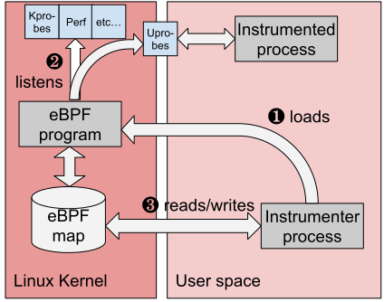

OpenTelemetry libraries provide telemetry collection for popular programming
languages and frameworks. However, getting started with distributed tracing can
be complex. In some compiled languages like Go or Rust, you must manually add
tracepoints to the code.

OpenTelemetry eBPF Instrumentation (OBI) is an auto-instrumentation tool to
easily get started with Application Observability. OBI uses eBPF to
automatically inspect application executables and the OS networking layer, and
capture trace spans, Rate Errors Duration (RED) metrics, runtime metrics, and
application and network relationships for supported Linux workloads. All data
capture occurs without any modifications to application code or configuration.

OBI offers the following features:

- **Wide language support**: Java (JDK 8+), .NET, Go, Python, Ruby, Node.js, C,
  C++, and Rust
- **Lightweight**: No code changes required, no libraries to install, no
  restarts needed
- **Efficient instrumentation**: Traces and metrics are captured by eBPF probes
  with minimal overhead
- **Distributed tracing**: Distributed trace spans are captured and reported to
  a collector
- **Log enrichment**: Enrich JSON and plain-text logs with trace context for
  correlation
- **Kubernetes-native**: Provides configuration-free auto-instrumentation for
  Kubernetes applications
- **Visibility into encrypted communications**: Capture transactions over
  TLS/SSL without decryption
- **Context propagation**: Propagate trace context across services automatically
- **Protocol support (client and server)**: HTTP/S, HTTP/2, gRPC, Kafka, NATS,
  MQTT, Memcached, SunRPC (including NFS), and JSON-RPC
- **Protocol support (client only)**: AMQP 1.0 and DNS queries
- **Database instrumentation (client and server)**: PostgreSQL (including the
  pgx driver), MySQL, MSSQL, and Redis
- **Database instrumentation (client only)**: MongoDB, Couchbase (N1QL/SQL++ and
  KV protocol), Aerospike, Elasticsearch, and OpenSearch
- **HTTP payload instrumentation**: Server-side GraphQL and client-side
  Elasticsearch, OpenSearch, and AWS S3, SQS, and SNS, plus MCP over JSON-RPC on
  both clients and servers
- **GenAI instrumentation**: Trace and metrics for OpenAI, OpenAI-compatible
  gateways, Ollama, Anthropic Claude, Google AI Studio (Gemini), AWS Bedrock,
  Qwen (DashScope), MCP over JSON-RPC, embedding and rerank APIs, and vector
  retrieval systems
- **Runtime metrics**: Collect Go, JVM, .NET, Node.js, and Python runtime
  metrics without SDK changes
- **GPU instrumentation**: Capture supported CUDA runtime operations on Linux
- **Span and service graph metrics**: Export application span metrics and
  service-to-service relationships
- **Low cardinality metrics**: Prometheus-compatible metrics with low
  cardinality for cost reduction
- **Network observability**: Capture network flows between services with byte
  and packet counters, TCP RTT, retransmit, connection, and socket I/O metrics
- **Enhanced service discovery**: Improved service name lookup with DNS
  resolution
- **Collector integration**: Run OBI as an OpenTelemetry Collector receiver
  component

## Stability

OBI v1.0.0 is the first stable release. It guarantees compatibility for:

- The public Go API of
  [`go.opentelemetry.io/obi`](https://github.com/open-telemetry/opentelemetry-ebpf-instrumentation/blob/v1.0.0/VERSIONING.md#go-module-api).
- Config v2, its generated schema, and the supported subset of OpenTelemetry
  declarative configuration.
- Documented CLI flags, environment variables, release binaries, and container
  image behavior.
- Telemetry classified as `stable`, in both OTLP and built-in Prometheus output.
- Supported environments and the documented upgrade and deprecation rules.

Changes that break these guarantees require a new major version. Minor releases
can add compatible functionality, and patch releases preserve compatibility. See
the
[release notes](https://github.com/open-telemetry/opentelemetry-ebpf-instrumentation/releases/tag/v1.0.0)
and
[versioning policy](https://github.com/open-telemetry/opentelemetry-ebpf-instrumentation/blob/v1.0.0/VERSIONING.md#compatibility-and-release-rules-after-v1).

The [Collector receiver](configure/collector-receiver/) is versioned separately
on a v0 release line. Telemetry and attributes not marked `stable` can still
change, as can network flow attribute names while their semantic conventions are
being aligned. See [telemetry stability](metrics/#stability).

## Upgrade to v1.0.0

- Use [Config v2](configure/config-v2/). Config v1 remains supported, but
  receives no bug fixes or new features. Follow the
  [migration guide](configure/migrate-to-config-v2/) and test the migrated
  configuration on one instance before rolling it out.
- The Collector receiver remains at `v0.15.2`; select core `v1.0.0` separately.
  See [Collector receiver setup](configure/collector-receiver/).
- The telemetry schema URL changes from `0.15.2` to `1.0.0`. The schema keeps
  earlier transformations and adds no new renames. See
  [telemetry stability](metrics/#stability) for schema limitations.

When upgrading from v1.0.0-rc.1 or a release before v0.15.2, review the
[v0.15.2 release notes](https://github.com/open-telemetry/opentelemetry-ebpf-instrumentation/releases/tag/v0.15.2)
for changes to span names, default metric attributes, Prometheus labels, and Go
configuration APIs. If upgrading from a release before v0.14.0, also review the
[v0.14.0 release notes](https://github.com/open-telemetry/opentelemetry-ebpf-instrumentation/releases/tag/v0.14.0).
Check the [known operational limitations](#limitations) during rollout.

If you want to explore the upstream examples, see the
[NGINX walkthrough](https://github.com/open-telemetry/opentelemetry-ebpf-instrumentation/tree/v1.0.0/examples/nginx)
and the
[Apache walkthrough](https://github.com/open-telemetry/opentelemetry-ebpf-instrumentation/tree/v1.0.0/examples/apache).

## How OBI works

The following diagram shows the high-level OBI architecture and where eBPF
instrumentation fits into the telemetry pipeline.

## Compatibility

OBI supports Linux environments that meet the following requirements:

| Requirement      | Supported                                                             |
| :--------------- | :-------------------------------------------------------------------- |
| CPU architecture | `amd64`, `arm64`                                                      |
| Linux kernel     | `5.8+`, or RHEL-family Linux `4.18+` with the required eBPF backports |
| Kernel features  | BTF                                                                   |
| Privileges       | Root, or the Linux capabilities required by the enabled OBI features  |

OBI publishes the following supported release artifacts:

| Artifact                                            | Supported platforms          |
| :-------------------------------------------------- | :--------------------------- |
| `obi` binary archive                                | Linux `amd64`, Linux `arm64` |
| `otel/ebpf-instrument` container image              | Linux `amd64`, Linux `arm64` |
| `otel/opentelemetry-ebpf-k8s-cache` container image | Linux `amd64`, Linux `arm64` |

OBI can be deployed on standalone Linux hosts, in containers, and on Kubernetes
when the environment meets the requirements above.

The
[support matrix](https://github.com/open-telemetry/opentelemetry-ebpf-instrumentation/blob/v1.0.0/SUPPORT_MATRIX.md)
defines the supported environments and feature-specific requirements.

OBI does not support non-Linux operating systems, Linux architectures other than
`amd64` and `arm64`, Linux environments without BTF, or kernel versions earlier
than Linux `5.8` outside the documented RHEL-family `4.18+` exception.

Feature-specific support details are documented in these guides:

- [Distributed traces](distributed-traces/): context propagation support,
  runtime-specific requirements, and distributed tracing limitations
- [Trace context association](context-propagation/): parent-child association
  support for asynchronous and threaded request handling
- [Export data](configure/export-data/): protocol, database, messaging, GenAI,
  GPU, and Go library instrumentation support

## Limitations

OBI provides application and protocol observability without code changes, but it
does not replace language-level instrumentation in every scenario. Use language
agents or manual instrumentation when you need custom spans,
application-specific attributes, business events, or other in-process telemetry
that eBPF-based instrumentation cannot derive automatically.

OBI can automatically capture network and protocol activity, but it cannot
always recover application-specific details that are not visible from eBPF
observation points.

Some features also have additional caveats or narrower support than the core
platform requirements. For details, refer to the feature-specific documentation
for [distributed traces](distributed-traces/) and
[exported instrumentation](configure/export-data/).

Known limitations and unresolved reports include:

- Application metrics can remain missing after a Kubernetes Pod starts or
  restarts. Restarting OBI can restore them. See
  [missing application metrics](troubleshooting/#missing-application-metrics-after-a-pod-restart).
- A user
  [reported child span timestamps earlier than parent timestamps](https://github.com/open-telemetry/opentelemetry-ebpf-instrumentation/issues/2568)
  with OBI v0.9.0/v0.10.0 on OpenShift 4.16. See the
  [reported conditions](troubleshooting/#reported-span-timestamp-anomalies).
- Service graphs can show `outgoing` destinations or separate Kubernetes and
  OpenTelemetry names for the same service when OBI cannot resolve its metadata.
  See [service graph limitations](metrics/#service-graph-limitations).

For a comprehensive list of capabilities required by OBI, refer to
[Security, permissions and capabilities](security/).

## Get started with OBI

- Follow the [setup](setup/) documentation to get started with OBI either with
  Docker or Kubernetes.
- Learn about [trace-log correlation](./trace-log-correlation/) to connect
  traces with application logs and enrich JSON logs with trace context.
- Discover how to run
  [OBI as a Collector receiver](./configure/collector-receiver/) for centralized
  telemetry processing.

## Troubleshooting

- See the [troubleshooting](./troubleshooting) guide for help with common
  issues.
