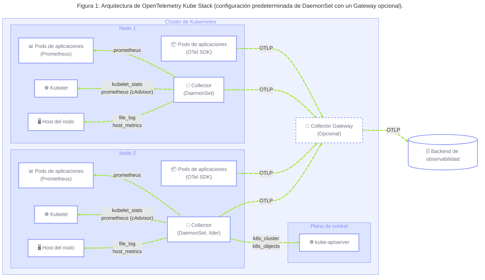

## Resumen {#summary}

Este blueprint ofrece una referencia para los equipos de Platform Engineering y
SRE responsables de proporcionar infraestructura de observabilidad en clústeres
de Kubernetes. Abarca dos áreas: el uso de recursos y el estado operativo de las
cargas de trabajo, y la salud de los componentes críticos de Kubernetes (DNS,
redes, ingress).

Al implementar los patrones de este blueprint, las organizaciones pueden
obtener:

- Visibilidad inmediata del uso de recursos de las cargas de trabajo, los
  eventos de falta de memoria (OOM), los fallos de las sondas y el estado del
  ciclo de vida de los pods, sin cambios en las aplicaciones.
- Una vía para monitorizar de forma fiable los componentes críticos de
  Kubernetes (CoreDNS, plugins de CNI, controladores de Ingress, KEDA, etc.).
- Enriquecimiento uniforme de metadatos mediante las convenciones semánticas de
  OTel, que permite investigar de forma correlacionada métricas, logs y trazas.
- Automonitorización de la infraestructura de recopilación de telemetría para
  detectar lagunas de datos silenciosas antes de que afecten a la respuesta a
  incidentes.

## Contexto {#background}

Los clústeres de Kubernetes alojan dos clases de entidades observables:

1. Las **cargas de trabajo** son los contenedores de aplicaciones y las
   primitivas de Kubernetes (Statefulset, Deployment, Daemonset, ReplicaSet,
   etc.) que los gestionan. Emiten señales mediante los SDK de OTel, pero su
   utilización de recursos y su estado operativo (limitación de CPU,
   terminaciones por OOM, fase del pod, resultados de las sondas) solo son
   visibles mediante las API específicas de Kubernetes. Además, algunos de estos
   componentes, como los pods y los contenedores, se gestionan a nivel de nodo,
   mientras que otros, como los estados de ReplicaSet y los HPA, se gestionan a
   nivel de clúster o plano de control.
2. Los **componentes críticos de infraestructura** incluyen CoreDNS, plugins de
   CNI, controladores de Ingress, subsistemas de volúmenes, KEDA y servicios de
   plataforma similares. Por lo general, son responsabilidad del equipo de
   plataforma, exponen métricas de Prometheus de forma nativa y requieren
   configuraciones de recopilación específicas.

Este blueprint se centra en _qué_ recopilar y _cómo etiquetarlo_. Solo se hace
referencia a la topología de las canalizaciones del Collector cuando es
necesario para observar componentes específicos de Kubernetes; las
recomendaciones sobre topologías del Collector para tu propia telemetría se
documentan por separado en el
[blueprint de plataformas de telemetría gestionadas](/docs/guidance/blueprints/managed-telemetry-platforms-for-k8s-workloads/).

## Desafíos comunes {#common-challenges}

### 1. La telemetría de las cargas de trabajo está incompleta {#1-workload-telemetry-is-incomplete}

El código de las aplicaciones no emite la limitación de CPU, las terminaciones
por OOM, las transiciones de fase de los pods ni los fallos de las sondas. Solo
se puede acceder a ellos mediante el servidor de la API de Kubernetes, y los
equipos de plataforma deben recopilarlos explícitamente.

Esto provoca:

- **Presión sobre los recursos invisible**: la limitación de CPU a nivel de
  cgroup solo se manifiesta como un aumento de la latencia, sin atribución a la
  infraestructura.
- **Las terminaciones por OOM parecen fallos de la aplicación**: sin una señal
  OOM correlacionada, los operadores no pueden distinguir una configuración de
  memoria incorrecta de un error de la aplicación.
- **No se puede distinguir entre limitación y OOM**: ambos provocan reinicios de
  pods. Sin señales de reinicios de contenedores y del motivo de la última
  terminación (`k8s.container.restarts` del servidor de la API), correlacionadas
  con métricas de CPU y memoria del kubelet, no hay una base para aplicar
  medidas correctivas.

### 2. Los metadatos son inconsistentes entre señales y capas {#2-metadata-is-inconsistent-across-signals-and-layers}

Cada recopilador de métricas añade esquemas de etiquetas diferentes (`pod_name`,
`pod`, `kubernetes_namespace`, `namespace`). Los atributos de las convenciones
semánticas de OTel (`k8s.pod.name`, `k8s.namespace.name`) no se aplican
automáticamente.

Esto provoca:

- **Telemetría de infraestructura desconectada de la telemetría de las
  aplicaciones**: aumenta la carga cognitiva de los operadores al investigar si
  un problema se debe a la aplicación o al contenedor, o a la infraestructura o
  los recursos.
- **Las reglas de alerta dejan de funcionar silenciosamente al cambiar de
  recopilador**: una alerta escrita para `pod_name` deja de encontrar
  coincidencias cuando un nuevo recopilador utiliza `pod`.
- **Falta de contexto organizativo**: las etiquetas de equipo responsable,
  entorno y nivel de las anotaciones de los pods rara vez están presentes en la
  telemetría, por lo que el enrutamiento de alertas y la atribución de costos se
  realizan manualmente.

### 3. Los componentes críticos del clúster no son observables de forma predeterminada {#3-critical-cluster-components-are-not-observable-by-default}

CoreDNS, los plugins de CNI, los controladores de Ingress, KEDA, cert-manager
**y muchos otros** exponen métricas sin un mecanismo de descubrimiento estándar.

Algunas consecuencias son:

- **Los picos de latencia del DNS parecen problemas de las aplicaciones**: las
  ralentizaciones de CoreDNS se manifiestan como tiempos de espera agotados en
  los componentes que realizan las solicitudes, indistinguibles de un servicio
  dependiente lento sin una métrica de la capa DNS.
- **Los descartes de paquetes de CNI no se atribuyen a su origen**: los paquetes
  descartados en la capa de políticas de red se manifiestan como fallos
  intermitentes de conectividad de los pods, sin atribución a la capa de red.
- **Los fallos de KEDA dejan silenciosamente las cargas de trabajo con recursos
  insuficientes**: un componente de escalado que no puede acceder a su métrica
  de origen deja de escalar automáticamente sin producir ningún error visible
  para el usuario.

### 4. La infraestructura de recopilación de telemetría carece de automonitorización {#4-telemetry-collection-infrastructure-has-no-self-monitoring}

Las lagunas silenciosas en las canalizaciones del Collector y de los SDK
—recopiladores que fallan, errores de exportación y pérdidas de datos por
contrapresión— se abordan en el
[desafío 5](/docs/guidance/blueprints/managed-telemetry-platforms-for-k8s-workloads/#challenge-5)
del blueprint de
[plataformas de telemetría gestionadas para cargas de trabajo en Kubernetes](/docs/guidance/blueprints/managed-telemetry-platforms-for-k8s-workloads/).

## Recomendaciones generales {#general-guidelines}

### 1. Utiliza receptores nativos de OTel para recopilar señales de las cargas de trabajo y de la infraestructura {#1-use-otel-native-receivers-to-collect-workload-and-infrastructure-signals}

**Desafíos abordados:** 1, 2

Este blueprint recomienda utilizar receptores nativos de OTel:

| Componente de OpenTelemetry Collector | Preajuste del chart de Helm | Componente equivalente de Prometheus/Kubernetes | Qué abarca                                                                                                                                                          |
| ------------------------------------- | --------------------------- | ----------------------------------------------- | ------------------------------------------------------------------------------------------------------------------------------------------------------------------- |
| **Receptor** `k8s_cluster`            | `clusterMetrics`            | `kube-state-metrics`                            | Métricas de objetos y estados de Kubernetes obtenidas de su API, como pods, nodos, espacios de nombres, cargas de trabajo, cuotas y condiciones.                    |
| **Receptor** `kubeletstats`           | `kubeletMetrics`            | **Métricas de cAdvisor / kubelet**              | Fuente preferida para las métricas de recursos de CPU, memoria y volúmenes de nodos, pods y contenedores obtenidas del kubelet.                                     |
| **Receptor** `hostmetrics`            | `hostMetrics`               | `node-exporter` (parcial)                       | Métricas del sistema operativo del host que `kubeletstats` no abarca, como métricas de procesos, sistemas de archivos, E/S de disco, red, carga y paginación.       |
| **Receptor** `filelog`                | `logsCollection`            | Fluent Bit / agentes de logs de nodos           | Las salidas stdout/stderr de los contenedores que el entorno de ejecución escribe en `/var/log/pods/*/*/*.log`. Recopílalas una vez por nodo mediante un DaemonSet. |
| **Receptor** `k8s_objects`            | `kubernetesObjects`         | N/A                                             | Estado de los recursos de objetos de Kubernetes (consulta periódica y/o seguimiento de cambios) como logs del servidor de la API.                                   |
| **Receptor** `k8s_events`             | `kubernetesEvents`          | N/A                                             | Eventos del clúster a medida que ocurren (desalojo, OOM, etc.).                                                                                                     |

Resultados:

- Cobertura completa de recursos a nivel de carga de trabajo (limitación, OOM,
  fase del pod, fallos de sondas) sin cambios en el código de las aplicaciones.

### 2. Aplica un enriquecimiento uniforme de metadatos mediante las convenciones semánticas de OpenTelemetry {#2-apply-uniform-metadata-enrichment-using-opentelemetry-semantic-conventions}

**Desafíos abordados:** 2

La telemetría que llega al backend debe incluir atributos de recursos de
Kubernetes de OTel consistentes para poder relacionar las señales sin reasignar
atributos. La forma de obtener esos metadatos depende de la fuente:

- Los **receptores de Kubernetes nativos de OTel** (`k8s_cluster`,
  `kubeletstats`, `k8s_objects`, `k8s_events`) ya emiten los atributos de
  identidad principales (`k8s.pod.name`, `k8s.namespace.name`, `k8s.node.name`,
  los UID de las cargas de trabajo y otros similares). Utiliza preferentemente
  los atributos integrados de estos receptores en lugar de volver a derivarlos.
- La **telemetría OTLP de las aplicaciones y la recopilada mediante Prometheus**
  suele carecer de ese contexto: enriquécela con `k8sattributesprocessor`, que
  asocia los datos a los pods y añade atributos estándar `k8s.`*.
- Los receptores de infraestructura no emiten las **etiquetas y anotaciones
  organizativas** (equipo, entorno, nivel); extráelas con `extract.labels` /
  `extract.annotations` de `k8sattributesprocessor` cuando las necesites en
  señales de aplicaciones o de pods.

Resultados:

- Las métricas, los logs y las trazas se relacionan mediante atributos
  consistentes, sin reasignaciones por consulta.
- Se siguen las convenciones semánticas de OpenTelemetry, lo que facilita la
  adopción de herramientas de observabilidad.

### 3. Utiliza el operador de OpenTelemetry como plano de control del Collector y recopila los objetivos de Prometheus localmente en cada nodo {#3-use-the-opentelemetry-operator-as-the-collector-control-plane-and-scrape-prometheus-targets-node-locally}

**Desafíos abordados:** 3

El OpenTelemetry Operator debe gestionar todos los Collectors de OTel del
clúster. La CRD `OpenTelemetryCollector` declara la configuración del Collector
como un objeto de Kubernetes, lo que permite flujos de trabajo de GitOps,
despliegues versionados y los modos de despliegue de este blueprint:
**DaemonSet** para la recopilación por nodo y, opcionalmente, **Deployment**
para el trabajo a nivel de clúster cuando no se dispone de elección de líder.

La recopilación de métricas de componentes del clúster nativos de Prometheus
(CoreDNS, plugins de CNI, controladores de Ingress, KEDA, cert-manager y
endpoints `/metrics` similares) **no** requiere el Target Allocator. Cada pod
del Collector del DaemonSet debe descubrir y recopilar únicamente los objetivos
de **su propio nodo**, mediante el descubrimiento de servicios de pods de
Kubernetes filtrado por `spec.nodeName` (kube-stack inyecta
`${OTEL_K8S_NODE_NAME}` en los Collectors del DaemonSet). Los pods habilitan la
recopilación mediante las anotaciones clásicas de Prometheus
(`prometheus.io/scrape=true` y, opcionalmente, `prometheus.io/port`,
`prometheus.io/path` y `prometheus.io/scheme`).

Dado que cada pod reside en un único nodo, cada objetivo se recopila mediante
una única réplica del Collector. Esto significa que no hay una lista de
objetivos de todo el clúster, ni Target Allocator, ni recopilación duplicada por
trabajos de ServiceMonitor/PodMonitor que se solapan. No combines este patrón de
DaemonSet con Target Allocator (ni con ninguna otra recopilación a nivel de
clúster) para los mismos endpoints.

El Operator también incorpora la CRD `Instrumentation` para inyectar
instrumentación automática sin código. Aunque queda fuera del alcance de este
documento, hace que el Operator sea la dependencia fundamental adecuada para
toda la pila de observabilidad del clúster.

Resultados:

- Cada objetivo de Prometheus se recopila exactamente una vez, mediante el
  Collector del nodo donde se ejecuta el objetivo.
- El ciclo de vida del Collector se gestiona automáticamente con recuperación
  automática.

## Implementación {#implementation}

El siguiente diagrama muestra la arquitectura resultante con los valores
predeterminados del chart: un Collector de DaemonSet por nodo, receptores
locales en cada nodo y receptores a nivel de clúster que se ejecutan únicamente
en el líder elegido.

El diagrama muestra un Collector Gateway opcional, fuera del alcance de este
blueprint. Consulta el blueprint de
[plataformas de telemetría gestionadas para cargas de trabajo en Kubernetes](/docs/guidance/blueprints/managed-telemetry-platforms-for-k8s-workloads/)
para obtener más información sobre el patrón de Collector Gateway para la
telemetría de las aplicaciones.

### 1. Despliega opentelemetry-kube-stack {#1-deploy-the-opentelemetry-kube-stack}

**Recomendaciones aplicadas:** 1, 2, 3

Despliega el
[chart de Helm](https://github.com/open-telemetry/opentelemetry-helm-charts/tree/main/charts/opentelemetry-kube-stack)
`opentelemetry-kube-stack` como base de este blueprint. El chart instala el
[OpenTelemetry Operator](/docs/platforms/kubernetes/operator/) junto con un
conjunto de Collectors gestionados como CR de `OpenTelemetryCollector`, por lo
que no necesitas instalaciones separadas de los charts `opentelemetry-operator`
y `opentelemetry-collector`.

De forma predeterminada, el chart despliega un Collector de **DaemonSet** con
los preajustes que utiliza este blueprint (`hostMetrics`, `kubeletMetrics`,
`kubernetesAttributes`, `kubernetesEvents` y `clusterMetrics`, `logsCollection`,
entre otros). Las métricas de todo el clúster utilizan la elección de líder en
ese DaemonSet para que solo una réplica las emita; si no se puede utilizar la
elección de líder, usa la
[alternativa sin elección de líder](https://github.com/open-telemetry/opentelemetry-helm-charts/tree/main/charts/opentelemetry-kube-stack/examples/no-leader-election-extension)
del chart, que separa la recopilación a nivel de clúster. El mismo DaemonSet
recopila métricas de componentes nativos de Prometheus en el nodo local (paso 6
de la implementación).

En lugar de escribir manualmente la configuración de receptores, procesadores y
RBAC, configura la recopilación mediante los **preajustes** del chart en
`collectors.*`. Cada preajuste incorpora el receptor o procesador
correspondiente a la canalización y genera las configuraciones de RBAC, los
volúmenes y los montajes necesarios. Los pasos restantes son fragmentos de
`values.yaml` para este chart.

### 2. Recopila métricas del estado del clúster con el preajuste `clusterMetrics` {#2-collect-cluster-state-metrics-with-the-clustermetrics-preset}

**Recomendaciones aplicadas:** 1, 2

El
[receptor](/docs/platforms/kubernetes/collector/components/#kubernetes-cluster-receiver)
`k8s_cluster` proporciona el estado de los objetos (fase del pod, número de
reinicios, estado de las réplicas, condiciones de los nodos) mediante el
seguimiento de la API de Kubernetes: es el sustituto nativo de OTel para
`kube-state-metrics`. No proporciona el consumo de recursos, que proviene del
kubelet (paso 3 de la implementación).

Como el receptor recopila telemetría de todo el clúster, solo una réplica del
Collector debe emitirla. Con `opentelemetry-kube-stack`, habilita el
[preajuste](/docs/platforms/kubernetes/helm/collector/#cluster-metrics-preset)
`clusterMetrics` en el Collector de DaemonSet
(`collectors.daemon.presets.clusterMetrics`); la elección de líder garantiza que
una única réplica produzca los datos. Si no se dispone de elección de líder,
utiliza el Collector de clúster separado del chart. El preajuste añade
automáticamente el receptor `k8s_cluster` y la configuración de RBAC necesaria.

Esto emite equivalentes nativos de OTel como `k8s.pod.phase`,
`k8s.container.restarts`, `k8s.deployment.available`/`k8s.deployment.desired`,
`k8s.node.condition_ready`, `k8s.pod.status_reason` y
`k8s.container.status.reason`. Aunque son opcionales, las métricas del motivo
del estado son especialmente importantes para comprender por qué puede estar
fallando un pod. Consulta la
[documentación de métricas opcionales del receptor](https://github.com/open-telemetry/opentelemetry-collector-contrib/blob/main/receiver/k8sclusterreceiver/documentation.md#optional-metrics)
`k8s_cluster` para saber cómo habilitarlas.

### 3. Prioriza `kubeletstats` para el uso de recursos; utiliza `hostmetrics` solo para cubrir carencias {#3-prefer-kubeletstats-for-resource-usage-use-hostmetrics-only-for-gaps}

**Recomendaciones aplicadas:** 1, 2

Tanto el
[receptor](/docs/platforms/kubernetes/collector/components/#kubeletstats-receiver)
`kubeletstats` como el
[receptor](/docs/platforms/kubernetes/collector/components/#host-metrics-receiver)
`hostmetrics` pueden informar sobre la CPU y la memoria de los nodos. Prioriza
`kubeletstats` para el uso de recursos de nodos, pods y contenedores, ya que es
la fuente alineada con kubelet/cAdvisor y evita duplicar las mismas series de
CPU y memoria de `hostmetrics`. Habilítalo en el Collector de **DaemonSet** de
kube-stack (`collectors.daemon.presets.kubeletMetrics`) con
`metric_groups: [node, pod, container]`.

Utiliza el
[preajuste](/docs/platforms/kubernetes/helm/collector/#host-metrics-preset)
`hostmetrics` solo para las señales que el
[preajuste](/docs/platforms/kubernetes/helm/collector/#kubelet-metrics-preset)
`kubeletstats` no puede proporcionar: normalmente métricas de procesos, además
de sistemas de archivos, E/S de disco, red, carga y paginación a nivel de host.
Cuando ambos preajustes estén habilitados, deshabilita los recopiladores `cpu` y
`memory` de `hostmetrics` que se solapan para que esas métricas provengan
únicamente de `kubeletstats`.

Importante: para garantizar la cobertura de los nodos del plano de control y de
los nodos con taints (GPU, spot), añade tolerancias al DaemonSet para recopilar
métricas de todos los nodos. Cualquier nodo sin un pod del Collector supone una
carencia de cobertura.

### 4. Recopila eventos y estados de objetos de Kubernetes con el receptor `k8s_objects` {#4-collect-kubernetes-events-and-object-state-with-the-k8s_objects-receiver}

**Recomendaciones aplicadas:** 1, 2

El receptor `k8s_objects` recopila datos de la API de Kubernetes como logs.
Utilízalo para dos señales complementarias:

- **Eventos** del
  [preajuste](/docs/platforms/kubernetes/helm/collector/#kubernetes-events-preset)
  `kubernetesEvents`: observa los eventos del clúster a medida que ocurren,
  incluidos fallos de planificación, fallos de sondas, terminaciones por OOM,
  errores de conexión de volúmenes y señales operativas similares que las
  métricas por sí solas suelen omitir.
- **Estado de los recursos de objetos** del
  [preajuste](/docs/platforms/kubernetes/collector/components/#kubernetes-objects-receiver)
  `kubernetesObjects`: consulta periódicamente (y, opcionalmente, realiza un
  seguimiento de los cambios de) objetos de Kubernetes como pods, deployments,
  nodos y recursos relacionados para conservar su historial de estados como
  logs.

Importante: ambas señales deben ejecutarse como un Deployment de una sola
réplica. Utiliza la elección de líder para obtener resiliencia con varias
réplicas, si es necesario.

### 5. Utiliza `k8sattributesprocessor` para enriquecer la telemetría con etiquetas organizativas obligatorias y opcionales {#5-use-k8sattributesprocessor-to-enrich-telemetry-with-required-and-optional-organizational-labels}

**Recomendaciones aplicadas:** 2

El
[preajuste](/docs/platforms/kubernetes/helm/collector/#kubernetes-attributes-preset)
`kubernetesAttributes` enriquece la telemetría con metadatos relevantes de
Kubernetes. Algunos de ellos son necesarios para una observabilidad adecuada,
como `k8s.pod.name`, `k8s.namespace.name` y `k8s.node.name`.

Configura `extract.labels` / `extract.annotations` explícitamente para las
claves organizativas que te interesen, como `team`, `squad`, `owner`, etc. Si no
se puede resolver `k8s.cluster.name` a partir de los metadatos de la nube,
inyéctalo como atributo estático del recurso mediante `resourceprocessor` o
establece `clusterName` en los valores de kube-stack.

Importante: nunca utilices una etiqueta personalizada cuando las
[convenciones semánticas de K8s](/docs/specs/semconv/resource/k8s/) ya ofrezcan
una opción para ella.

### 6. Recopila métricas de componentes nativos de Prometheus en cada nodo mediante el modo DaemonSet {#6-scrape-prometheus-native-components-on-each-node-via-daemonset-mode}

**Recomendaciones aplicadas:** 3

Los objetivos de recopilación configurados manualmente para todo el clúster en
el
[receptor de Prometheus](https://github.com/open-telemetry/opentelemetry-collector-contrib/blob/main/receiver/prometheusreceiver/README.md#getting-started)
son propensos a la recopilación duplicada, lo que infla los valores de las
métricas y las vuelve poco fiables. El Target Allocator resuelve este problema
al distribuir los objetivos entre las réplicas del Collector, pero es
innecesario cuando todos los Collectors ya se ejecutan como un DaemonSet y el
descubrimiento se limita al mismo nodo donde se ejecuta cada Collector.

La implementación recomendada es el patrón de DaemonSet de
[opentelemetry-kube-stack](https://github.com/open-telemetry/opentelemetry-helm-charts/tree/main/charts/opentelemetry-kube-stack):
el receptor de Prometheus utiliza el descubrimiento de servicios de pods de
Kubernetes restringido al nodo local (`spec.nodeName=${OTEL_K8S_NODE_NAME}`).
Cada pod del Collector recopila únicamente los pods con anotaciones en ese nodo.
Un pod reside en un único nodo, por lo que se recopila una sola vez.

De forma predeterminada, kube-stack carga
`collectors.daemon.scrape_configs_file: daemon_scrape_configs.yaml`, que ya
incluye un trabajo para pods con `prometheus.io/scrape=true`. Para obtener el
mismo comportamiento sin el archivo de recopilación, establece
`scrape_configs_file: ""` y habilita
`collectors.daemon.presets.prometheus.podAnnotations`. Esos preajustes son
mutuamente excluyentes con `scrape_configs_file` y requieren `mode: daemonset`.

Asegúrate de que los componentes críticos del clúster (CoreDNS, plugins de CNI,
controladores de Ingress, KEDA, cert-manager y similares) expongan un endpoint
`/metrics` y tengan la anotación `prometheus.io/scrape=true`. **No** recopiles
también esos mismos endpoints con Target Allocator, ServiceMonitor o PodMonitor:
el descubrimiento solapado es lo que vuelve a introducir la recopilación
duplicada.

## Implementaciones de referencia {#reference-implementations}

> Si tienes una arquitectura de OpenTelemetry de nivel de producción que
> implementa este blueprint y quieres que aparezca en esta página, ¡abre un
> issue en el
> [repositorio del SIG de usuarios finales](https://github.com/open-telemetry/sig-end-user/issues)!
