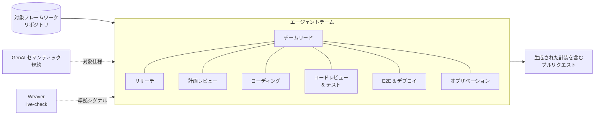
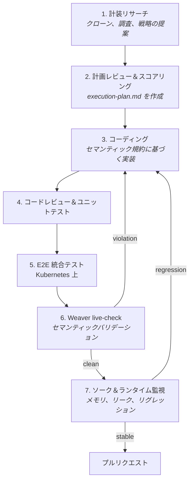

GenAI フレームワークの計装は、適切な拡張ポイントを見つけ、フレームワークの操作を OpenTelemetry セマンティック規約にマッピングし、結果をテストし、フレームワークの変更に合わせて保守することを意味します。
新しいフレームワークごとにこれを行うには、多大なエンジニアリング時間がかかります。

私たちは、エージェントチームがこの作業の大部分を担えるかどうかをテストしてきました。
エージェントはフレームワークを調査し、計画を提案し、[GenAI 向け OpenTelemetry セマンティック規約](/docs/specs/semconv/gen-ai/)に基づいて実装し、[OpenTelemetry Weaver](https://github.com/open-telemetry/weaver) を使用して出力されたテレメトリーをチェックします。
エンジニアは計画と結果のプルリクエストをレビューします。

## なぜ計装を自動化するのか {#why-automate-instrumentation}

経験豊富なコントリビューターでも、フレームワークの計装に数日かかることがあります。
実装によって属性、単位、スパン境界の選択が異なることもあり、フレームワーク間でテレメトリーのクエリが難しくなります。
エージェントは反復的な調査と実装作業を支援できます。
GenAI セマンティック規約と Weaver が共通の仕様と出力をチェックする手段を提供します。

## 構成要素 {#the-pieces}

このシステムは、GenAI セマンティック規約、Weaver、オーケストレーターを使用します。

**GenAI セマンティック規約**は動作の保証を定義します。
スパン名、属性名、単位、モデル・トークン・メッセージ・ツール呼び出しを運ぶフィールドを定めます。
生成されるプラグインはこれらの定義に従う必要があります。

**Weaver** はバリデーターです。
私たちはその [live-check](https://github.com/open-telemetry/weaver/tree/v0.25.1/crates/weaver_live_check) 機能に依存しています。
これは OTLP リスナーを起動し、実行中の計装が出力するテレメトリーを一連の _advisor_ に通して、解決済みのセマンティック規約レジストリと比較します。
組み込みの advisor は基本項目をカバーし（`missing_attribute`、`type_mismatch`）、デフォルトの OTel Rego ポリシーが命名やフォーマットのルールを追加します。
`--advice-policies` で独自のポリシーを追加することも可能です。
すべての検出事項にはレベル（`violation`、`improvement`、`information`）が付与され、レポートに violation が含まれる場合、Weaver は非ゼロの終了コードで終了します。

**オーケストレーション層**はエージェントをスケジュールし、結果のプルリクエストを投稿します。
私たちはセルフホストのマルチエージェントタスクプラットフォームを使用していますが、オーケストレーターに必要なのはリポジトリをチェックアウトし、エージェントを実行し、プルリクエストを開くことだけです。

## アーキテクチャ {#architecture}

フレームワークリポジトリ（例: [LangChain](https://github.com/langchain-ai/langchain)）が与えられると、システムはそのフレームワーク用の計装を含むプルリクエストを開きます。



## エージェントチーム {#the-agent-team}

オーケストレーターは、リサーチ、計画、コーディング、テスト、バリデーションの各エージェントに担当を割り当てます。

- **チームリードエージェント** — 実行を初期化し、他のエージェントを順序付けし、ループの状態を管理します。
- **計装リサーチエージェント** — 対象フレームワークをクローンし、アーキテクチャを調査し、まずフックやコールバックなどの公開拡張ポイントを探します。
  既存の実装を調査し、候補となる計装戦略をリストアップしたリサーチレポートを作成します。
  メソッドラッピングは、それらの拡張ポイントが必要なライフサイクルを観測できない場合にのみ検討します。
- **計画レビューエージェント** — 候補を複雑さ、保守性、カバレッジの観点でスコアリングし、最適なものを選択し、どの拡張ポイントを使用するか、各属性をどこから取得するかを指定する詳細な `execution-plan.md` を作成します。
  これは本質的に仕様生成のステップであり、人間がレビューする自然なポイントです。
- **コーディングエージェント** — 共有の GenAI ユーティリティを使用して、GenAI セマンティック規約に基づいて `execution-plan.md` を実装します。
- **コードレビュー＆テスト検証エージェント** — 生成されたコードをレビューし、ユニットテストを作成し、レビューが対応されテストが通るまでコーディングエージェントとやり取りを繰り返します。
- **E2E 生成＆デプロイエージェント** — コーディングと並行して実行し、プラグインの準備が整ったときにすぐ使えるよう統合テストハーネスを準備します。
- **オブザベーションエージェント** — Kubernetes 上でハーネスを実行し、OTLP 出力をキャプチャし、Weaver にセマンティックバリデーションを委ね、メモリリークやその他のランタイムリグレッションがないかワークロードを長期的に監視します。

## ループエンジニアリング {#loop-engineering}

チームリードエージェントが各ステップをスケジュールします。
他のエージェントは計画の変更が必要な場合、チームリードに制御を返すことができます。



コードレビューとユニットテストの後、フレームワークのサンプルをコンテナイメージにパッケージ化し、計装を追加し、テスト用の Kubernetes クラスターで実行します。
Weaver が出力された OTLP データをチェックします。
violation が見つかるとコーディングエージェントに差し戻され、パスするとメモリリークやその他のランタイムリグレッションのためのソークテストに進みます。
エンジニアはチームリードに割り込んで、計画の変更やステップの再実行を指示できます。

## 生成された計装の構成 {#what-the-generated-instrumentation-looks-like}

生成されるコードには、2つの選択が影響します。

1つ目は、`execution-plan.md` がコードを書く前に計装ポイントを固定することです。
コーディングエージェントにはメソッドをラップするよう指示されるのではなく、リサーチ段階で必要なライフサイクルをカバーできる場合は公開フックやコールバックが優先されます。
たとえば、OpenAI Agents SDK はライフサイクルフックを公開しているため、そちらの戦略が優先されます。
ここで示す CrewAI プラグインはバージョン 0.80 以降をサポートしており、そのバージョンでは公開コールバックがこれらのスパンに必要な完全な開始/終了ライフサイクルを公開していなかったため、計画はメソッドラッピングを選択しました。
新しい CrewAI リリースではより広範なイベントリスナー API が提供されているため、それらのバージョンでは、まずそのネイティブ API を評価すべきです。
ラッピング計画は、明示的でレビュー可能なターゲットのリストとして表示されます。

```python
_CREWAI_UNINSTRUMENT_TARGETS = (
    ("crewai.crew", "Crew", "kickoff"),
    ("crewai.crew", "Crew", "kickoff_async"),
    ("crewai.flow.flow", "Flow", "kickoff"),
    ("crewai.flow.flow", "Flow", "kickoff_async"),
    ("crewai.agent", "Agent", "execute_task"),
    ("crewai.task", "Task", "execute_sync"),
    ("crewai.tools.tool_usage", "ToolUsage", "_use"),
)
```

レビュアーはフレームワークの API に対してこれらのターゲットを確認できます。

2つ目は、エージェントがフレームワークオブジェクトを自分で属性名を書くかわりに共有の GenAI ユーティリティにマッピングすることです。
[`opentelemetry-util-genai`](https://github.com/open-telemetry/opentelemetry-python-genai) は現在、OpenTelemetry Python GenAI リポジトリの `util/opentelemetry-util-genai` に存在します。
その `handler.invoke_local_agent()` メソッドは、同じプロセス内で実行されるエージェントのための `AgentInvocation` を作成します。

以下の最小限のラッパーは、CrewAI の例をそのアップストリーム API に適応させたものであり、元の生成プラグインからの抜粋ではありません。
ここで、`wrapped` は元のバウンドメソッド `Agent.execute_task`、`instance` は CrewAI エージェント、`args` と `kwargs` はメソッドの引数です。
ラッパーの登録と SDK の設定は省略されています。

```python
from opentelemetry.util.genai.handler import get_telemetry_handler


def wrap_execute_task(wrapped, instance, args, kwargs):
    handler = get_telemetry_handler()
    with handler.invoke_local_agent(agent_name=instance.role) as invocation:
        if invocation.should_capture_content:
            invocation.agent_description = instance.goal
        return wrapped(*args, **kwargs)
```

このユーティリティは `INTERNAL` スパンを開始し、呼び出し中はそれをカレントにし、コンテキストマネージャーの終了時にスパンを終了します。
ラップされたメソッドが例外を発生させた場合、ユーティリティは失敗を記録し、例外をそのまま伝搬させます。
ラッパーはエージェントのゴールをコピーする前に `should_capture_content` をチェックします。
ゴールにはユーザー提供の指示が含まれている可能性があるためです。

共有ユーティリティは属性名とテレメトリーのライフサイクルを処理しますが、計装はフレームワークのデータを正しくマッピングする必要があります。
私たちはテストと人間によるレビュー、および Weaver のレジストリチェックでそれらのマッピングを検証しています。

元の生成プラグインは、[alibaba/loongsuite-python](https://github.com/alibaba/loongsuite-python) の以前のユーティリティパッケージへの拡張を使用しており、フォーク固有の `InvokeAgentInvocation` 型を含んでいました。
上記の例では、読者が OpenTelemetry のユーティリティから始められるよう、アップストリーム API を使用しています。
プラグインをこれらの API に移行する作業は、以下で説明するアップストリーム化の一部です。

## Weaver による出力の検証 {#verifying-the-output-with-weaver}

Weaver は出力された OTLP データを解決済みのセマンティック規約レジストリと比較します。

オブザベーションエージェントは Weaver を直接呼び出しません。
コンフォーマンスランナーを通じて実行を駆動します。
ランナーはシナリオを起動し、OTLP エンドポイントに接続し、出力されたデータを `weaver registry live-check` に渡します。
公開されている例として、[semantic-conventions-conformance](https://github.com/open-telemetry/semantic-conventions-conformance) リポジトリのルートから CrewAI/OpenInference シナリオを実行できます。

```sh
otel-conformance scenarios/gen-ai/python/crewai/openinference
```

その `conformance.yaml` はランナーと計装を指定します。

```yaml
runner: genai-conformance
instrumented_library: crewai
instrumentation_library: openinference-instrumentation-crewai
```

この公開シナリオは、LoongSuite プラグインではなく OpenInference でランナーを実演します。
`genai-conformance` ラッパーがセマンティック規約レジストリのピンとアドバイスポリシーを提供するため、繰り返し実行しても同じ定義が使用されます。

各シナリオはそれぞれ独自の live-check の下で実行され、violation が見つかると実行が失敗します。
これがデフォルトの動作です。
`--report-only` はオプトアウトであり、セマンティックな検出事項を警告にダウングレードしつつ、シナリオがクラッシュしたり測定対象が何もなかった場合には依然として失敗します。

LoongSuite プラグインでの別の実行では、サンプルエンティティから以下の検出事項が返されました。

```json
{
  "live_check_result": {
    "all_advice": [
      {
        "id": "span_status_ok_set_by_instrumentation",
        "context": { "status_code": "ok" },
        "message": "Span 'execute_tool ping' has status.code='ok'; instrumentations must leave status UNSET on success (OK is reserved for application code).",
        "level": "violation",
        "signal_type": "span",
        "signal_name": "execute_tool ping"
      }
    ],
    "highest_advice_level": "violation"
  }
}
```

ランナーのドメイン非依存のアドバイスポリシーは、スパンステータスを OK に設定した計装にフラグを立てます。
コーディングエージェントがツールスパンでそれを行いました。
Weaver の非ゼロの終了コードにより、検出事項が修正のために差し戻されました。

同じランナーは、プラグインが出力したレジストリ定義済み属性と出力していない属性を示すカバレッジマトリックスも生成します。
カバレッジは測定であってゲートではないため、それらの実行では `--report-only` を使用します。
属性の欠落は記録されますが、ビルド失敗にはなりません。


このマトリックスは、14 個の LoongSuite Python 計装にわたる 29 個の属性のカバレッジを示しています。
コミュニティの[ライブコンフォーマンスマトリックス](https://open-telemetry.github.io/semantic-conventions-conformance/?link-check=no&last-validated=2026-10-29#/signals/span%3Agen_ai.invoke_agent.internal)は公開シナリオ全体で同じシグナルを表示しますが、上記の LoongSuite プラグインは現在含まれていません。

これとは別に、Weaver live-check はエージェントが出力したがレジストリに定義されていない属性を `missing_attribute` violation として報告します。
既知の violation を一時的に受け入れる場合は、その検出事項の `id` と理由を `expected_violations` にリストします。
Weaver がその violation を報告しなくなった場合にも実行が失敗し、そのエントリが古くなっており削除すべきであることを通知します。
カバレッジはレジストリ定義済み属性のみをカウントするため、カスタム拡張はプラグインのスコアを上げません。
複数のフレームワークがレジストリに定義されていない同じ属性を必要とする場合は、GenAI セマンティック規約への追加を提案します。

コーディングエージェントは、GenAI セマンティック規約にない詳細のために CrewAI プラグインに `gen_ai.crewai.*` 属性を追加しました。
[OpenTelemetry の命名ガイダンス](/docs/specs/semconv/general/naming/)は、この接頭辞が将来の標準属性と衝突する可能性があると警告しているため、今後のプロンプトではレジストリ定義済みの GenAI 属性のみを出力するようエージェントに要求すべきです。

## これまでの成果 {#what-weve-shipped-so-far}

私たちはこのシステムを使用して、さまざまな GenAI フレームワーク、エージェント SDK、エージェントベンチマーク向けのエンドツーエンドの計装開発を推進してきました。
生成されたプラグインは、Alibaba の Apache-2.0 ディストリビューションである Loongsuite Python の `instrumentation-loongsuite` パッケージに含まれており、それぞれプルリクエストの段階で人間によるレビューを受けています。
現在、CrewAI、LangChain、LangGraph、LiteLLM、AutoGen、AgentScope、Dify、Google ADK、Claude Agent SDK、Microsoft Agent Framework、MCP、mem0 などのフレームワークと SDK をカバーしているほか、BFCL-v4、WebArena、MiniSWEAgent などのエージェントベンチマークもカバーしています。

コンフォーマンスチェックにより、フレームワーク間でテレメトリーの一貫性が保たれています。

私たちは、この計装を OpenTelemetry Python GenAI プロジェクトに取り込む作業も進めています。
議論は [opentelemetry-python-genai#185](https://github.com/open-telemetry/opentelemetry-python-genai/issues/185) で公開されており、最初の計装プルリクエストが現在レビュー中です。

## うまくいかなかったこと {#what-didnt-work}

最初のバージョンには Weaver チェックがありませんでした。
レビュー用のモデルがテレメトリーが仕様に従っているかを判定していましたが、規約に違反する出力を承認してしまうことがありました。
その判定をレジストリ比較と violation に対する非ゼロ終了コードに置き換えました。

Claude Agent SDK は異なる制約を示しました。
その Python パッケージはクローズドソースの Claude Code CLI をラップしており、エージェントループ、ツールディスパッチ、モデル呼び出しはそこで行われます。
プラグインはプロセス境界を越えるものを報告できますが、CLI 内部の詳細をキャプチャすることはできません。
フレームワークが公開していないデータは、リサーチや計画で回復することはできません。

計画にはフレームワークの専門知識がまだ必要です。
最初の `execution-plan.md` はフレームワークのライフサイクルの詳細を見落とすことが多いため、フレームワークに精通したエンジニアが実装前に計画をレビューします。
エージェントは、計装戦略を単独で選択するよりも、レビュー済みの計画を実装する方がより確実です。

## 人間によるレビューが重要な場面 {#where-human-review-matters}

セマンティック規約は属性名とスパンの種類を定義しますが、フレームワークの操作をそれらにマッピングするには依然として判断が必要です。

一部の値には直接的なソースがあります。
`gen_ai.tool.name` と `gen_ai.tool.call.id` はツール呼び出しオブジェクトから取得し、`gen_ai.usage.input_tokens` と `gen_ai.usage.output_tokens` はプロバイダーの使用量データから取得します。
他のマッピングにはより多くの判断が必要です。
CrewAI はクルー、タスク、エージェント、フローを公開しており、計装はそれらの操作のうちどれが `invoke_agent` 操作を表し、どれが異なるスパンを必要とするかを決定しなければなりません。
その決定には人間によるレビューが必要です。

GenAI フレームワークを保守しており、このような方法で計装を作成してほしい場合、またはそれを推進するセマンティック規約の改善に貢献したい場合は、以下をご確認ください。

- エージェントが遭遇しそうなギャップを見つけた場合は、[GenAI セマンティック規約リポジトリ](https://github.com/open-telemetry/semantic-conventions-genai)にイシューを提出してください。
- 次に何を標準化するかを決める議論に参加するには、[GenAI Semantic Conventions and Instrumentation SIG](https://github.com/open-telemetry/community/blob/8b6c5060617ced1caf4c39ff5b7318aa2e9c7569/projects/gen-ai.md) のディスカッションに参加してください。
- 生成された計装がアップストリームに移行するにあたり、[OpenTelemetry Python GenAI](https://github.com/open-telemetry/opentelemetry-python-genai) にコントリビューションしてください。
