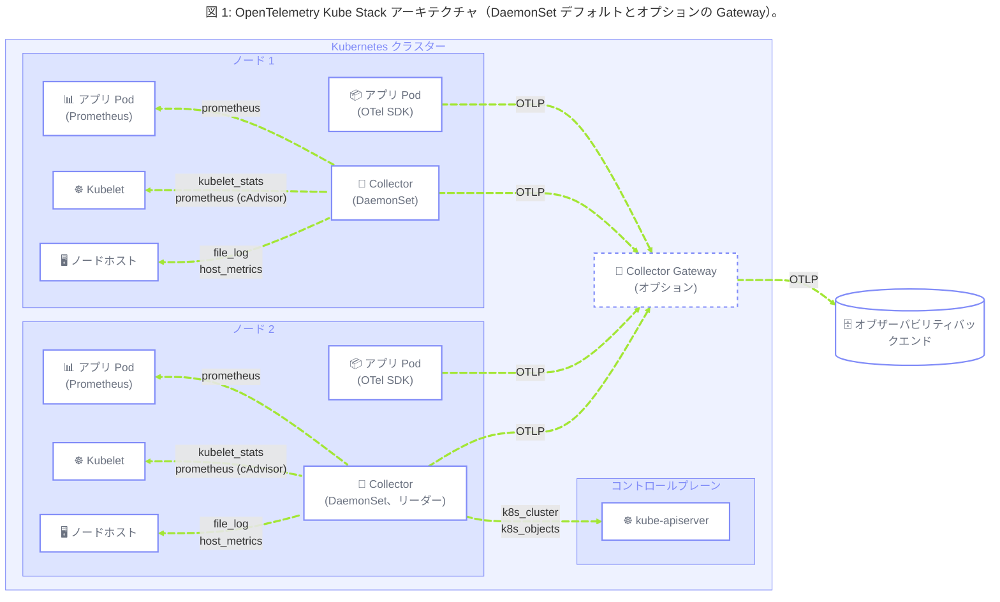

## 概要 {#summary}

このブループリントは、Kubernetes クラスターにおけるオブザーバビリティインフラストラクチャの提供を担うプラットフォームエンジニアリングチームおよび SRE チーム向けのリファレンスを示します。
リソース使用量とワークロードの運用状態、そして Kubernetes の重要コンポーネント（DNS、ネットワーキング、Ingress）のヘルスという2つの領域をカバーします。

このブループリントのパターンを実装することで、組織は以下の成果を期待できます。

- アプリケーション側の変更なしに、ワークロードのリソース使用量、OOM イベント、プローブ失敗、Pod のライフサイクル状態をすぐに可視化できます。
- Kubernetes の重要コンポーネント（CoreDNS、CNI プラグイン、Ingress コントローラーなど）の信頼性の高いモニタリングへの道筋が得られます。
- OTel セマンティック規約を使用した統一的なメタデータ付与により、メトリクス、ログ、トレース間の相関分析が可能になります。
- テレメトリー収集インフラストラクチャの自己監視により、サイレントなデータギャップがインシデント対応に影響を与える前に検出されます。

## 背景 {#background}

Kubernetes クラスターは、2つのクラスのオブザーバブルなエンティティをホストします。

1. **ワークロード** とは、アプリケーションコンテナと、それらを管理する Kubernetes プリミティブ（Statefulset、Deployment、Daemonset、ReplicaSet など）です。
   OTel SDK を使用してシグナルを出力しますが、リソース使用率と運用状態（CPU スロットリング、OOM キル、Pod フェーズ、プローブ結果）は Kubernetes 固有の API を通じてのみ確認できます。
   さらに、これらのコンポーネントの一部は Pod やコンテナのようにノードレベルで管理され、ReplicaSet の状態や HPA などはクラスター/コントロールプレーンレベルで管理されます。
2. **重要インフラストラクチャコンポーネント** には、CoreDNS、CNI プラグイン、Ingress コントローラー、ボリュームサブシステム、KEDA、およびそれに類するプラットフォームサービスが含まれます。
   これらは（一般的に）プラットフォーム側が所有し、ネイティブに Prometheus メトリクスを公開し、専用のスクレイプ設定が必要です。

このブループリントは、_何を_ 収集し、_どのようにラベルを付けるか_ に焦点を当てています。
Collector パイプラインのトポロジーは、Kubernetes 固有のコンポーネントの観測に必要な場合にのみ言及します。
独自のテレメトリーに対する Collector トポロジーの推奨事項は、[Kubernetes ワークロード向けマネージドテレメトリープラットフォーム](/docs/guidance/blueprints/managed-telemetry-platforms-for-k8s-workloads/)ブループリントで別途ドキュメント化されています。

## よくある課題 {#common-challenges}

### 1. ワークロードテレメトリーが不完全 {#1-workload-telemetry-is-incomplete}

CPU スロットリング、OOM キル、Pod フェーズの遷移、プローブ失敗はアプリケーションコードからは出力されません。
これらは Kubernetes API サーバーを通じてのみアクセスでき、プラットフォームチームが明示的に収集する必要があります。

これにより以下の問題が発生します。

- **見えないリソース圧迫**: cgroup レベルの CPU スロットリングは、インフラストラクチャの帰属情報なしにレイテンシの増加としてのみ表面化します。
- **OOM キルがアプリケーションのクラッシュに見える**: 相関する OOM シグナルがなければ、オペレーターはメモリの設定ミスとアプリケーションのバグを区別できません。
- **スロットリングと OOM が区別できない**: どちらも Pod の再起動を引き起こします。
  API サーバーからのコンテナ再起動と最終終了理由のシグナル（`k8s.container.restarts`）を kubelet の CPU/メモリメトリクスと相関させなければ、修正の根拠がありません。

### 2. メタデータがシグナルやレイヤー間で不整合 {#2-metadata-is-inconsistent-across-signals-and-layers}

各スクレイパーは異なるラベルスキーマ（`pod_name`、`pod`、`kubernetes_namespace`、`namespace`）を付与します。
OTel セマンティック規約の属性（`k8s.pod.name`、`k8s.namespace.name`）は自動的には適用されません。

これにより以下の問題が発生します。

- **インフラテレメトリーとアプリテレメトリーが分断される**: ある問題がアプリ/コンテナに起因するのか、インフラ/リソースに起因するのかをトラブルシューティングする際、オペレーターの認知負荷が増大します。
- **アラートルールがスクレイパーの変更で暗黙的に壊れる**: `pod_name` に対して書かれたアラートが、新しいスクレイパーが `pod` を使用すると一致しなくなります。
- **組織的なコンテキストが欠落する**: チーム所有権、環境、ティアラベルが Pod のアノテーションからテレメトリーに含まれることはまれであり、アラートルーティングとコスト帰属は手動になります。

### 3. 重要なクラスターコンポーネントがデフォルトでオブザーバブルでない {#3-critical-cluster-components-are-not-observable-by-default}

CoreDNS、CNI プラグイン、Ingress コントローラー、KEDA、cert-manager **およびその他多数** は、標準的なディスカバリーメカニズムなしにメトリクスを公開しています。

これにより発生する問題の例をいくつか示します。

- **DNS レイテンシのスパイクがアプリケーションの問題に見える**: CoreDNS の遅延が上流のタイムアウトとして現れ、DNS レイヤーのメトリクスなしには遅い下流サービスと区別できません。
- **CNI のパケットドロップが帰属不明になる**: ネットワークポリシーレイヤーでドロップされたパケットが、ネットワークレイヤーの帰属情報なしに断続的な Pod の接続障害として表面化します。
- **KEDA の障害がワークロードを暗黙的にプロビジョニング不足のままにする**: ソースメトリクスに到達できないスケーラーは、ユーザーに見えるエラーを出さずにオートスケーリングを停止します。

### 4. テレメトリー収集インフラストラクチャの自己監視がない {#4-telemetry-collection-infrastructure-has-no-self-monitoring}

Collector と SDK パイプラインにおけるサイレントなギャップ — クラッシュしたスクレイパー、エクスポートの失敗、バックプレッシャー下のデータドロップ — は、[Kubernetes ワークロード向けマネージドテレメトリープラットフォーム](/docs/guidance/blueprints/managed-telemetry-platforms-for-k8s-workloads/)ブループリントの[課題5](/docs/guidance/blueprints/managed-telemetry-platforms-for-k8s-workloads/#challenge-5)でカバーされています。

## 一般的なガイドライン {#general-guidelines}

### 1. OTel ネイティブレシーバーを使用してワークロードとインフラストラクチャのシグナルを収集する {#1-use-otel-native-receivers-to-collect-workload-and-infrastructure-signals}

**対処する課題:** 1、2

このブループリントでは OTel ネイティブレシーバーの使用を推奨します。

| OpenTelemetry Collector コンポーネント | Helm チャートプリセット | 対応する Prometheus/Kubernetes コンポーネント | カバーする内容                                                                                                                                   |
| -------------------------------------- | ----------------------- | --------------------------------------------- | ------------------------------------------------------------------------------------------------------------------------------------------------ |
| `k8s_cluster` **レシーバー**           | `clusterMetrics`        | `kube-state-metrics`                          | Pod、ノード、Namespace、ワークロード、クォータ、コンディションなど、Kubernetes API からの Kubernetes オブジェクト/状態メトリクス。               |
| `kubeletstats` **レシーバー**          | `kubeletMetrics`        | **cAdvisor / kubelet メトリクス**             | kubelet からのノード、Pod、コンテナの CPU/メモリ（およびボリューム）リソースメトリクスの優先ソース。                                             |
| `hostmetrics` **レシーバー**           | `hostMetrics`           | `node-exporter`（部分的）                     | `kubeletstats` がカバーしないホスト OS メトリクス — たとえばプロセス、ファイルシステム、ディスク I/O、ネットワーク、負荷、ページングメトリクス。 |
| `filelog` **レシーバー**               | `logsCollection`        | Fluent Bit / ノードログエージェント           | ランタイムが `/var/log/pods/*/*/*.log` に書き込むコンテナの stdout/stderr。DaemonSet を使用してノードごとに1回収集します。                       |
| `k8s_objects` **レシーバー**           | `kubernetesObjects`     | N/A                                           | API サーバーからログとして取得する Kubernetes オブジェクトリソースの状態（pull および/または watch）。                                           |
| `k8s_events` **レシーバー**            | `kubernetesEvents`      | N/A                                           | 発生時のクラスターイベント（Eviction、OOM など）。                                                                                               |

成果:

- アプリケーションコードの変更なしに、ワークロードレベルのリソースカバレッジ（スロットリング、OOM、Pod フェーズ、プローブ失敗）を完全に実現します。

### 2. OpenTelemetry セマンティック規約を使用して統一的なメタデータ付与を適用する {#2-apply-uniform-metadata-enrichment-using-opentelemetry-semantic-conventions}

**対処する課題:** 2

バックエンドに到達するテレメトリーは、再マッピングなしにシグナルを結合できるよう、一貫した OTel Kubernetes リソース属性を持つべきです。
そのメタデータの取得方法はソースによって異なります。

- **OTel ネイティブ Kubernetes レシーバー**（`k8s_cluster`、`kubeletstats`、`k8s_objects`、`k8s_events`）は、コアとなる識別属性（`k8s.pod.name`、`k8s.namespace.name`、`k8s.node.name`、ワークロード UID など）をすでに出力しています。
  これらのレシーバーの組み込み属性を優先し、再導出は避けてください。
- **アプリケーション OTLP および Prometheus でスクレイプされたテレメトリー** は通常そのコンテキストを持ちません。
  `k8sattributesprocessor` を使用してデータを Pod に関連付け、標準の `k8s.`\* 属性を追加することでエンリッチします。
- **組織ラベル/アノテーション**（チーム、環境、ティア）はインフラレシーバーからは出力されません。
  アプリまたは Pod スコープのシグナルにそれらが必要な場合は、`k8sattributesprocessor` の `extract.labels` / `extract.annotations` を使用して抽出します。

成果:

- メトリクス、ログ、トレースが一貫した属性で結合でき、クエリごとの再マッピングが不要になります。
- OpenTelemetry セマンティック規約に準拠することで、オブザーバビリティツールの導入が容易になります。

### 3. OpenTelemetry Operator を Collector コントロールプレーンとして使用し、Prometheus ターゲットをノードローカルでスクレイプする {#3-use-the-opentelemetry-operator-as-the-collector-control-plane-and-scrape-prometheus-targets-node-locally}

**対処する課題:** 3

OpenTelemetry Operator がクラスター内のすべての OTel Collector を管理する必要があります。
`OpenTelemetryCollector` CRD は Collector 設定を Kubernetes オブジェクトとして宣言し、GitOps ワークフロー、バージョン管理されたロールアウト、およびこのブループリントが使用するデプロイメントモード — ノードごとの収集のための **DaemonSet** と、リーダー選出が利用できない場合のクラスタースコープ作業のためのオプションの **Deployment** — を可能にします。

Prometheus ネイティブのクラスターコンポーネント（CoreDNS、CNI プラグイン、Ingress コントローラー、KEDA、cert-manager、および同様の `/metrics` エンドポイント）のスクレイプには Target Allocator は**不要**です。
各 DaemonSet Collector Pod は、`spec.nodeName` でフィルタリングされた Kubernetes Pod サービスディスカバリーを使用して、**自身のノード上** のターゲットのみをディスカバリーしてスクレイプすべきです（kube-stack は DaemonSet Collector に `${OTEL_K8S_NODE_NAME}` を注入します）。
Pod は従来の Prometheus アノテーション（`prometheus.io/scrape=true`、およびオプションの `prometheus.io/port`、`prometheus.io/path`、`prometheus.io/scheme`）でオプトインします。

特定の Pod は1つのノードにのみ存在するため、各ターゲットは1つの Collector レプリカによってのみスクレイプされます。
つまり、クラスター全体のターゲットリストも、Target Allocator も、ServiceMonitor/PodMonitor ジョブの重複による二重スクレイプもありません。
この DaemonSet パターンを、同じエンドポイントに対して Target Allocator（またはその他のクラスター全体のスクレイプ）と組み合わせないでください。

Operator はさらに、ゼロコード自動計装の注入のための `Instrumentation` CRD を導入します。
これはここではスコープ外ですが、完全なクラスターオブザーバビリティスタックの正しい基盤的依存関係として Operator を位置づけます。

成果:

- 各 Prometheus ターゲットは、ターゲットが動作するノード上の Collector によって正確に1回スクレイプされます。
- Collector のライフサイクルは自動ヒーリングにより自動的に管理されます。

## 実装 {#implementation}

以下の図は、チャートのデフォルト値で得られるアーキテクチャを示しています。
ノードごとに1つの DaemonSet Collector、すべてのノードにノードローカルレシーバー、選出されたリーダー上でのみクラスタースコープレシーバーが動作します。

オプションの Collector Gateway はこのブループリントのスコープ外ですが、図に示されています。
Collector Gateway パターンについての詳細は、アプリケーションレベルのテレメトリーに関する [Kubernetes ワークロード向けマネージドテレメトリープラットフォーム](/docs/guidance/blueprints/managed-telemetry-platforms-for-k8s-workloads/)ブループリントを参照してください。

### 1. opentelemetry-kube-stack をデプロイする {#1-deploy-the-opentelemetry-kube-stack}

**対応するガイドライン:** 1、2、3

このブループリントの基盤として `opentelemetry-kube-stack` [Helm チャート](https://github.com/open-telemetry/opentelemetry-helm-charts/tree/main/charts/opentelemetry-kube-stack)をデプロイします。
このチャートは [OpenTelemetry Operator](/docs/platforms/kubernetes/operator/) を、`OpenTelemetryCollector` CR として管理される一連の Collector とともにインストールするため、`opentelemetry-operator` と `opentelemetry-collector` のチャートリリースを別々に用意する必要がありません。

デフォルトでは、このチャートはこのブループリントが依存するプリセット（`hostMetrics`、`kubeletMetrics`、`kubernetesAttributes`、`kubernetesEvents`、`clusterMetrics`、`logsCollection` など）を備えた **DaemonSet** Collector をデプロイします。
クラスター全体のメトリクスはその DaemonSet 上でリーダー選出を使用し、1つのレプリカのみがそれらを出力します。
リーダー選出が使えない場合は、チャートの[リーダー選出なしの代替案](https://github.com/open-telemetry/opentelemetry-helm-charts/tree/main/charts/opentelemetry-kube-stack/examples/no-leader-election-extension)を使用して、クラスタースコープの収集を分離します。
同じ DaemonSet がローカルノード上の Prometheus ネイティブコンポーネントもスクレイプします（実装ステップ6）。

レシーバー、プロセッサー、RBAC の設定を手動で記述するのではなく、チャートの `collectors.*` 配下の**プリセット**を通じて収集を設定します。
各プリセットは対応するレシーバーまたはプロセッサーをパイプラインに接続し、必要な RBAC、ボリューム、マウントを生成します。
残りのステップは、このチャートの `values.yaml` フラグメントです。

### 2. `clusterMetrics` プリセットでクラスター状態メトリクスを収集する {#2-collect-cluster-state-metrics-with-the-clustermetrics-preset}

**対応するガイドライン:** 1、2

`k8s_cluster` [レシーバー](/docs/platforms/kubernetes/collector/components/#kubernetes-cluster-receiver)は、Kubernetes API を watch することでオブジェクト状態（Pod フェーズ、再起動回数、レプリカ状態、ノードコンディション）を提供します。
これは `kube-state-metrics` の OTel ネイティブな置き換えです。
リソース消費は提供しません。それは kubelet から取得します（実装ステップ3）。

レシーバーがクラスター全体のテレメトリーを収集するため、1つの Collector レプリカのみがそれを出力すべきです。
`opentelemetry-kube-stack` では、DaemonSet Collector（`collectors.daemon.presets.clusterMetrics`）で `clusterMetrics` [プリセット](/docs/platforms/kubernetes/helm/collector/#cluster-metrics-preset)を有効にします。
リーダー選出により単一のレプリカがデータを生成することが保証されます。
リーダー選出が利用できない場合は、チャートの分離されたクラスター Collector をかわりに使用します。
プリセットは `k8s_cluster` レシーバーと必要な RBAC を自動的に追加します。

これにより `k8s.pod.phase`、`k8s.container.restarts`、`k8s.deployment.available`/`k8s.deployment.desired`、`k8s.node.condition_ready`、`k8s.pod.status_reason`、`k8s.container.status.reason` などの OTel ネイティブの同等メトリクスが出力されます。
これらはオプションですが、ステータス理由メトリクスは Pod が失敗している理由を理解するために特に重要です。
有効化の方法については `k8s_cluster` [レシーバーのオプションメトリクスのドキュメント](https://github.com/open-telemetry/opentelemetry-collector-contrib/blob/main/receiver/k8sclusterreceiver/documentation.md#optional-metrics)を参照してください。

### 3. リソース使用量には `kubeletstats` を優先し、`hostmetrics` はギャップのみに使用する {#3-prefer-kubeletstats-for-resource-usage-use-hostmetrics-only-for-gaps}

**対応するガイドライン:** 1、2

`kubeletstats` [レシーバー](/docs/platforms/kubernetes/collector/components/#kubeletstats-receiver)と `hostmetrics` [レシーバー](/docs/platforms/kubernetes/collector/components/#host-metrics-receiver)はどちらもノードの CPU とメモリを報告できます。
ノード、Pod、コンテナのリソース使用量には `kubeletstats` を優先してください。
kubelet/cAdvisor に整合したソースであり、`hostmetrics` からの同一の CPU/メモリ系列の重複を避けられるためです。
kube-stack の **DaemonSet** Collector（`collectors.daemon.presets.kubeletMetrics`）で `metric_groups: [node, pod, container]` とともに有効にします。

`hostmetrics` [プリセット](/docs/platforms/kubernetes/helm/collector/#host-metrics-preset)は、`kubeletstats` [プリセット](/docs/platforms/kubernetes/helm/collector/#kubelet-metrics-preset)が提供できないシグナル — 通常はプロセスメトリクス、加えてホストレベルのファイルシステム、ディスク I/O、ネットワーク、負荷、ページングメトリクス — にのみ使用します。
両方のプリセットを有効にする場合は、`hostmetrics` の重複する `cpu` と `memory` スクレイパーを無効にして、それらが `kubeletstats` からのみ取得されるようにします。

重要: コントロールプレーンおよびテイントされたノード（GPU、スポット）でのカバレッジを保証するために、DaemonSet に tolerations を追加してすべてのノードがスクレイプされるようにしてください。
Collector Pod のないノードはカバレッジギャップとなります。

### 4. `k8s_objects` レシーバーで Kubernetes イベントとオブジェクト状態を収集する {#4-collect-kubernetes-events-and-object-state-with-the-k8s_objects-receiver}

**対応するガイドライン:** 1、2

`k8s_objects` レシーバーは Kubernetes API データをログとして収集します。
2つの補完的なシグナルに使用します。

- `kubernetesEvents` [プリセット](/docs/platforms/kubernetes/helm/collector/#kubernetes-events-preset)からの**イベント**: スケジューリング失敗、プローブ失敗、OOM キル、ボリュームアタッチエラー、およびメトリクスだけでは見逃されがちな類似の運用シグナルを含む、クラスターイベントを発生時に watch します。
- `kubernetesObjects` [プリセット](/docs/platforms/kubernetes/collector/components/#kubernetes-objects-receiver)からの**オブジェクトリソースの状態**: Pod、Deployment、ノード、および関連リソースなどの Kubernetes オブジェクトを定期的に pull（およびオプションで watch）し、オブジェクトの状態履歴をログとして保持します。

重要: 両方のシグナルは Deployment（シングルレプリカ）として実行する必要があります。
必要に応じて、複数レプリカの耐障害性のためにリーダー選出を使用します。

### 5. `k8sattributesprocessor` を使用して必須およびオプションの組織ラベルでテレメトリーをエンリッチする {#5-use-k8sattributesprocessor-to-enrich-telemetry-with-required-and-optional-organizational-labels}

**対応するガイドライン:** 2

`kubernetesAttributes` [プリセット](/docs/platforms/kubernetes/helm/collector/#kubernetes-attributes-preset)は、関連する Kubernetes メタデータでテレメトリーをエンリッチします。
`k8s.pod.name`、`k8s.namespace.name`、`k8s.node.name` など、適切なオブザーバビリティに必要なものもあります。

`team`、`squad`、`owner` など、関心のある組織キーに対して `extract.labels` / `extract.annotations` を明示的に設定します。
`k8s.cluster.name` がクラウドメタデータから解決できない場合は、`resourceprocessor` を使用して静的リソース属性として注入するか、kube-stack の values で `clusterName` を設定します。

重要: [K8s セマンティック規約](/docs/specs/semconv/resource/k8s/)にすでにオプションがある場所では、カスタムラベルを使用しないでください。

### 6. DaemonSet モードで各ノード上の Prometheus ネイティブコンポーネントをスクレイプする {#6-scrape-prometheus-native-components-on-each-node-via-daemonset-mode}

**対応するガイドライン:** 3

[Prometheus レシーバー](https://github.com/open-telemetry/opentelemetry-collector-contrib/blob/main/receiver/prometheusreceiver/README.md#getting-started)上のクラスター全体の手動スクレイプターゲットは、二重スクレイプを起こしやすく、メトリクス値が水増しされて信頼性を損ないます。
Target Allocator はターゲットを Collector レプリカ間でシャーディングすることでこの問題を解決しますが、すべての Collector がすでに DaemonSet として動作し、ディスカバリーが Collector の動作するノードに制限されている場合は不要です。

推奨される実装は [opentelemetry-kube-stack](https://github.com/open-telemetry/opentelemetry-helm-charts/tree/main/charts/opentelemetry-kube-stack) の DaemonSet パターンです。
Prometheus レシーバーがローカルノードに制限された Kubernetes Pod サービスディスカバリー（`spec.nodeName=${OTEL_K8S_NODE_NAME}`）を使用します。
各 Collector Pod はそのノード上のアノテーション付き Pod のみをスクレイプします。
Pod は1つのノードに存在するため、1回だけスクレイプされます。

デフォルトでは、kube-stack は `collectors.daemon.scrape_configs_file: daemon_scrape_configs.yaml` を読み込みます。
これには `prometheus.io/scrape=true` を持つ Pod 向けのジョブがすでに含まれています。
スクレイプファイルなしで同じ動作を得るには、`scrape_configs_file: ""` を設定し、`collectors.daemon.presets.prometheus.podAnnotations` を有効にします。
これらのプリセットは `scrape_configs_file` と相互に排他的で、`mode: daemonset` が必要です。

重要なクラスターコンポーネント（CoreDNS、CNI プラグイン、Ingress コントローラー、KEDA、cert-manager など）が `/metrics` エンドポイントを公開し、`prometheus.io/scrape=true` を持っていることを確認してください。
同じエンドポイントを Target Allocator、ServiceMonitor、または PodMonitor でも**スクレイプしないでください** — ディスカバリーの重複が二重スクレイプを再導入する原因です。

## リファレンス実装 {#reference-implementations}

> このブループリントを実装したプロダクショングレードの OpenTelemetry アーキテクチャをお持ちで、このページに掲載を希望される場合は、[End-User SIG リポジトリ](https://github.com/open-telemetry/sig-end-user/issues)で Issue を作成してください！
