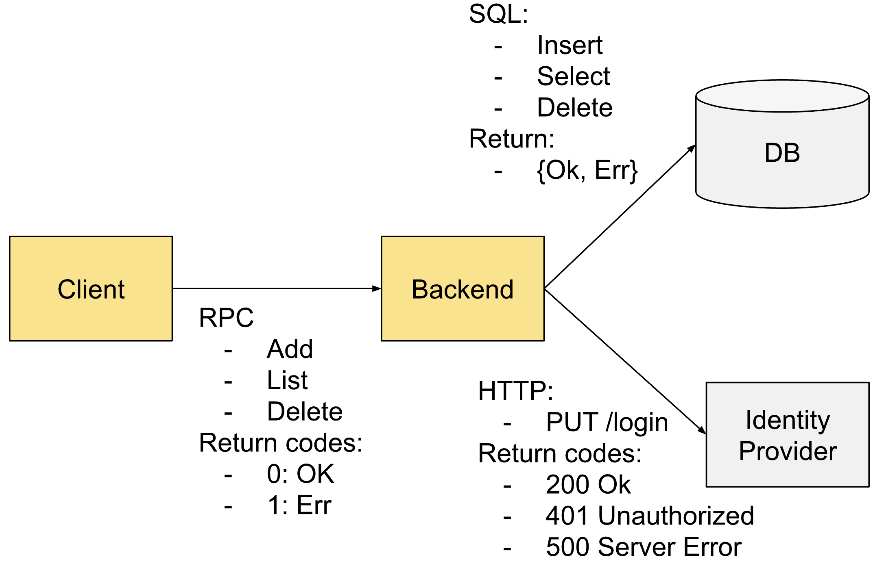

[OBI のメトリクス](../metrics/) のカーディナリティは、計装される環境のサイズと複雑さに大きく依存するため、シンプルかつ正確な公式を提供する方法はありません。

このドキュメントでは、デフォルトの OBI インストールで生成される可能性のあるメトリクスのカーディナリティの概算を提供しようとします。
各メトリクスファミリーは選択的に有効化または無効化できるため、OBI が生成可能な各種のメトリクスごとにいくつかのセクションに分かれています。

以下のシリーズ数の算出は、単一クラスター、クラシック Prometheus ヒストグラム、OBI のデフォルトバケット境界を前提としています。
ネイティブヒストグラムと OTLP ヒストグラムでは表現が異なります。
各クラスターを個別に見積もってください。

## 用語 {#terminology}

続ける前に、曖昧であったり解釈の余地がある用語を明確にしておきます。

- **インスタンス**: 計装対象の各単位です。アプリケーションレベルのメトリクスでは、サービスインスタンスやクライアントインスタンスがこれに当たります。Kubernetes では Pod がこれに当たります。1 つのアプリケーションインスタンスが複数のプロセスで実行される場合もあります。ネットワークレベルのメトリクスでは、各インスタンスは特定のホスト内のすべてのネットワークフローを計装する OBI インスタンスです。
- **インスタンスオーナー**: Kubernetes では、ほとんどのインスタンス（Pod）にはオーナーリソースがあります。カーディナリティを抑制するために、インスタンスではなくオーナーに関するデータを報告したい場合があります。インスタンスオーナーの例は Deployment、DaemonSet、ReplicaSet、StatefulSet ですが、Pod にオーナーがない場合（スタンドアロンの Pod）、その Pod 自体がオーナーとして報告されます。
- **URL パス**: クライアントが送信し、サーバーが受信する URL リクエストの生のパスです。たとえば `/clients/348579843/command/833` のような形式です。
- **URL ルート**: URL リクエストの集約されたパスで、カーディナリティを抑制するために意味的にグループ化されます。これは通常、一部の Web フレームワークが HTTP リクエストをコードで定義する方法を模倣します。たとえば `/clients/{clientId}/command/{command_num}` のような形式です。
- **操作**: 要求された機能を表します。
  - HTTP: `GET` などのすべての HTTP 動詞に URL ルートを続けたもの
  - gRPC: サービスのパス
  - SQL: `SELECT`、`UPDATE` などの SQL コマンドに対象テーブルを続けたもの
  - Kafka: Produce/Fetch
- **サーバー**: HTTP または gRPC リクエストを受信して処理する任意のインスタンスです。サーバーはクライアントにもなり得ます。
- **クライアント**: HTTP、gRPC、データベース、または MQ のリクエストを送信する任意のインスタンスです。クライアントはサーバーにもなり得ます。
- **サービス**: Kubernetes のコンテキストでは、共通のホスト名とポートを介してアクセスされる一群のサーバーが提供する機能です。
- **エンドポイント**: サービス、サーバー、またはクライアントを識別する IP またはホスト名とポートです。
- **戻りコード**: 各サービス呼び出しによって返され、実行結果に関するメタ情報を表します。HTTP では HTTP ステータスコードであり、他のプロトコルでは通常 0（成功）または 1（エラー）です。

## アプリケーションレベルのメトリクス {#application-level-metrics}

アプリケーションレベルのメトリクスでは、カーディナリティに影響する要因が複数あり、それらが線形に関連しているわけではないため、単純な乗算の公式を当てはめることはできません。

たとえば、HTTP ルートの数とサーバーアドレスの数はどちらもカーディナリティを増加させますが、すべてのサーバーインスタンスが同じ HTTP ルートを受け付けるわけではないため、単純に掛け合わせることはできません。

次の公式は非常におおまかな上限を示すことができますが、[我々の測定](#case-study-cardinality-of-opentelemetry-demo) では、実測のカーディナリティは計算値よりもはるかに低い結果でした。
このため、見積もりと並行してエクスポートされるシリーズを測定してください。

ただし、全体のカーディナリティに影響する可能性のある要因は次のとおりです。

- **Instances**: 計装されているエンティティの数。サービスとクライアントの両方を含みます。
- **MetricNames**: アプリケーションレベルのメトリクス名の数。OBI が計装するアプリケーションのタイプに応じて変わります。報告される各メトリクスについて 1 つカウントします。
- クライアント側メトリクス（OBI が他のアプリケーションへリクエストを行うアプリケーションを計装する場合）:
  - `http.client.request.duration`
  - `http.client.request.body.size`
  - `http.client.response.body.size`
  - `rpc.client.call.duration`
  - `db.client.operation.duration`
  - `messaging.client.operation.duration`
  - `messaging.process.duration`
- サーバー側メトリクス（OBI が他のアプリケーションからのリクエストをディスパッチするアプリケーションを計装する場合）:
  - `http.server.request.duration`
  - `http.server.request.body.size`
  - `http.server.response.body.size`
  - `rpc.server.call.duration`
- **エラータイプ**: v0.14.0 以降、HTTP の duration および body-size の Prometheus シリーズには `error_type` ラベルがあります。
  成功したリクエストでは値は空です。
  同じ操作、エンドポイント、ステータスコードに対して複数のエラータイプがあると、別々のシリーズが作成されます。
  すべての HTTP シリーズに固定の係数を掛けるのではなく、デプロイメントで観測された値をカウントしてください。
- **データベースコレクションと RPC ポート**: v0.15.2 以降、データベースの duration メトリクスにはデフォルトで `db.collection.name` が含まれ、RPC クライアントの duration には `server.port` が含まれ、失敗した RPC サーバーの duration には `error.type` が含まれます。
  各操作で観測される個別の組み合わせをカウントしてください。
  メッセージングの duration メトリクスも操作タイプとサブスクリプション名で分割される場合があります。
- **HistogramBuckets** は、この例の各アプリケーションメトリクスがヒストグラムであるため、考慮する必要があります。
  OBI のデフォルトでは、duration バケット境界が 15 個、body-size バケット境界が 10 個です。
  Prometheus は `+Inf` バケット、sum、count を追加するため、属性の組み合わせごとにそれぞれ 18 または 13 のシリーズが生成されます。
- **Operations** は呼び出された機能と同等です。HTTP サービスでは HTTP メソッドと HTTP ルートをグループ化したものであり、RPC では RPC メソッド名です。
- **Endpoints** はサーバーアドレスとポートの数です。
- **ReturnCodes** は操作の取り得る結果の数です。通常、gRPC では Ok/Err、または HTTP ステータスコードです。

### 計算例 {#example-calculation}

提示したカーディナリティの公式の被乗数は重複する場合があります。
たとえば、計装されたクライアントアプリケーションが `/foo` と `/bar` の HTTP リクエストを送信し、サービス A と B の両方に接続する場合、次のようになります。

- Operations: 2
- Endpoints: 2

`Operations * Endpoints` の積はカーディナリティを 4 倍にします。
しかし、`/foo` ルートがサービス A 専用で、`/bar` ルートがサービス B 専用である場合、実際のカーディナリティ乗数は 2 だけになります。

カーディナリティを計算する際は、楽観的な値と悲観的な値の両方を設定してください。

次の例は、サンプルシステムのカーディナリティを計算する方法を示します。
クライアントとバックエンドの両方が OBI によって計装されています。
他のコンポーネントは外部です。



悲観的な計算は次のようになります。

```text
#Instances * #MetricNames * #HistogramSeries * #Operations * #Endpoints * #ReturnCodes
= 2 * 5 * 18 * 7 * 3 * 7 = 26,460
```

参照とした数値:

- 2 インスタンス（クライアントとバックエンド）
- 役割とプロトコルに応じた 5 種類のメトリクス:
  - クライアント
    - `rpc.client.call.duration`
  - RPC サーバーとしてのバックエンド
    - `rpc.server.call.duration`
  - SQL と HTTP クライアントとしてのバックエンド
    - `http.client.request.duration`
    - `http.client.request.body.size`
    - `db.client.operation.duration`
- duration ヒストグラムあたり 18 シリーズ（明示的バケット 15 個、`+Inf`、sum、count）を悲観的な上限として使用。
  body-size ヒストグラムは 13 シリーズ
- 7 つの操作: RPC Add/List/Delete、HTTP PUT、SQL Insert/Select/Delete
- 3 つのエンドポイント: バックエンド、Identity プロバイダー、DB
- 7 つの戻りコード: RPC OK/Err、HTTP 200/401/500、SQL OK/Err

この上限は意図的に緩く設定されています。SQL の操作は RPC や HTTP メトリクスに掛け合わされず、各メトリクスはクライアントまたはサーバーのどちらか一方のみが出力します。
また、HTTP ステータスコードごとに `error_type` の値が 1 つであることを前提としており、追加のエラータイプがあるとシリーズはさらに分割されます。
この算出では、SQL 操作ごとに 1 つのデータベースコレクション、エンドポイントごとに 1 つの RPC サーバーポート、失敗した操作ごとに 1 つの RPC エラータイプも前提としています。

これらの前提のもとで、5 つのメトリクスから 417 シリーズをカウントでき、悲観的な上限の 26,460 よりはるかに少ない値です。

| #   | インスタンス | メトリクス                      | エンドポイント | 操作       | コード |
| --- | ------------ | ------------------------------- | -------------- | ---------- | ------ |
| 1   | クライアント | `rpc.client.call.duration`      | バックエンド   | Add        | OK     |
| 2   | クライアント | `rpc.client.call.duration`      | バックエンド   | Add        | Err    |
| 3   | クライアント | `rpc.client.call.duration`      | バックエンド   | List       | OK     |
| 4   | クライアント | `rpc.client.call.duration`      | バックエンド   | List       | Err    |
| 5   | クライアント | `rpc.client.call.duration`      | バックエンド   | Delete     | OK     |
| 6   | クライアント | `rpc.client.call.duration`      | バックエンド   | Delete     | Err    |
| 7   | バックエンド | `rpc.server.call.duration`      |                | Add        | OK     |
| 8   | バックエンド | `rpc.server.call.duration`      |                | Add        | Err    |
| 9   | バックエンド | `rpc.server.call.duration`      |                | List       | OK     |
| 10  | バックエンド | `rpc.server.call.duration`      |                | List       | Err    |
| 11  | バックエンド | `rpc.server.call.duration`      |                | Delete     | OK     |
| 12  | バックエンド | `rpc.server.call.duration`      |                | Delete     | Err    |
| 13  | バックエンド | `http.client.request.duration`  | Identity Prov  | PUT /login | 200    |
| 14  | バックエンド | `http.client.request.duration`  | Identity Prov  | PUT /login | 401    |
| 15  | バックエンド | `http.client.request.duration`  | Identity Prov  | PUT /login | 500    |
| 16  | バックエンド | `http.client.request.body.size` | Identity Prov  | PUT /login | 200    |
| 17  | バックエンド | `http.client.request.body.size` | Identity Prov  | PUT /login | 401    |
| 18  | バックエンド | `http.client.request.body.size` | Identity Prov  | PUT /login | 500    |
| 19  | バックエンド | `db.client.operation.duration`  | DB             | Insert     | OK     |
| 20  | バックエンド | `db.client.operation.duration`  | DB             | Insert     | Err    |
| 21  | バックエンド | `db.client.operation.duration`  | DB             | Select     | OK     |
| 22  | バックエンド | `db.client.operation.duration`  | DB             | Select     | Err    |
| 23  | バックエンド | `db.client.operation.duration`  | DB             | Delete     | OK     |
| 24  | バックエンド | `db.client.operation.duration`  | DB             | Delete     | Err    |

簡潔さのために、ヒストグラムバケットはカウントしていません。
次にメトリクスインスタンスをヒストグラムバケット、それにヒストグラムの `_count` と `_sum` で乗算します。

- 3 個の body-size メトリクスインスタンス × 13 = 39
- 21 個の duration メトリクスインスタンス × 18 = 378

合計のカーディナリティ: **417**

この例は、1 つの公式ではデプロイメントのカーディナリティを予測できない理由を示しています。
このカウントでさえ、有効化されたメトリクスとラベルの値に依存します。
より大規模な Kubernetes クラスターでは、エクスポートされるシリーズを測定して、実際のワークロードの接続と属性を把握してください。

## ネットワークレベルのメトリクス {#network-level-metrics}

ネットワークレベルのメトリクスはアプリケーションレベルのメトリクスより見積もりが簡単です。
`network` 機能は `obi.network.flow.bytes` カウンターをエクスポートします。
パケットカウンターやゾーン間バイトカウンターも個別に有効化できます。
カーディナリティは、どのエンドポイントが通信し、どの属性を選択するかに依存します。

`obi.network.flow.bytes` のデフォルト属性は次のとおりです。

- `direction`: `request`、`response`、または `unknown`。
- Kubernetes メタデータが有効な場合の送信元と送信先のエンドポイントオーナー名、オーナータイプ、名前空間: `k8s_src_owner_name`、`k8s_src_owner_type`、`k8s_src_namespace`、`k8s_dst_owner_name`、`k8s_dst_owner_type`、`k8s_dst_namespace`。
- `k8s_cluster_name`: 各クラスターで一意。
  他のメトリクスと同様、単一クラスターを想定しています。
  この属性も Kubernetes メタデータが必要です。

これらの例では、各オーナー数は名前空間、オーナー名、オーナータイプの個別の組み合わせを表すため、オーナータイプに別の乗数は不要です。
各オーナーペアで観測される個別の `direction` 値をカウントしてください。

簡略化された悲観的な公式は次のようになります。

```text
#Directions * #SourceOwners * #DestinationOwners
```

ここではすべての送信元オーナーがすべての送信先オーナーに接続されていると仮定しました。
接続係数を適用するほうが現実的です。
たとえば 100 個の Deployment/DaemonSet/StatefulSet を持つクラスターで、各オーナーが平均 2 つの他のオーナーに接続されている場合、カーディナリティは次のようになります。

2 directions × 100 source owners × 2 destination owners = **400** シリーズ（すべてのオーナーペアで `request` と `response` の両方が発生する場合のバイトカウンター）。
`unknown` の direction 値があるとさらに増える可能性があります。
追加のメトリクス機能もシリーズを追加します。

## サービスグラフメトリクス {#service-graph-metrics}

サービスグラフメトリクスは、HTTP、RPC、SQL、Redis、Kafka など、アプリケーションメトリクスで計装可能なインスタンスに対して生成されます。
ネットワークメトリクスはプロトコルに関係なく、ネットワークトラフィックを持つ任意のインスタンスに対して生成されます。

サービスグラフメトリクスは次のメトリクスを生成します。

- `traces_service_graph_request_client`: 15 バケットのヒストグラム
- `traces_service_graph_request_server`: 15 バケットのヒストグラム
- `traces_service_graph_request_failed_total`: カウンター
- `traces_service_graph_request_total`: カウンター

各メトリクスには次の属性もあります。

- `source`: obi
- `client` と `client_namespace`
- `server` と `server_namespace`

計算はネットワークメトリクスと類似していますが、カーディナリティはより高くなります。

- ネットワークバイトカウンターではなく、全体で 38 のカーディナリティを持つメトリクス/ヒストグラムのセット（2 つの 18 シリーズヒストグラム + 2 つのカウンター）を報告します。
- インスタンスのオーナー（たとえば Deployment）で集約するのではなく、クライアントはリクエストを送信するインスタンスであり、サーバーは通常単一のサービスインスタンス経由でアクセスされるため、オーナーとなる場合があります。

## スパンメトリクス {#span-metrics}

オプションの `application_span_otel` 機能を使用すると、OBI は次のメトリクスをエクスポートします。

- `traces.span.metrics.duration`: Prometheus 経由でエクスポートされる場合、明示的バケット 15 個、`+Inf`、sum、count を持つヒストグラム
- `traces.span.metrics.calls`: カウンター

非推奨の `application_span` 機能は、以前の `traces_spanmetrics_latency` および `traces_spanmetrics_calls_total` という名前を使用します。
非推奨の `application_span_sizes` 機能は、後継なしで 2 つのサイズカウンターを追加します。
[メトリクスのエクスポート機能](../configure/export-data/#metrics-export-features) を参照してください。

各メトリクスにカーディナリティを追加する可能性のある属性は次のとおりです。

- Service/ServiceNamespace/Instance ID
- スパンの種類: Client/Server/Internal
- スパン名: 通常、操作の名前であり、カーディナリティが高くなる可能性があります
- 戻りコード

最大カーディナリティはおおまかに次のように計算できます。

```text
19 metric series * 3 span kinds * #Instances * #Operations * #ReturnCodes
```

[前述のアプリケーションメトリクスの計算例](#example-calculation) で示したとおり、HTTP の戻りコードの大きな数は HTTP サービスにのみ掛かる、あるいは一部のインスタンスグループは総ルートのサブセットしか持たないといった仮定を置きました。

## ケーススタディ: OpenTelemetry デモのカーディナリティ {#case-study-cardinality-of-opentelemetry-demo}

以下の測定値は、ローカルの 3 ノードクラスターにデプロイされた [OpenTelemetry Demo](/docs/demo/architecture/) の以前のデプロイメントから取得したものです。
バンドルされている OpenTelemetry の計装は無効化し、OBI が計装を行いました。
これらのカウントはそのデプロイメントを表しています。
クエリを使用してご自身のデプロイメントを調査し、現在のカーディナリティを見積もる際には、有効化されたメトリクスファミリーと選択した属性を含めてください。

### アプリケーションレベルメトリクスの測定 {#measure-application-level-metrics}

計装対象のほとんどのインスタンスはクライアントでありサービスでもあるため、より正確にするために公式の `#instances` 引数を無視します。

```text
#MetricNames * #HistogramSeries * #Operations * #Endpoints * #ReturnCodes
```

最終的なカーディナリティに対して属性が非線形に与える影響を最小化するため、メトリクスのタイプごと（HTTP、gRPC、Kafka）に別々にカーディナリティの数値を計算します。

**HTTP メトリクス:**

- この例に含まれる 4 つの HTTP ヒストグラムメトリクス
- 悲観的なメトリクスごとの上限として、明示的ヒストグラムバケット 15 個、`+Inf`、sum、count
- 既知の操作: 75。実行中の OTel デモから PromQL クエリ `group by (http_request_method, http_route)({__name__=~"http_.*"})` で測定
- 26 エンドポイント。実行中の OTel デモから PromQL クエリ `group by (server_address, server_port)({__name__=~"http_.*"})` で測定
- 6 個のレスポンスステータスコード: 200、301、308、403、408、504。実行中の OTel デモから抽出

v0.14.0 以降、`application` 機能は 6 つの HTTP ヒストグラムファミリー（クライアントとサーバーの duration、リクエストの body size、レスポンスの body size）をエクスポートできます。
この以前のスナップショットの 4 メトリクスの係数を再利用するのではなく、ご自身のデプロイメントが実際に出力するファミリーを含めてください。

HTTP メトリクスの最大計算上限値は次のとおりです。

```text
4 x 18 x 75 x 26 x 6 = 842,400
```

これは、アプリケーションレベルのメトリクスに対して公式がいかに効果的でないかを示しています。
既知のすべてのアプリケーションメトリクスタイプを含めても、測定値はずっと低くなります。

`count({__name__=~"http_.*|rpc_.*|sql_.*|redis_.*|messaging_.*"})` **→ 9,600**

### ネットワークレベルメトリクスの測定 {#measure-network-level-metrics}

デフォルト属性のバイトカウンターについて、21 個のデモ Deployment がすべての 21 個の Deployment と通信し、すべてのオーナーペアで `request` と `response` の両方が発生すると仮定すると、見積もりは次のようになります。

2 × 21 × 21 = 882 シリーズ

アーキテクチャ図の 29 個の接続のみをカウントし、それぞれ双方向と仮定すると、より低い見積もりが得られます。

2 × 29 = 58 シリーズ

デフォルトの `direction` 属性には `unknown` の値もあり得るため、シリーズがさらに増える可能性があります。
名前空間やタイプが異なるオーナーは個別にカウントしてください。

ネットワークメトリクスは、OpenTelemetry デモの接続、その他の内部クラスターの接続、計装トラフィックを測定します。
現在の合計は `count(obi_network_flow_bytes_total)` でクエリできます。

OpenTelemetry デモに属する部分をよりよく把握するために、次のクエリで名前空間間のトラフィックをグループ化できます。

```text
count(obi_network_flow_bytes_total) by (k8s_src_namespace, k8s_dst_namespace)
```

以前のスナップショットでは次の名前空間ペアが記録され、合計 312 シリーズでした。

| k8s_src_namespace | k8s_dst_namespace | count |
| ----------------- | ----------------- | ----- |
| default           | default           | 156   |
| kube-system       | default           | 47    |
| default           | kube-system       | 47    |
|                   | default           | 14    |
| default           |                   | 14    |
|                   | kube-system       | 13    |
| kube-system       |                   | 13    |
|                   | gmp-system        | 3     |
| gmp-system        |                   | 3     |
| default           | gmp-system        | 1     |
| gmp-system        | default           | 1     |

OpenTelemetry デモのコンポーネント間トラフィックに対して生成されるネットワークメトリクスの数は 156 です。
`default` 名前空間は送信元と送信先の両方になっています。
`kube-system`、`gmp-system`、または名前空間なしの他のトラフィックもあり、これらは外部接続、テレメトリー、Kubernetes 管理に属します。

### サービスグラフメトリクスの測定 {#measure-service-graph-metrics}

ネットワークメトリクスはサービスグラフの構築によく使用されますが、実際のサービスグラフメトリクスは異なる形をしています。

- ネットワークバイトカウンターではなく、2 つのカウンターメトリクスと 2 つのヒストグラムメトリクス（明示的バケット 15 個、`+Inf`、sum、count）があります。
- サービスグラフメトリクスは、通常、内部 Kubernetes トラフィックや、アプリケーションレベルで計装されていないインスタンスからのトラフィックを無視します。

測定値は次のとおりです。

`count({__name__=~".*service_graph.*"})` **→ 2300**

### スパンメトリクスの測定 {#measure-span-metrics}

アプリケーションレベルメトリクスの計算では、関連するパラメーターの数が多いため、解析的な数値を得ることが難しいことを示しました。
PromQL で測定することで、カーディナリティの正確な測定値を得ることができます。

`count({__name__=~".*spanmetrics.*"})` **→ 3900**（以前のデプロイメントの値）。
`application_span_otel` の場合は、かわりに `traces_span_metrics_.*` をクエリしてください。
