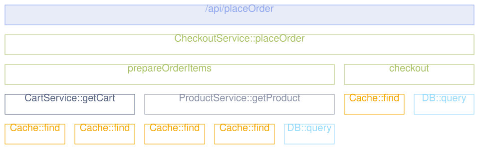

O [escopo de instrumentação](/docs/specs/otel/common/instrumentation-scope/) é
uma unidade lógica de _software_ à qual a telemetria emitida é associada. Ele
pode representar um módulo, pacote, classe, biblioteca ou _framework_ — qualquer
limite significativo escolhido por quem desenvolve para distinguir uma fonte de
telemetria de outra.

## Como um escopo é definido {#how-a-scope-is-defined}

Um escopo é identificado por uma tupla
`(name, version, schema_url, attributes)`, em que `version`, `schema_url` e
`attributes` são opcionais. O `name` deve identificar de forma única a unidade
lógica de _software_ — por exemplo, o nome totalmente qualificado de uma
biblioteca, classe ou módulo.

O escopo é especificado ao obter um _tracer_, _meter_ ou _logger_ a partir de um
_provider_. Cada trecho, métrica e registro de log produzido por essa instância
é então marcado com o escopo:

- **Para bibliotecas e _frameworks_**: utilize o nome totalmente qualificado e a
  versão da biblioteca como escopo. Ao escrever uma biblioteca de instrumentação
  para uma biblioteca que não possui suporte nativo ao OpenTelemetry, utilize o
  nome e a versão da própria biblioteca de instrumentação.
- **Para código da aplicação**: uma escolha comum é o nome da classe ou do
  módulo, como `CheckoutService`.

## Por que escopos são importantes {#why-scopes-matter}

No _backend_ de observabilidade, é possível filtrar, agrupar e comparar a
telemetria por escopo. Isso permite identificar qual versão de uma biblioteca
está causando latência, isolar sinais de um módulo específico ou comparar o
comportamento entre versões de um mesmo componente.

## Escopos em um rastro {#scopes-in-a-trace}

O diagrama a seguir mostra um rastro com trechos de seis escopos de
instrumentação diferentes, identificados por cores e pela legenda:

- O escopo `http-framework` produz o trecho raiz `/api/placeOrder`.
- O escopo `CheckoutService` produz `CheckoutService::placeOrder`,
  `CheckoutService::prepareOrderItems` e `CheckoutService::checkout`. Os três
  trechos compartilham o mesmo escopo de instrumentação porque são criados pela
  mesma instância de _tracer_, obtida com o nome `CheckoutService`.
- Os escopos `CartService` e `ProductService` produzem, cada um, um trecho a
  partir de seus respectivos componentes da aplicação.
- Os escopos `Cache library` e `DB library` produzem trechos a partir de código
  de biblioteca, agrupados por nome e versão da biblioteca.

