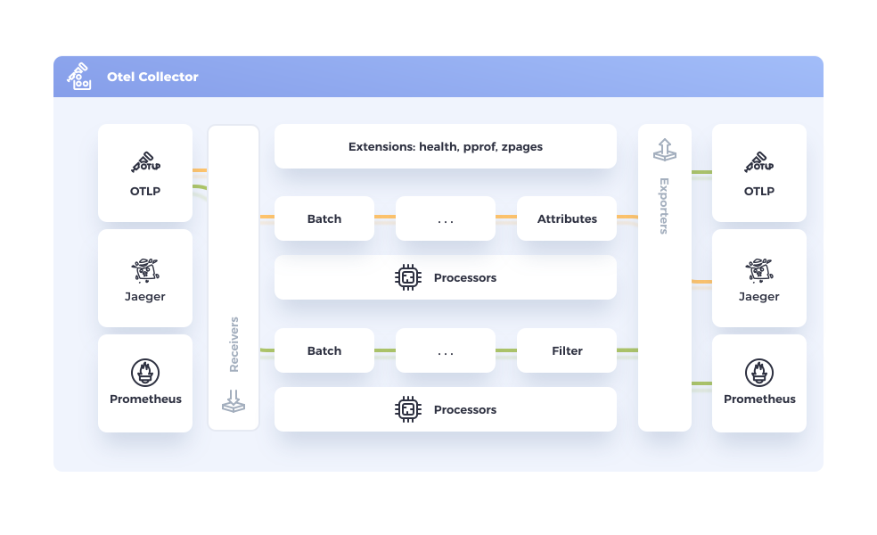

## Introducere {#introduction}

Colectorul OpenTelemetry oferă o soluție independentă de furnizor pentru
primirea, procesarea și exportul datelor de telemetrie. Acesta elimină
necesitatea de a rula, administra și întreține mai mulți agenți sau colectori.
Oferă o scalabilitate îmbunătățită și acceptă formate de date de observabilitate
open source (de exemplu, Jaeger, Prometheus, Fluent Bit etc.), permițând
trimiterea acestora către unul sau mai multe backend-uri open source sau
comerciale.

## Obiective {#objectives}

- _Ușurință în utilizare_: Configurație implicită adecvată, compatibilitate cu
  protocoalele populare și colectarea datelor imediat după pornire.
- _Performanță_: Stabilitate și performanță ridicate în condiții variate de
  încărcare și configurare.
- _Observabilitate_: Un exemplu de serviciu observabil.
- _Extensibilitate_: Posibilitatea de personalizare fără modificarea codului de
  bază.
- _Unificare_: O singură bază de cod, care poate fi utilizată atât ca agent, cât
  și ca serviciu de colectare, cu suport pentru trace-uri, metrici și loguri.

## Când să folosești un colector {#when-to-use-a-collector}

Pentru majoritatea limbajelor de programare, există soluții de instrumentație
care permit exportul datelor către backend-uri populare și prin OTLP. Prin
urmare, te-ai putea întreba:

> În ce situații este recomandat să folosești un colector pentru trimiterea
> datelor, în loc ca fiecare serviciu să le trimită direct către backend?

Dacă abia începi să explorezi OpenTelemetry, trimiterea datelor direct către un
backend este o modalitate excelentă de a obține rapid rezultate. De asemenea,
într-un mediu de dezvoltare sau într-o infrastructură de mici dimensiuni, poți
obține rezultate bune și fără un colector.

Totuși, în general, recomandăm utilizarea unui colector alături de serviciul
tău. Astfel, serviciul poate transmite rapid datele de telemetrie, iar
colectorul se poate ocupa de operațiuni suplimentare, precum reîncercarea
transmiterii în caz de eroare, gruparea datelor în loturi (batching), criptarea
sau filtrarea datelor sensibile.

În plus, [configurarea unui colector](quick-start) este mai simplă decât ai
putea crede. Exportatorii OTLP configurați implicit pentru fiecare limbaj de
programare presupun existența unui endpoint local al colectorului. Prin urmare,
odată pornit, acesta va începe automat să primească date de telemetrie.

## Securitatea Colectorului {#collector-security}

Respectă bunele practici pentru a te asigura că colectorii tăi sunt
[găzduiți][hosted] și [configurați][configured] în condiții de securitate.

## Stare {#status}

Starea **Colectorului** este [mixtă][mixed], deoarece componentele sale de bază
au în prezent [niveluri de stabilitate][stability levels] diferite.

**Componentele Colectorului** au niveluri diferite de maturitate. Nivelul de
stabilitate al fiecărei componente este documentat în fișierul său `README.md`.
Lista completă a componentelor disponibile poate fi consultată în
[registru][registry].

Artefactele software ale Colectorului beneficiază de suport pentru o perioadă
determinată, în funcție de publicul căruia îi sunt destinate. Acest suport
include cel puțin remedieri pentru erori critice și vulnerabilități de
securitate. Pentru mai multe informații, consultă
[politicile de suport](https://github.com/open-telemetry/opentelemetry-collector/blob/main/VERSIONING.md).

## Distribuții și versiuni {#releases}

Pentru informații despre distribuțiile și versiunile Colectorului, inclusiv
despre [cea mai recentă versiune][latest release], consultă pagina
[Distribuții](distributions/).

[configured]: /docs/security/config-best-practices/
[hosted]: /docs/security/hosting-best-practices/
[latest release]:
  https://github.com/open-telemetry/opentelemetry-collector-releases/releases/latest
[mixed]: /docs/specs/otel/document-status/#mixed
[registry]: /ecosystem/registry/?language=collector
[stability levels]:
  https://github.com/open-telemetry/opentelemetry-collector#stability-levels
