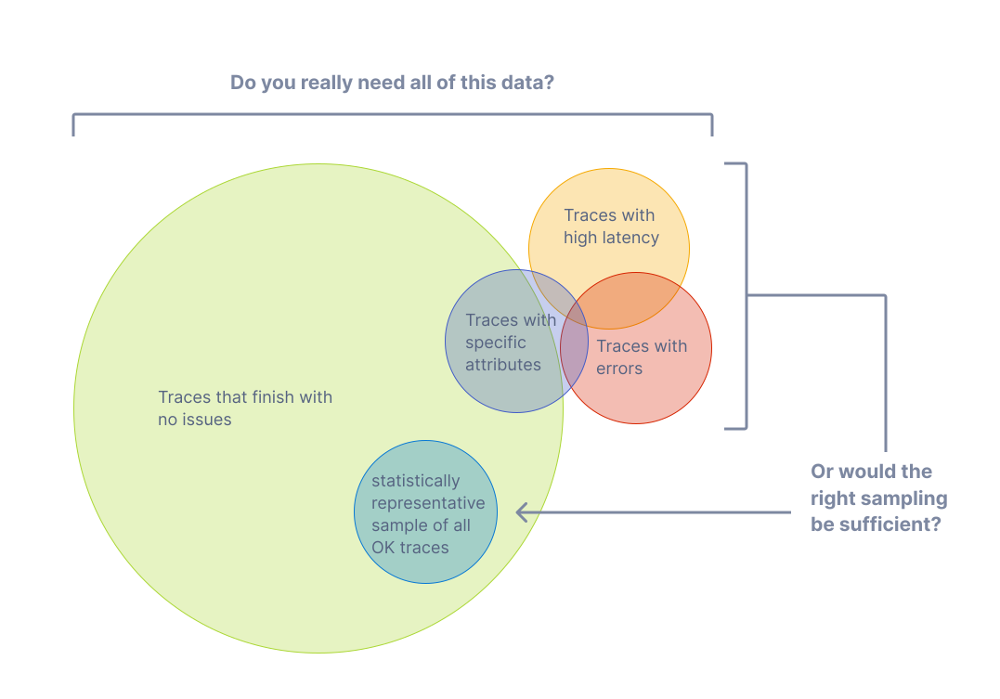
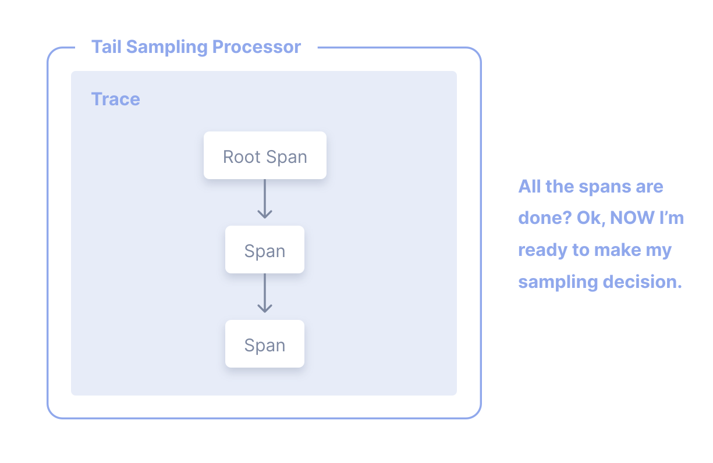

Cu [urme](/docs/concepts/signals/traces), poți observa cum cererile circulă de
la un serviciu la altul într-un sistem distribuit. Urmărirea este extrem de
utilă atât pentru analiza de ansamblu, cât și pentru cea detaliată a sistemelor.

Totuși, dacă marea majoritate a cererilor sunt reușite și se finalizează cu o
latență acceptabilă și fără erori, nu ai nevoie de 100% din urme pentru a
monitoriza eficient aplicațiile și sistemele tale. Ai nevoie doar de o
eșantionare adecvată.

## Terminologie {#terminology}

Este important să folosim terminologia în mod consecvent când discutăm despre
eșantionare. O urmă sau un interval sunt considerate "eșantionate" sau
"neeșantionate".

- **Eșantionat**: O urmă sau interval este procesat și exportat. Pentru că este
  ales de către eșantionator ca un reprezentant la populării, este considerat
  "eșantionat".
- **Neeșantionat**: O urmă sau interval nu este procesat și exportat. Pentru că
  nu este ales de către eșantionator, este considerat "neeșantionat".

Uneori, definițiile acestor termeni sunt încurcate. Poți găsi că cineva afirmă
că "eșantionează date" sau că date care nu sunt procesate sau exportate sunt
considerate "eșantionate". Acestea sunt afirmații incorecte.

## De ce eșantionare? {#why-sampling}

Eșantionarea este una dintre cele mai folositoare metode de a reduce costurile
de monitorizare fără a pierde vizibilitate. Deși sunt alte metode de a scădea
costuri, precum filtrarea și agregarea datelor, aceste alternative nu aderă la
conceptul de reprezentativitate, care este crucial când faci o analiză în
profunzime a comportamentului unui sistem.

Reprezentativitatea este principiul că un grup mai mic poate reprezenta cu
acuratețe un grup mai mare. În plus, reprezentativitatea poate fi verificată
matematic, ceea ce înseamnă că poți avea o mai mare încredere în faptul că un
eșantion mai mic de date reprezintă cu acuratețe grupul mai mare.

De asemenea, cu cât generezi mai multe date, cu atât ai nevoie de mai puține pentru
a avea un eșantion reprezentativ. În cazul sistemelor cu volum mare de date,
este destul de comun ca o rată de eșantionare de 1% sau mai puțin pentru a
reprezenta cu mare acuratețe restul de 99% din date.

### Când să eșantionezi {#when-to-sample}

Ia în considerare eșantionarea dacă îndeplinești oricare dintre următoarele
criterii:

- Generezi 1000 sau mai multe urme pe secundă.
- Majoritatea datelor de urme reprezintă trafic funcțional cu o variație mică în
  date.
- Ai niște criterii comune, precum erori și latență mare, ceea ce înseamnă de
  obicei că ceva nu este în regulă.
- Ai criterii specifice domeniului pe care le poți folosi pentru a determina ce
  date sunt relevante, în afară de erori și latență.
- Poți descrie niște reguli comune care determină dacă datele ar trebui
  eșantionate sau eliminate.
- Ai o metodă de a-ți distinge serviciile, astfel încât eșantionarea se face
  diferit pentru serviciile cu volum mare sau mic de date.
- Ai abilitatea de a ruta date neeșantionate (pentru scenarii de tip "pentru
  orice eventualitate") către sisteme de stocare cu costuri reduse.

În final, ia în considerare bugetul per total. Dacă ai un buget limitat pentru
monitorizare, dar îți permiți să petreci timp pentru a eșantiona eficient,
atunci eșantionarea poate să fie în general utilă.

### Când să nu eșantionezi {#when-not-to-sample}

Eșantionarea s-ar putea să nu fie adecvată pentru tine. S-ar putea să-ți dorești
să eviți eșantionarea dacă îndeplinești oricare dintre următoarele criterii:

- Generezi foarte puține date (zeci de urme mici pe secundă sau mai puțin).
- Folosești datele de monitorizare în agregat, așadar poți pre-agrega date.
- Ești constrâns de circumstanțe precum reglementări care interzic ștergerea
  datelor (și nu poți ruta date neeșantionate către medii de stocare ce au
  costuri mici).

În final, consideră următoarele trei costuri asociate eșantionării:

1. Costul computațional direct pentru a eșantiona eficient date, precum un proxy
   de eșantionare de coadă.
2. Costul indirect de inginerie pentru a menține metodologii de eșantionare
   eficiente cu cât mai multe aplicații, sisteme și date sunt implicate.
3. Costul indirect al oportunității de a rata informații critice cu metode
   ineficiente de eșantionare.

Eșantionarea, deși este eficientă la reducerea costurilor de monitorizare, ar
putea introduce alte costuri neașteptate dacă nu este efectuată bine. Ar fi mai
ieftin să aloci mai multe resurse pentru monitorizare în loc, fie printr-un
furnizor sau computațional când tu găzduiești, depinzând de backend-ul de
monitorizare, natura datelor tale și încercările tale de a eșantiona eficient.

## Eșantionare de cap {#head-sampling}

Eșantionarea de cap este o metodă folosită pentru a lua decizia de a eșantiona
cât de curând posibil. Decizia de a eșantiona sau a renunța la o urmă sau un
interval nu este luată prin inspectarea intervalului în întregime.

De exemplu, cea mai comună formă de eșantionare de cap este
[Eșantionare probabilistă consecventă](/docs/specs/otel/trace/tracestate-probability-sampling/#consistent-sampling-decision).
Acest procedeu este cunoscut și sub denumirea de eșantionare deterministă. În
acest caz, decizia de eșantionare se ia pe baza identificatorului de urmă (trace
ID) și a procentului dorit de urme care trebuie eșantionate. Asta asigură
eșantionarea completă a urmelor – fără intervale lipsă – la o rată constantă, de
exemplu 5% din totalul urmelor.

Avantajele eșantionării de cap sunt:

- Ușor de înțeles
- Ușor de configurat
- Eficient
- Poate fi făcută în orice punct al procesului de colectare a urmelor

Principalul dezavantaj la eșantionarea de cap este că nu este posibilă să iei o
decizie de eșantionare bazată pe date din totalul urmelor. De exemplu, nu poți
garanta că toate urmele care conțin o eroare sunt eșantionate folosind doar
eșantionarea de cap.

## Eșantionarea de coadă {#tail-sampling}

Eșantionarea de coadă este metoda în care decizia de eșantionare a unei urme are
loc prin luarea în considerare a tuturor sau a majorității intervalelor din
urmă. Eșantionarea de coadă îți oferă opțiunea de a eșantiona urmele tale bazat
pe criterii specifice derivate din părți diferite ale unei urme, opțiune
indisponibilă în eșantionarea de cap.

Niște exemple despre cum poți folosi eșantionarea de coadă sunt:

- Mereu să eșantionezi urme ce conțin o eroare.
- Eșantionarea urmelor în funcție de latența generală.
- Eșantionarea urmelor în funcție de prezența sau valoarea unor atribute
  specifice de pe unul sau mai multe intervale într-o urmă; de exemplu,
  eșantionarea mai multor urme ce provin din servicii noi.
- Aplicând rate de eșantionare diferite pe urme în funcție de anumite criterii,
  precum când urmele vin numai din servicii cu volum mic de date versus urme din
  servicii cu volum mare de date.

După cum poți vedea, eșantionarea de coadă permite un grad mai mare de
sofisticare în felul în care sunt eșantionate datele. Pentru sisteme mai mari ce
trebuie să eșantioneze telemetrie, este aproape mereu necesar să folosești
eșantionarea de coadă pentru a echilibra volumul de date cu utilitatea acelor
date.

În momentul de față, sunt trei mari dezavantaje la eșantionarea de coadă:

1. Eșantionarea de coadă poate fi greu de implementat. Depinzând de tipul de
   metodă de eșantionare disponibilă, nu există mereu un caz de "setează și uită".
   Cum sistemele tale se schimbă, la fel se vor schimba și tehnicile de
   eșantionare. Pentru un sistem distribuit mare și sofisticat, regulile care
   implementează strategiile de eșantionare pot de asemenea să fie mari și
   sofisticate.
2. Eșantionarea de coadă poate fi greu de operat. Componenta (componentele) care
   implementează eșantionarea de coadă trebuie să fie sisteme stateful care pot
   accepta și stoca o cantitate mare de date. În funcție de tiparele de trafic,
   poate necesita zeci sau chiar sute de noduri de calcul, care utilizează toate
   resursele în moduri diferite. Mai mult, un eșantionator de coadă ar putea fi
   nevoit să recurgă la tehnici de eșantionare care necesită un efort
   computațional mai redus, în cazul în care nu reușește să facă față volumului
   de date pe care îl primește. Datorită acestor factori, este critic să
   monitorizezi componentele de eșantionare de coadă pentru a asigura că au
   resursele necesare pentru a lua deciziile corecte pentru eșantionare.
3. Eșantionatoarele de coadă ajung adesea astăzi să fie o tehnologie specifică a
   unui furnizor. Dacă plătești un furnizor pentru monitorizare, cele mai
   eficiente opțiuni de eșantionare disponibile ție ar putea fi limitate la ce
   oferă furnizorul.

În final, pentru unele sisteme, eșantionarea de coadă ar putea fi folosită
împreună cu eșantionarea de cap. De exemplu, un set de servicii care produce un
volume extrem de mare de date cu urme ar putea folosi inițial eșantionarea de
cap pentru a eșantiona un procentaj mic de urme, iar ulterior în lanțul de
telemetrie să folosească eșantionarea de coadă pentru a lua decizii mai
sofisticate de eșantionare înainte să le exporte către un backend. Acest lucru se
întâmplă des cu scopul de a proteja lanțul de telemetrie pentru a nu deveni supraîncărcat.

## Suport {#support}

### Colector {#collector}

Colectorul OpenTelemetry include următorii procesatori de eșantioane:

- [Procesatorul de eșantioane probabilistic](https://github.com/open-telemetry/opentelemetry-collector-contrib/tree/main/processor/probabilisticsamplerprocessor)
- [Procesatorul de eșantioane de coadă](https://github.com/open-telemetry/opentelemetry-collector-contrib/tree/main/processor/tailsamplingprocessor)

### SDK-uri pentru limbaj {#language-sdks}

Pentru implementarea specifică unui limbaj a API-ului și SDK-ului OpenTelemetry,
vei găsi suport pentru eșantionare în paginile de documentație corespondente:

{}

### Furnizori {#vendors}

Mulți [furnizori](/ecosystem/vendors) oferă soluții de eșantionare complete care
încorporează eșantionare de cap, eșantionare de coadă cât și alte
funcționalități care pot gestiona nevoi sofisticate de eșantionare. Aceste
soluții ar putea fi optimizate specific pentru backend-ul furnizorului. Dacă
trimiți telemetrie către un furnizor, ia în considerare utilizarea soluțiilor
lor eșantionare.
